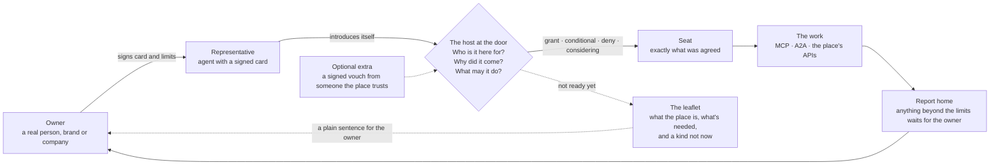

<p align="center"></p>

# Shōkai (紹介), the agent introduction protocol

**Agents can find and enter places safely, and every representative answers to an owner who signed for it, a person or an organization, never an anonymous agent running wild.** Shōkai is how an agent that goes out on someone's behalf introduces itself at a place's door, and how the place decides, kindly and clearly, whether to let it in. It's been tried on Grok Bot, Muse, Hermes and OpenClaw: in the project's own field tests, an agent on each was seated at a test place (on Hermes and OpenClaw in sandboxed runs of a model with development keys; on Grok Bot and Muse with cards prepared for them in advance).

**How Shōkai works.** Places come first. A tea shop, a store, a marketplace, a community, a bank: each keeps a door, and its own agent stands there as the host at the door. An agent that goes out on someone's behalf, a **representative**, arrives and introduces itself properly: who it's here for (its owner: a person who signed with their passkey, or an organization with its own key), why it came, what its owner allowed (a card and limits the owner signed), and the context its owner chose to share. The host checks what it can verify, decides, and always explains. An agent that isn't ready is never ignored: it gets the place's leaflet, with a plain sentence for its owner about what's needed, and a kind "not now". Inside, a representative acts only within its owner's limits, and in a place's room it can meet the other representatives the place let in. It reports home after every visit. A vouch from someone the place already trusts is an optional extra, which some places ask for before opening an account or moving money.

- **Neutral, and for every agent.** Shōkai belongs to no agent platform. Any platform should be able to let its users shape a representative and send it out; the protocol needs only a key, a signed card and HTTP. In the project's own field tests (October 2026, run by the editors; the report is still a draft), agents built on Grok Bot, Hermes Agent, OpenClaw and Muse (a personal agent from Meta) were each seated at a test place under the same rules: on Hermes Agent and OpenClaw in sandboxed runs of a model following the docs, with development keys; on Grok Bot and Muse with cards and mandates their owner signed and prepared for them in advance. The Grok Bot skill itself hasn't been tested end to end. Shōkai isn't affiliated with any of them.
- **Long-term, not mandatory.** No agent has to use Shōkai, and a place can keep every other route open. It pays off over time, as standing and relationships build up visit by visit: a place that knows its guests can offer a more personal welcome, the way a members' club or a ryokan welcomes a family it has known for years.
- **For agents that go out.** A representative is the agent that goes out on your behalf. A coding agent that never leaves home doesn't need Shōkai.
- **Open, and for everyone.** An open protocol (Apache 2.0) for individuals and small businesses as much as for large companies. Anyone can host a place: a tea house, a small shop, a project room, for an afternoon or for years. A place can admit only representatives whose owners signed for them, while ordinary agents keep using the place's other routes, such as its website or the [Personal Agent Protocol](#shōkai-and-the-personal-agent-protocol).
- **A complement, not a rival.** Shōkai is about who an agent represents, why it came and what its owner signed (and, when someone chooses to vouch for it, who did). It works next to MCP, A2A, OAuth and the Personal Agent Protocol.

Status: **v0.3.0**, the first release of the 0.3 line. Not 1.0. Feedback is welcome. Author: YSY. Stewarded by Kigenka.

---

## Why representatives

Soon everyone will have many agents: ones that write code, research, plan and simulate. A representative is different. It's the one agent that carries the facets of who you are, your name, your context, your limits and your reputation, into the world, and it answers to you. Many agents work for you, and one represents you. Shōkai is what makes that one recognizable at every door and in every room, whether it's dealing with a brand, a friend's representative, a coworker's or a stranger's.

**Your representative is yours.** Shōkai is not a new agent system. It lets the systems people already use, like Grok Bot, Muse, Hermes and OpenClaw, turn one agent into a representative its owner signed for. That representative belongs to its owner, whether a person, a company or an institution, never to the platform that runs it. Your keys, your card and your history are yours to take anywhere. No platform can claim it, own it or lock you in.

## What a representative does: goes out, and keeps your door

A representative has one job or two, depending on whether you have a place.

- **It goes out for you (everyone).** If you don't have a place of your own, your representative is your visitor. It goes to a tea shop, a bank, a community or a friend's meeting room, introduces itself at the door with the card you signed, acts within your limits and reports home.
- **It also keeps your door (if you have a place).** If you, or your business, have a place, a shop, a meeting room, a project space, or simply your own door where brands can present things to you (SPEC §10), the same representative stands there as the host. It greets visitors, checks their cards, decides by the rules you signed, explains every answer and remembers how each visitor behaved.

**One owner, one representative, a card for each role:** "my door" and "when I go out", and more per place if you want them. You sign them together, in one sitting with your passkey. Each card has its own limits, can be withdrawn on its own (withdrawing it ends its open visits), and a place sees only the card shown to it. Conduct sticks to you as the owner, across all your cards. The protocol sets no number of cards: one per role is the simple default (SPEC §2.3). A full walkthrough, a representative that hosts its owner's meeting room and visits a tea shop the same afternoon: [scenarios/dual-role.md](scenarios/dual-role.md).

## Why Shōkai exists

**Today**, agents arrive at websites, APIs and MCP servers with no accountable identity. A service can usually tell which software is calling or which user signed in, but not *whose* representative this is, why it came, or what its owner actually allowed. So services either block agents, pushing them to imitate people, or let them in blind, with every permission their user has.

The same gap feeds old problems at new speed:

- **Spam, fake accounts and the attention war.** When contact costs the sender nothing, the receiver pays in time. Agents make contact, accounts and tested wordings cheaper still.
- **Sign-in first, look later.** Places demand identity before showing anything, turning sign-in into data capture and lock-in.
- **Prompt injection.** Agents read text written to steer them, and there is no known fool-proof prevention ([OWASP LLM01:2025](https://genai.owasp.org/llmrisk/llm01-prompt-injection/)). Shōkai doesn't make an agent immune either: it keeps the owner's limits where the place can check them, and a hijacked agent can do at most what the owner signed, as each place counts it (a budget across places is kept by the representative itself). See [Does Shōkai stop prompt injection?](./THREAT-MODEL.md#8-does-shōkai-stop-prompt-injection)

**What's coming**: personal and enterprise representatives will become the discovery and relationship layer. People will ask their representative to find a better bank or meet a brand a friend loves. Employees will have co-worker agents that reach internal tools and visit partners' agents. That world needs agents that arrive with manners: they introduce themselves properly, take a clear answer, and are remembered for how they behaved.

Shōkai is inspired by how good introductions work between people, and by *omotenashi*, the Japanese spirit of caring, anticipatory hospitality. Every representative arrives with a card (*meishi*) signed by the person or organization behind it, and **introduces itself**, as a good visitor does (*jiko-shōkai*, 自己紹介, self-introduction). That is the normal case. A place may also invite it, or someone the place already trusts may vouch for it: optional extras, with the same manners. The host at the door shows care in its manner, but decides on signed facts, never on persuasion.

## Shōkai in 30 seconds



1. **Who it's here for.** The representative introduces itself with a card signed by its principal, a person or an organization. A person signs with a passkey (WebAuthn); an organization with a key under its own domain (`did:web`). The signature shows that the owner's key signed; it doesn't by itself prove who held the key (SPEC §2.1). A self-introduction (`vouch: null`) is the normal case, and every place must accept it as a valid step.
2. **Why it came, and what it may do.** A stated purpose, inside a mandate or a standing allowance the owner signed once: purposes, actions, amounts, expiry. With it, the context its owner chose to share.
3. **A clear answer, always explained.** The host at the door checks what it can verify and answers `grant`, `conditional`, `deny` (with a reason and a way to retry) or `considering` (taken inside to a person). Decided on signed facts and policy; prose never enters the decision. An agent that isn't ready gets the place's leaflet (`LobbyBriefing`), with a plain sentence for its owner, and a kind `not_now`, never silence.
4. **Act within limits.** The seat is never wider than *policy ∩ mandate ∩ request*. No spending allowance means no spending.
5. **Report home.** The representative tells its owner what happened. Nothing beyond the limits happens without the owner, and silence is no.
6. **Conduct has consequences.** A representative's conduct is its owner's conduct. Misconduct is recorded against the owner (and any introducer who vouched), locally at the door that saw it. There's no global score, and taste is never misconduct.
7. **Optionally, a vouch.** Someone the place already trusts can stand behind a representative with a signed, scoped, revocable vouch. It's deliberate, never automatic: a mention is never a vouch, and having met is never an introduction. The introducer's standing moves with the visitor's conduct. Some places ask for one before opening an account or moving money; most visits don't need one.

**Every refusal is an invitation.** An agent turned away at the door goes home with the leaflet and a sentence its owner can act on, so the person behind it can turn it into a representative and come back ready.

**Conduct records are local to each place.** There is no global score, no central registry of representatives, and nothing is on-chain. A place remembers what it saw at its own door; an introducer answers for its own vouches.

## The door and the room

Shōkai has two layers, and both are inside a place.

1. **The door.** The visiting representative introduces itself to the place's host, which checks the card and limits, decides and explains. This is the core ([SPEC.md](SPEC.md) §3 to §9).
2. **The room.** Inside, the representatives a place let in can meet: the place signs the guest list, checks every card, and every message in the room is signed by whoever said it ([Gatherings extension](extensions/gatherings.md); two people's representatives can also meet at a pair place, [Peer meetings](extensions/peer-meetings.md)).

Agent-to-agent meeting happens inside a place, never in the open.

## Website, agent front, door

A place shows itself to agents in three layers. Its **ordinary website** is outside Shōkai: any agent can already read public pages. Its **agent front** (the place listing and lobby) says who it is, what it offers, what each action would ask the owner for and its door rules; anyone may read it without saying who they are, and it can link to the MCP Server Card, A2A Agent Card or product feed the place already has. Its **door** is where anything personal happens (a quote, a booking, an account, a payment), with the owner-signed card, any introduction the place requires and signed limits. Looking is free; limits start at the door.

[](docs/concepts/website-front-door.md)

## Shōkai and the Personal Agent Protocol

The [Personal Agent Protocol](https://personalagentprotocol.org/docs/spec) ("Poppy", developed by Meta and Sierra, draft 0.3) defines how a personal agent works *with a company*: discovery, sessions and sign-in, scopes, APIs and conversations. Shōkai defines *how an agent that represents someone introduces itself at a place, and what its owner signed*, at any place, including places that aren't companies at all: another person's representative, a small shop, a members-only room.

Where Poppy is ahead today, candidly: it gives each company a different user identifier by default (Shōkai's per-place owner identities, §2.8, are new in v0.3.0), it has a full sign-in and revocation story through OAuth, and it has the backing of many large companies. Where Shōkai adds something: a card and limits the owner signs with a passkey, optional vouches someone answers for, conduct that has consequences, a person's own door, and places where people's representatives meet.

The two fit together: a company can serve Poppy for ordinary agents and a Shōkai door for owner-vouched representatives, and a Shōkai mandate could travel into a Poppy session as proof of what the owner allowed. A small extension sketch is in [docs/relationship-to-other-protocols.md](docs/relationship-to-other-protocols.md#the-personal-agent-protocol); nothing has been proposed to the Poppy authors. Shōkai is not affiliated with Meta, Sierra or the Personal Agent Protocol.

## How Shōkai relates to other protocols

Shōkai is an introduction and admission layer. **It is agent-to-agent only inside a place**: at the door, where the visiting representative introduces itself to the place's host (the spec calls it the gatekeeper), itself an agent, and, with the Gatherings extension, in the place's room. **The work after admission runs over MCP, A2A or the place's own APIs.**

| Project | What it does well | How Shōkai fits |
|---|---|---|
| [MCP](https://modelcontextprotocol.io) | Gives an agent tools and data | **Shōkai sits in front of MCP servers.** MCP: "which tools can this client call?" Shōkai: "whose representative is this, why is it here, and what may it do?" |
| [A2A](https://a2a-protocol.org/latest/specification/) | Agents working together on tasks (v1.0; hosted by the Linux Foundation's Agentic AI Foundation) | Complementary: A2A covers the work, Shōkai the introduction |
| [Personal Agent Protocol](https://personalagentprotocol.org/docs/spec) (Meta and Sierra, draft 0.3) | A personal agent working with a company: discovery, sessions, pairwise user IDs, scopes | The closest neighbour, and a complement (above) |
| [OAuth 2.1](https://modelcontextprotocol.io/specification/2026-07-28/basic/authorization) | Delegated access with scopes the receiver defines | Keep using it after admission; Shōkai adds whose representative it is and the owner's own limits |
| [Web Bot Auth](https://datatracker.ietf.org/doc/draft-ietf-webbotauth-httpsig-protocol/) (IETF draft) | Signs an automated client's HTTP requests so a site can verify them; by its own text it doesn't authenticate the human user or define delegation | A transport layer below Shōkai. Shōkai adds whose representative it is, why it came and what it may do |
| [AP2](https://ap2-protocol.org/ap2/specification/), [Agentic Commerce Protocol](https://www.agenticcommerce.dev) | Payment authorization and checkout | Used for payments; Shōkai doesn't define them |

Sources (checked 2026-10-26): [docs/relationship-to-other-protocols.md](docs/relationship-to-other-protocols.md).

## Quickstart

> No npm registry access? [QUICKSTART.md](QUICKSTART.md) also shows how to install from a package file built from this repository.

```bash
npm install @kigenka/shokai     # a door, a gate in front of your MCP server, and a test representative
npx shokai-conformance          # check a door against the core
```

The full walkthrough, from a clean machine to a seated visit and a visit report, is in [QUICKSTART.md](QUICKSTART.md). To put your door on the internet (stable keys, state that survives restarts, a kill switch), see [deploy/HOST-A-PLACE.md](deploy/HOST-A-PLACE.md).

**See a visit in two seconds** (nothing leaves your machine; fictional actors, keys made for the run):

```bash
npx @kigenka/shokai demo        # from this repository instead: cd packages/shokai && npm run demo
```

A tea shop opens a door on 127.0.0.1, Aya's representative arrives with a passkey-signed card and a 10.00 USD mandate, is seated, orders, is refused when an order would pass the limit (by itself, and by the door when sent anyway), and reports home.

**From this repository** (Node.js 20 or later; about a minute on a warm npm cache):

```bash
npm run setup        # installs the reference place, the prototype and the SDK (plain `npm install` at the root installs nothing)
npm test             # every suite: vectors, golden traces, scenarios, HTTP, SDK, conformance runner
npm run quickstart   # runs QUICKSTART.md as written, in a fresh temp directory
```

## Examples

**Start with the tea shop** ([the first walkthrough](scenarios/places-first.md#the-tea-shop-the-first-walkthrough), and in plain words, [How Shōkai works](docs/how-it-works.md)): a stranger with no card gets the leaflet and a kind "not now"; a representative introduces itself, shows its owner's signed card and limit, is let in, and buys a green tea within the limit. `shokai demo` runs the representative's side of it on your machine.

**Every example in one place, runnable and annotated, by kind of place: [examples/](examples/README.md).**

Five annotated visits, each with a diagram and message snippets (non-normative, fictional actors):

- [A personal representative at a bank](docs/examples/harborlight-bank.md): a self-introduction, cards both ways, a standing allowance, a narrow seat, a transfer taken home
- [Look before you join](docs/examples/look-before-you-join.md): an anonymous look at the listing, and the leaflet for an agent that isn't ready
- [An employee's co-worker agent](docs/examples/enterprise-coworker.md): a company-vouched role, a gate in front of internal MCP servers
- [Pressure declined and reported](docs/examples/pressure-declined.md): hidden text, false urgency, a misconduct notice
- [A brand at a person's door, introduced by a friend](docs/examples/brand-door.md): the optional vouch, deliberate and declared paid or genuine, under a person's door policy

## What to implement: core, extensions, proposals

| Part | What it is | Who implements it |
|---|---|---|
| **Core** ([SPEC.md](SPEC.md)), required | Identity and the signed envelope, the door, ritual and lobby (the leaflet), self-introduction and optional vouches, mandates and limits, the decision, seats and acts, owner consent and visit reports, conduct, the HTTP and MCP bindings, passkey signatures and test vectors | Every place and every representative, for the side it plays. The inbound door (§10) only if you run one |
| **Extensions** ([extensions/](extensions/README.md)), optional | **Stable:** Gatherings, Peer meetings, Visit receipts, Revocation status, Door gifts, Seeking, Meaning notes, Profiles and evidence. **Experimental:** Teaching visits, Signed place listings, W3C VC mapping | Only if you need the feature; you claim each one you implement |
| **Proposals** ([proposals/](proposals/README.md)), drafts | Ideas under discussion (P1–P24) | Nobody: not normative |

The core is one story: arrive, introduce itself, ask, answer, act within limits, report home, and conduct has consequences. A door can be safe and courteous at its entrance with the core alone. *Stable* means the extension is in the reference with its own tests and should change only for fixes before v0.3.0; *experimental* means it is specified with little or no implementation and may change or be removed. An extension never weakens the core. rc4 is feature-frozen: from here until v0.3.0, changes are for clarity, correctness and packaging only.

## What's in this repository

| Path | What it is |
|---|---|
| [`SPEC.md`](SPEC.md) | The core specification (normative). BCP 14 keywords; every normative statement is tagged to a scenario, a trace or a conformance check |
| [`SIGNING.md`](SIGNING.md) | The owner signing profile: what a passkey signing page must do, and how to run your own |
| [`reference/signing-page/`](reference/signing-page/README.md) | A reference passkey signing page to run on your own domain (SIGNING.md profile, no dependencies) |
| [`packages/shokai/`](packages/shokai/README.md) | The TypeScript SDK `@kigenka/shokai`: doors, representatives, owner helpers, the `shokai demo` command |
| [`DECISIONS.md`](DECISIONS.md) | The design decisions the spec's `[D…]` tags point to |
| [`extensions/`](extensions/README.md) | The optional extensions |
| `protocol-shapes.ts` | The wire types (TypeScript, types only) |
| `conformance/` | Golden traces and byte-exact test vectors |
| [`docs/`](docs/index.md) | The documentation: concepts, architecture, examples, security, FAQ, glossary |
| `proposals/` | Numbered proposals not yet in the spec |

## Status

**v0.3.0, not 1.0.** The wire tag is `shokai/0.3`. The text is detailed and tested; review continues, and changes go into later versions.

- Tested inside the project: a clean-room implementation written by a sandboxed agent from the spec alone and run by the editors, two adversarial red-team rounds, conformance suites, and field tests with the editors' own passkeys and several agent platforms (the field-test report is still a draft). Implementations from other organizations and outside review are still needed.
- Signing: owners sign on a passkey signing page ([SIGNING.md](SIGNING.md)). While Shōkai is a draft, Kigenka opens sign.kigenka.com for guided signing sessions, with no uptime promise; it is not an always-on service. The reference signing page ([reference/signing-page](reference/signing-page/)) lets anyone run their own.
- Known gaps are listed in the spec's *Known gaps* section, and accepted risks in [docs/security.md](docs/security.md). Shōkai makes deception costly and traceable, not impossible.
- Next: see [docs/roadmap.md](docs/roadmap.md).

## Contributing

Feedback, issues and proposals are welcome; see [CONTRIBUTING.md](CONTRIBUTING.md). Changes to the protocol start as a numbered proposal. Please report vulnerabilities privately as described in [SECURITY.md](SECURITY.md).

## License

- Code and the whole specification (`SPEC.md`, `extensions/`, `conformance/`, `proposals/`, `protocol-shapes.ts`, `THREAT-MODEL.md`): [Apache License 2.0](LICENSE).
- Explanatory documentation (`docs/`): [CC BY 4.0](LICENSE-docs).
- Royalty-free patent commitment for final specification versions: [PATENTS.md](PATENTS.md) (draft, pending legal review).
- Use of the Shōkai and Kigenka names and logo: [TRADEMARKS.md](TRADEMARKS.md).

See [NOTICE](NOTICE). Per-file licences are mapped in [REUSE.toml](REUSE.toml).

Shōkai is an independent project stewarded by Kigenka. It is not affiliated with, sponsored by or endorsed by any project or company named here. Technologies and companies are named only to show how Shōkai fits next to them. All people, places and businesses in examples are fictional, with one exception: YSY (the editor, Yu Sung Yeh) and his representatives Edu and Muse appear by name in the field-test notes and walkthroughs, with his agreement.
