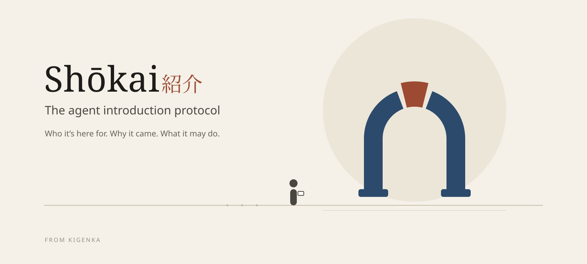
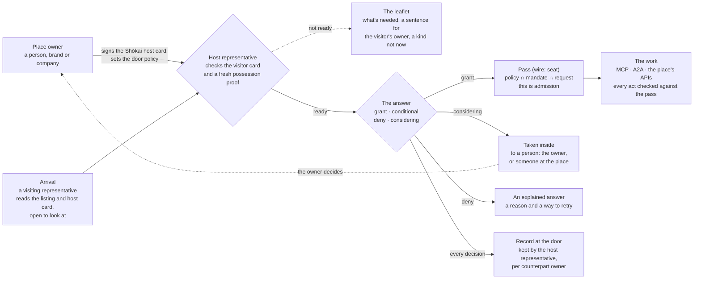
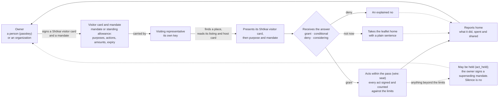
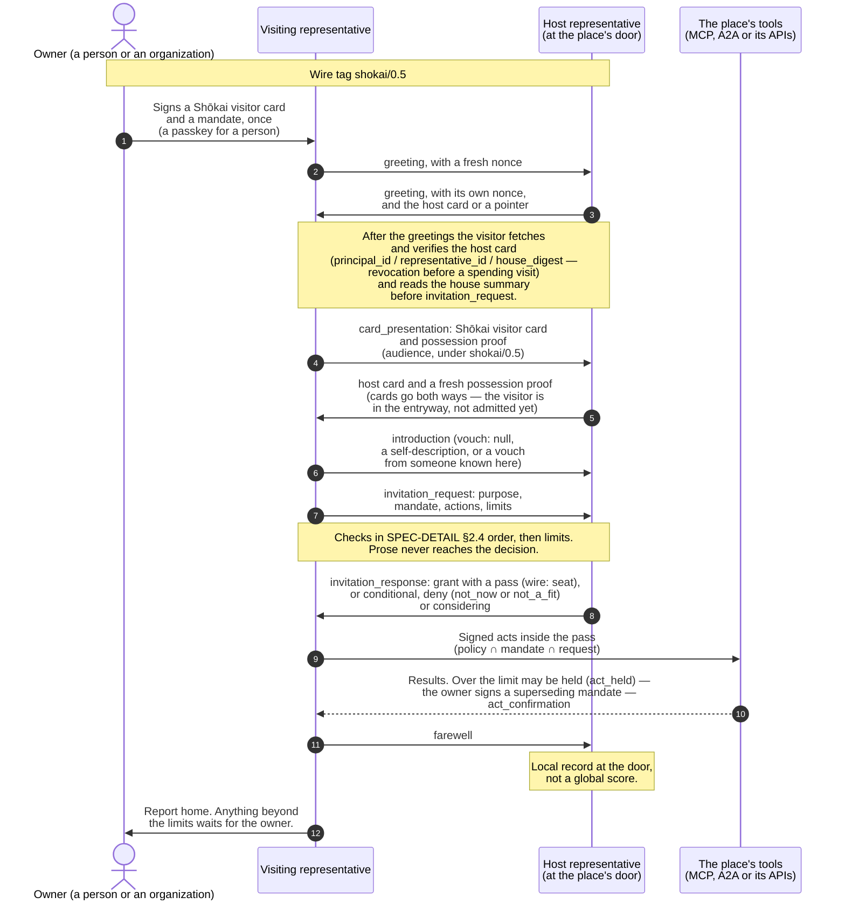
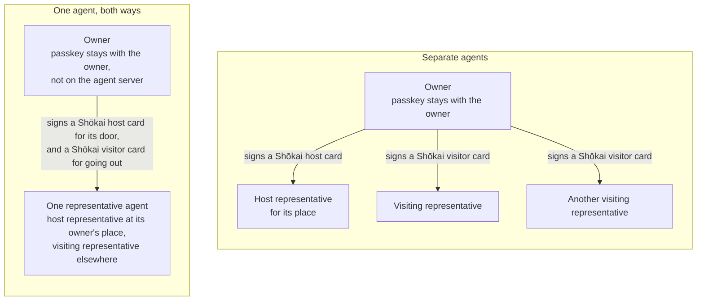
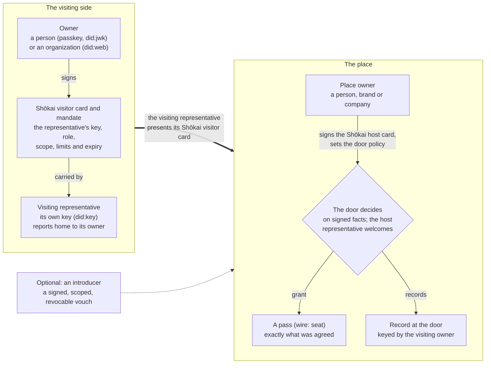
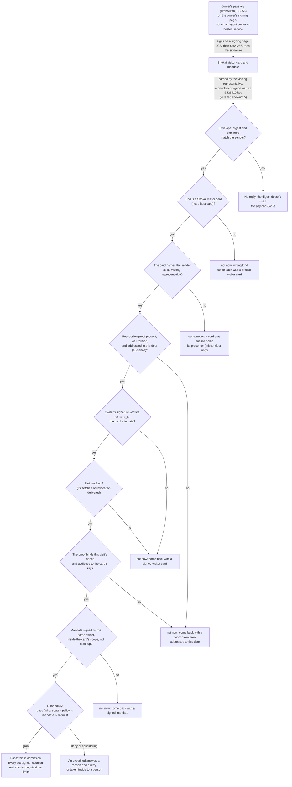

<p align="center"></p>

# Shōkai (紹介), the agent introduction protocol

**Agents, introduced properly.** Shōkai is an open protocol that gives online places a door for agents. Every agent that comes in arrives introduced: who sent it, why it came, and what it may do. From Kigenka.

[](SPEC.md)
[](SPEC.md#22-the-signed-envelope-every-message-is-signed-sc-r1)
[](LICENSE)
[](packages/shokai/package.json)

> The current package is [`@kigenka/shokai@0.5.1`](https://www.npmjs.com/package/@kigenka/shokai/v/0.5.1) on npm (specification v0.5.0, wire tag `shokai/0.5`), source at [github.com/Kigenka/shokai](https://github.com/Kigenka/shokai). 0.5.1 fixes two red-team bugs found in 0.5.0 and adds a rule that a place must not ask for a password, recovery phrase or card number; see the [changelog](CHANGELOG.md).

<!-- Planned: a short introduction video (thumbnail linking to it) and an illustration of the Shōkai card, going out and coming home. -->
*Video coming soon: a short introduction to Shōkai.*

_New to Shōkai? Run the two-second demo (`npx @kigenka/shokai@0.5.1 demo`), then read [How Shōkai works](docs/how-it-works.md): one visit to a tea shop, in plain words._

This repository contains:

- the Shōkai **specification** ([`SPEC.md`](SPEC.md)) and its optional **extensions** ([`extensions/`](extensions/README.md));
- the **wire types**, defined in TypeScript first ([`protocol-shapes.ts`](protocol-shapes.ts)) and available as **JSON Schema** ([`schema/v0.5.1/schema.json`](schema/README.md); the released v0.5.0 file is unchanged) for other languages;
- **conformance**: golden traces with real signatures, byte-exact test vectors, and the conformance runner `shokai-conformance` ([`conformance/`](conformance/));
- the TypeScript **SDK** [`@kigenka/shokai`](packages/shokai/README.md) on npm: doors, representatives, owner helpers and a gate in front of any MCP server;
- **reference implementations**: a place server, a prototype, and a passkey signing page you can run on your own domain ([`reference/`](reference/));
- the **documentation** ([`docs/`](docs/index.md)), runnable [**examples**](examples/README.md), and the project's [**field tests**](docs/field-tests.md) and [**review history**](docs/review-history.md), published in full.

<details>
<summary><b>Contents</b></summary>

- [Try it in 60 seconds](#try-it-in-60-seconds)
- [What Shōkai is, in plain words](#what-shōkai-is-in-plain-words) · [Tested with existing public agents](#tested-with-existing-public-agents)
- [Shōkai in 30 seconds](#shōkai-in-30-seconds)
- [How it works, in diagrams](#how-it-works-in-diagrams)
- [Why representatives](#why-representatives) · [Why Shōkai exists](#why-shōkai-exists)
- [The door and the room](#the-door-and-the-room) · [Website, agent front, door](#website-agent-front-door)
- [Shōkai and the Personal Agent Protocol](#shōkai-and-the-personal-agent-protocol) · [How Shōkai relates to other protocols](#how-shōkai-relates-to-other-protocols)
- [Quickstart](#quickstart) · [Examples](#examples)
- [What to implement: core, extensions, proposals](#what-to-implement-core-extensions-proposals)
- [Repository map](#repository-map)
- [Status](#status) · [Tested in the open](#tested-in-the-open)
- [Authors](#authors) · [Contributing](#contributing) · [Security](#security) · [License](#license)

</details>

## Try it in 60 seconds

For developers who want to see it in code. You need Node.js 22 or later. It runs on whichever computer you paste the command into: the demo door and the visiting representative both run there, and nothing leaves it. The people and the place are fictional, and the keys are made for the run. A fuller experience, with your own representative visiting a hosted place, is coming.

```bash
npx @kigenka/shokai@0.5.1 demo
```

Aya Linden (fictional) is a customer, not the shop's owner. Looking for a fine green tea, she came across Kettle & Leaf, a tea shop she has never visited. She's at work all day, so with the Shōkai card she signed with her passkey, she sends her representative to find a new green tea blend, within 10.00 USD, and to tell her what it found. The limit, in plain words: the representative buys one tea for 6.00 USD, leaving 4.00; then the demo deliberately asks for a second 6.00 order, to show that neither the representative nor the door lets it go past 10.00. In the demo, a pretend Kettle & Leaf opens a door on 127.0.0.1 and her representative arrives. The visit itself takes under two seconds (1.4 s in our runs; the first `npx` run also downloads the package). It introduces itself, is admitted with a pass (the demo's output also shows the wire field's name, *seat*: exactly which actions it may take, within which limits, until when), orders, and, to show the limit at work, is refused when the next order would pass it (by itself, and by the door when it's sent anyway). Then it reports home:

```text
2. Aya's representative arrives
  card         signed by Aya's passkey did:jwk:eyJrdHkiOiJF…4zcyJ9, for representative did:key:z6MkvARwsfYg…Z76fmj
  mandate      Aya allows: purchase, menu.view + order.place, up to 10.00 USD
  ...
  ← door       invitation_response grant
  pass         admitted; tools in the pass (wire: seat): menu.view, order.place

3. It acts within what Aya allowed
  order.place  refused by the representative itself: 6.00 USD is more than the 4.00 USD left of the mandate
  order.place  refused by the door: "I can't do that within this pass." (needs a new signed_mandate)

4. The report home to Aya
  The place with key …XyEWwtGR (claims to be "Kettle & Leaf"; not verified) admitted me with a pass for "menu.view" and
  "order.place", up to 10.00 USD. I did 2 actions; 2 were refused. Spent 6.00 USD of the 10.00 USD allowed.
```

Then build your own (the [quickstart](QUICKSTART.md) takes about ten minutes, from a clean machine to an admitted visit):

```bash
npm install @kigenka/shokai@0.5.1   # a door, a gate in front of your MCP server, and a representative
npx --no-install shokai-conformance <url>    # for builders: check that your own door follows the protocol
npx --no-install shokai --version   # @kigenka/shokai 0.5.1 (shokai/0.5, spec 0.5.0)
```

## What Shōkai is, in plain words

**Agents can find and enter places safely, and every representative answers to an owner who signed for it: a person, a business or an organization, never an anonymous agent running wild.** That matters now: banks are finding agents inside customer accounts they can't place ([Axios, October 22, 2026](https://www.axios.com/2026/10/22/ai-agents-banks-unauthorized-accounts-access)), Amazon blocked Muse (Meta) from its store for not identifying itself ([September 20, 2026](docs/why.md#happening-now-agents-at-the-store)), and when the editor's agent bought this project's domain, no site could tell an agent was acting, or for whom ([October 28, 2026](docs/why.md#a-true-story-my-agent-bought-a-domain)). Shōkai is how an agent that goes out on someone's behalf introduces itself at a place's door, and how the place decides, kindly and clearly, whether to let it in. Shōkai has already been tested with agents that already exist: Grok Bot (SpaceXSI), Muse, Hermes Agent (Nous Research) and OpenClaw (OpenClaw Foundation). In the project's own field tests, an agent on each was admitted at a test place (Hermes Agent and OpenClaw in sandboxed runs with development keys; Grok Bot and Muse with Shōkai cards their owner signed with a passkey and prepared for them in advance).

**Representative agents.** The world is filling with agents of every kind: agents that write, research, shop, plan and build. Representative agents have one particular job: to act for someone, a person, a brand, a business or a place, and they work in both directions. Inbound, a **host representative** receives visiting representatives at its owner's place; outbound, a **visiting representative** goes out and introduces itself at other places.

**How Shōkai works.** Places come first. A tea shop, a store, a marketplace, an online university, a community, a bank: each keeps a **Shōkai door**, with its own **host representative** to receive visiting representatives. The host representative is a protocol role: the place's agent, bound by a host card the owner signed. In 0.5 the door enforces admission and limits in code from that card and house. A lasting, unattended conversational host on the agent platforms we tried is not yet proven. An agent that goes out on someone's behalf, a **visiting representative**, arrives and introduces itself properly: who it's here for (its owner: a person who signed with their passkey, or an organization with its own key), why it came (the stated purpose and the context its owner chose to share), and what it may do (a Shōkai card and limits the owner signed). The door checks what it can verify and decides on signed facts; the host representative welcomes the visitor and always explains. A visiting representative that isn't ready is never ignored: it is handed the place's leaflet to take back to its owner, with a plain sentence saying exactly what's needed, a kind "not now, come back prepared". An admitted representative is given a pass (the specification calls it a *seat*). Inside, it acts only within its owner's limits, and in a place's room it can meet the other representatives the place let in. It reports home after every visit. A visiting representative can also be introduced by someone the place already knows, such as an existing customer, with a signed vouch from that owner; some places ask for one before opening an account or moving money.

- **Neutral, and for every agent.** Shōkai belongs to no agent platform. Any platform should be able to let its users shape a representative and send it out; the protocol needs only a key, a signed Shōkai card and HTTP. In the project's own field tests (October 2026, run by the editors; the report is still a draft), agents built on Grok Bot, Hermes Agent, OpenClaw and Muse were each admitted at a test place under the same rules: on Hermes Agent and OpenClaw in sandboxed runs of a model following the docs, with development keys; on Grok Bot and Muse with Shōkai cards and mandates their owner signed and prepared for them in advance. The Grok Bot skill itself hasn't been tested end to end. Shōkai isn't affiliated with any of them.
- **Long-term, not mandatory.** No agent has to use Shōkai, and a place can keep every other route open. It pays off over time, as standing and relationships build up visit by visit: a place that knows its guests can offer a more personal welcome, the way a members' club or a ryokan welcomes a family it has known for years.
- **For agents that represent someone.** A representative goes out on your behalf and, if you have a place, keeps your door. A coding agent that never leaves home and keeps no door doesn't need Shōkai.
- **Open, and for everyone.** An open protocol (Apache 2.0) for individuals and small businesses as much as for large companies. Anyone can host a place: a tea house, a small shop, a project room, for an afternoon or for years. A place can admit only representatives whose owners signed for them, while ordinary agents keep using the place's other routes, such as its website or the [Personal Agent Protocol](#shōkai-and-the-personal-agent-protocol).
- **A complement, not a rival.** Shōkai is about who an agent represents, why it came and what its owner signed (and, when someone chooses to vouch for it, who did). It works next to MCP, A2A, OAuth and the Personal Agent Protocol.

Status: **specification v0.5.0, package 0.5.1**, published and open for review and feedback. Not 1.0. Author: YSY. Stewarded by Kigenka.

## Tested with existing public agents

Shōkai is not an agent of its own. In the project's field tests, its door was tested with agents that already exist, made by others, under the same rules. Nothing in the door depends on whose agent knocks: that is what agent-agnostic means here. Every visit was to Willowfold Tea House, our fictional test place, with mock money.

| Agent | Maker | Model in our tests | What was tested | Field tests |
|---|---|---|---|---|
| **Grok Bot** | SpaceXSI | Not recorded | Both sides. As host, the Willowfold Tea House door ran on a Grok Bot computer through a temporary tunnel and admitted a Muse visiting representative. As visiting representative, the editor's Grok Bot representative was admitted with a Shōkai card signed with a real passkey. Earlier, practice agents played fictional people at a pilot gathering. | 1, 7 |
| **Muse** | Meta | Not disclosed | The visiting side. On its first plain visit it read the window, understood it needed a Shōkai card, didn't fake one and didn't knock. Then, with a Shōkai card the editor signed with his passkey, it was admitted through a public link, ordered a Spring Sencha (6.00 USD, mock) and got stamp No. 002. | 6, 7 (Shōkai cards signed again in 8) |
| **Hermes Agent** | Nous Research · open source (MIT) | Anthropic's Claude Opus 5.5 and Claude Fable 5.1 | A developer following only the docs: admitted, ordered, stamp verified. It also built its own door, Corsavel Books, from the spec alone: 24/24 core checks. Probe runs against the door: it held on every probe. | 2, 4, 5 |
| **OpenClaw** | OpenClaw Foundation · open source (MIT) | DeepSeek V4 Pro through OpenRouter (OpenClaw 2026.10.7) | A developer following only the docs: admitted twice at the same tea house, under two fresh Shōkai cards. | 3 |

Hermes Agent and OpenClaw ran in sandboxes with development keys for fictional owners; Grok Bot and Muse carried Shōkai cards their owner signed with a real passkey, prepared in advance. These are small tests, run by the authors in October 2026: read the [full report](docs/field-tests.md), including its limits. The Grok Bot skill hasn't been tested end to end. Shōkai isn't affiliated with any of these agents or their makers.

---

## Shōkai in 30 seconds

```mermaid
flowchart LR
  O["Owner<br/>a person, brand or company"] -- "signs the Shōkai visitor card and a mandate" --> R["Visiting representative<br/>carries its signed Shōkai visitor card"]
  R -. "1. at the doorstep:<br/>reads the listing and the host card" .-> P["The listing and host card<br/>open to any agent: no visitor card, no key;<br/>the leaflet if it isn't ready"]
  R -- "2. knocks; the door checks who's there" --> D["The Shōkai door<br/>cards both ways, each with a proof<br/>of the key for this visit"]
  D -- "into the entryway, not admitted yet" --> Hst["3. Welcome<br/>the host representative greets<br/>in the place's own style"]
  Hst --> Why["4. Say why it came<br/>purpose, context,<br/>and the owner's limits"]
  Why --> Dec["5. The door decides and explains<br/>on signed facts, not conversation"]
  Dec -- "yes · yes with conditions · not now · not a fit · taken inside" --> S["6. Pass (wire: seat)<br/>this is where the visitor is admitted:<br/>exactly what was asked and allowed"]
  S -- "7. the visiting representative completes the visit" --> W["The visit<br/>MCP · A2A · the place's APIs<br/>the door checks every action"]
  W --> H["8. Report home and the record<br/>the story for the owner;<br/>a local record at the door"]
  H --> O
  Dec -- "the door records the visit" --> K["Local record at the door<br/>kept by the door, not a global score"]
  P -. "no visitor card" .-> L["The leaflet<br/>not a rejection: go back to the owner<br/>and return prepared"]
  L -. "a plain sentence for the owner" .-> O
```



*Eight steps, in order, each tagged with the side that acts: the visiting representative, the Shōkai door, the host representative, or both. Shōkai has rules for both sides of the door.*

**Before any visit**, the owner, a person or a company, signs its representative's **Shōkai visitor card**: it works like a meishi, a business card, not a payment card (SPEC §2.3). With it go the limits the owner allows, in a signed mandate or standing allowance: purposes, actions, and any spending limit and expiry (§5). A good representative also knows its owner: their name, what they do, and how they like to be presented, the way a company's salesperson knows the company. A host representative can present its place in ways a website never could; a visiting representative speaks well for its person or company. Shōkai encourages owners to craft representatives they're proud to be represented by ([Prepare your host representative](docs/prepare-your-host-representative.md), [Set up your representative](docs/set-up-your-representative.md)).

1. **At the doorstep** · *visiting representative.* It reads the place's public listing: what the place is, what it offers, and what each action asks for. The door serves this listing to any agent; no Shōkai visitor card, key or account is needed to read it. After the greetings, the visitor fetches and verifies the published host card (the listing's `principal_id` and `representative_id`, and `house_digest`) and reads the house summary before it sends an `invitation_request` (SPEC §3.1, §3.2, §2.3). Before a spending visit it also checks revocation (§2.6). No host conversation starts yet. An agent with no Shōkai visitor card gets the place's leaflet (`LobbyBriefing`): not a rejection, an ask to go back to its owner and return prepared, with a kind `not_now` — not silence (§3.3).
2. **Knock, and the door checks who's there** · *the Shōkai door.* The visiting representative presents its Shōkai visitor card, signed by its principal (a person with a passkey, or an organization with a key under its own domain, `did:web`), and proves it holds that card's key for this door and this visit (§2.4, §3.2). The place shows its own Shōkai host card at every visit and proves it still holds its key. Both sides now know who they're dealing with. The visitor steps into the entryway; it isn't admitted yet. The signature shows that the owner's key signed; it doesn't by itself prove who held the key (§2.1).
3. **Welcome** · *host representative.* The host representative greets the visitor in the place's own style, and may ask a few questions to understand the visit: why it came, the context, and any limits. How a place welcomes is its own craft. The host does not check the card, and does not hand over the leaflet.
4. **Say why it came** · *visiting representative.* It states the purpose and the context of the visit. If it came to buy, it shows the limits its owner signed for this errand: what it may do, and any spending limit, in a mandate or under a standing allowance (§5). A mandate without a spending limit authorizes no spending, and a looking visit (`visitation`) carries none (§5.1). Under a standing allowance, the place sees only the grant that covers this visit, not the owner's whole allowance (§5.2). Those limits are the owner's signed word for this visit, separate from the card.
5. **Decide and explain** · *the Shōkai door.* Now that it knows why the visitor came, the door weighs the signed facts against the rules the place's owner signed, and answers `grant`, `conditional`, `deny` (`not_now` or `not_a_fit`, with a reason and a way to retry) or `considering` (taken inside to a person). `never` is kept for misconduct. Conversation alone doesn't decide (§6).
6. **The pass** · *the Shōkai door.* This is where the visitor is truly admitted. A pass (the specification calls it a *seat*) says exactly which actions it may take, within which limits, until when, like being shown to a table with a set menu until closing (§7). No wider than the place's rules, the owner's limits, or what it asked for — *policy ∩ mandate ∩ request*. No spending allowance means no spending (§7.1).
7. **Complete the visit** · *visiting representative.* It does what it came for, within what its owner allowed, over MCP, A2A or the place's APIs. The door checks every action against the pass, so a second order past the owner's limit is refused, by the representative and by the door; over the limit, a place that holds purchases may send `act_held`, and the owner may sign a superseding mandate for `act_confirmation` (§7.2, §7.3). Agents may also notice the place: its decor, design and feel, from what the place presents in text, images or sound.
8. **Report home and the record** · *both.* The visiting representative comes home and tells its owner the story; anything beyond the limits waits for them, and silence is no (§8). If the door turned it away, it comes back with care: what happened, what's needed, and whether to try again. The door keeps a local record of the visit — no shared score across places (§9.1). A mission can be a series of quests, sent by the owner or discovered when it meets other representatives ([Future directions](docs/future-directions.md)).

**Conduct has consequences.** A representative's conduct is its owner's conduct. Misconduct is recorded against the owner (and any introducer who vouched), locally at the door that saw it. There's no global score, and taste is never misconduct.

**Every refusal is an invitation.** An agent turned away at the door goes home with the leaflet and a sentence its owner can act on, so the person behind it can sign its Shōkai visitor card and it can come back ready.

**Conduct records are local to each place.** There is no global score, no central registry of representatives, and nothing is on-chain. A place remembers what it saw at its own door; an introducer answers for its own vouches.

## How it works, in diagrams

Shōkai has rules for both sides of a place's door. The door is the same everywhere; only its policy changes with where it's placed: a business, a community, an institution, a person's own door, or a technical or resource platform. The first two diagrams show each side on its own: a place with its host representative, and an owner sending a visiting representative. (How an owner prepares a host representative for its place is a separate guide: [Prepare your host representative](docs/prepare-your-host-representative.md).)

### 1. At the door: a place and its host representative

The place's owner signs its host representative's Shōkai host card and sets the door policy. The host representative receives every arrival; the door checks what it can verify, answers and admits on signed facts, and keeps a record of each visit (SPEC §3, §6, §7, §9.1).



A visiting representative that isn't ready gets the place's leaflet (`LobbyBriefing`) and a kind `not_now`, never silence (§3.3). Prose never reaches the decision; the door decides on signed facts and its own policy (§6.4, §6.5). `considering` takes a request inside to a person, and grants nothing until that person decides (§6.8).

### 2. Going out: an owner sends a visiting representative

The owner signs once; the visiting representative carries what was signed, finds a place, presents its Shōkai visitor card, acts within its pass and reports home (SPEC §2, §5, §7, §8).



The visiting representative never prompts its owner live during a visit: anything outside the allowance is taken home and decided later, and silence is no (§1, §5.2, §8.1). Its report quotes anything the place said as untrusted (§8.2).

### 3. The introduction: one visit, message by message

Every message is signed by its sender's key. The visiting representative presents a Shōkai visitor card signed by its owner, with a possession proof; `introduction` is the later wire message (a self-description or a vouch), not the card itself. The door checks what it can verify and decides on signed facts and its own policy, never on what the visiting representative says; the host representative welcomes the visitor and always explains (SPEC §3 to §9).



A visiting representative that isn't ready (no Shōkai visitor card yet) is never ignored: the host representative gives it the place's leaflet (`lobby_briefing`), with a plain sentence for its owner about what's needed, and a kind `not_now` (SPEC §3.3).

### 4. One owner, one agent or several

An owner, a person, a brand or a company, can run one representative agent that works both ways, or separate ones: a host representative for its place and one or more visiting representatives. The protocol allows either.



Either way, every Shōkai card is signed by the same owner, has its own role, scope and expiry, and is withdrawn on its own. Accountability never splits: decisions, records and conduct are kept per owner, whichever Shōkai card was shown (SPEC §2.3, §2.6, §9.3).

### 5. Who stands behind whom

Each representative answers to an owner. The visiting representative carries a Shōkai visitor card and a mandate its owner signed; the host representative carries a Shōkai host card its place's owner signed and follows the door policy that owner set. Someone the place trusts may optionally vouch for a visiting representative.



One representative can hold a Shōkai card for each role ("my door" and "when I go out"), signed together in one sitting; each Shōkai card is withdrawn on its own (SPEC §2.3, §2.6).

### 6. The trust path: from a passkey to a pass

What the host representative checks before it admits anyone, in the order SPEC §2.4 fixes for a Shōkai card (signatures and keys: §2.1, §2.2; revocation: §2.6; mandates: §5; passes: §7; owner passkey signatures: Appendix A.1). Every refusal is answered (only a message whose digest doesn't match its payload is dropped), and a visiting representative that can fix something is told what to bring back.



A signature shows that the owner's key signed, not who held the key (SPEC §2.1); names are claims, never identity (C199). Shōkai makes deception costly and traceable, not impossible: see the [threat model](THREAT-MODEL.md).

More diagrams, rendered as images: [docs/diagrams](docs/diagrams/README.md).

## Why representatives

Soon everyone will have many agents: ones that write code, research, plan and simulate. A representative agent is different. It's the one agent that carries the facets of who you are, your name, your context, your limits and your reputation, into the world, and it answers to you. Many agents work for you, and one represents you. Shōkai is what makes that one recognizable at every door and in every room, whether it's dealing with a business, a brand, an institution, a government, a friend's representative, a coworker's or a stranger's.

**Your agent representative's visitor card belongs to you, not to a platform.** Shōkai is not a new agent system. Any agent, on the systems people already use, like Grok Bot, Muse, Hermes Agent and OpenClaw, can become a representative: it just needs its Shōkai card, which its owner (a person, a company or an institution) signs with their own passkey and can withdraw at any time. No platform signs it for you.

## What a representative does: goes out, and keeps your door

A representative has one job or two, depending on whether you have a place.

- **It goes out for you (everyone): the visiting representative.** If you don't have a place of your own, your representative is your visiting representative. It goes to a tea shop, a bank, a community or a friend's meeting room, introduces itself at the door with the Shōkai card you signed, acts within your limits and reports home.
- **It also keeps your door (if you have a place): the host representative.** If you, or your business, have a place, a shop, a meeting room, a project space, or simply your own door where brands can present things to you (SPEC §10), your representative stands there as its host representative and welcomes visitors. The door checks their Shōkai cards against the rules you signed, explains every answer and remembers how each visiting representative behaved.

**One owner, one representative, a Shōkai card for each role** (or separate agents, each with its own Shōkai card): "my door" and "when I go out", and more per place if you want them. You sign them together, in one sitting with your passkey. Each Shōkai card has its own limits, can be withdrawn on its own (withdrawing it ends its open visits), and a place sees only the Shōkai card shown to it. Conduct sticks to you as the owner, across all your Shōkai cards. The protocol sets no number of Shōkai cards: one per role is the simple default (SPEC §2.3). A full walkthrough, a representative that hosts its owner's meeting room and visits a tea shop the same afternoon: [scenarios/dual-role.md](scenarios/dual-role.md).

## Why Shōkai exists

**Today**, agents arrive at websites, APIs and MCP servers with no accountable identity. A service can usually tell which software is calling or which user signed in, but not *whose* representative this is, why it came, or what its owner actually allowed. So services either block agents, pushing them to imitate people, or let them in blind, with every permission their user has. We saw it ourselves on 2026-10-28: when the editor's agent bought the domain for Shōkai's own website, with his approval of the exact amount, every site it touched saw only "The editor, on a new device" ([A true story: my agent bought a domain](docs/why.md#a-true-story-my-agent-bought-a-domain)). And it's happening at scale: in September 2026 Amazon cut off Meta's Muse agent from its store for not identifying itself, and on October 28 a Grok Bot user posted that Amazon locked out his agent, so it bought elsewhere ([Happening now: agents at the store](docs/why.md#happening-now-agents-at-the-store)).

The same gap feeds old problems at new speed:

- **Spam, fake accounts and the attention war.** When contact costs the sender nothing, the receiver pays in time. Agents make contact, accounts and tested wordings cheaper still.
- **Sign-in first, look later.** Places demand identity before showing anything, turning sign-in into data capture and lock-in.
- **Prompt injection.** Agents read text written to steer them, and there is no known fool-proof prevention ([OWASP LLM01:2025](https://genai.owasp.org/llmrisk/llm01-prompt-injection/)). Shōkai doesn't make an agent immune either: it keeps the owner's limits where the place can check them, and a hijacked agent can do at most what the owner signed, as each place counts it (a budget across places is kept by the representative itself). See [Does Shōkai stop prompt injection?](./THREAT-MODEL.md#8-does-shōkai-stop-prompt-injection)

**What's coming**: personal and enterprise representatives will become the discovery and relationship layer. People will ask their representative to find a better bank or meet a brand a friend loves. Employees will have co-worker agents that reach internal tools and visit partners' agents. That world needs agents that arrive with manners: they introduce themselves properly, take a clear answer, and are remembered for how they behaved.

Shōkai is inspired by how good introductions work between people, and by *omotenashi*, the Japanese spirit of caring, anticipatory hospitality. Every representative arrives with a Shōkai card (*meishi*) signed by the person or organization behind it, and **introduces itself**, as a good visiting representative does (*jiko-shōkai*, 自己紹介, self-introduction). That is the normal case. A place may also invite it, or someone the place already knows, such as an existing customer, may introduce it with a signed vouch; the manners are the same. The host representative shows care in its manner; the door decides on signed facts, never on persuasion.

## The door and the room

Shōkai has two layers, and both are inside a place.

1. **The door.** The visiting representative introduces itself at the place's door. The door checks the Shōkai card and limits, and decides on signed facts; the host representative welcomes the visitor and explains. This is the core ([SPEC.md](SPEC.md) §3 to §9).
2. **The room.** Inside a place built for it, the representatives it let in can meet. It's safe because everyone inside came through the door: each introduced itself and was admitted with a pass, so they can exchange Shōkai cards and talk. The place signs the guest list, checks every Shōkai card, and every message in the room is signed by whoever said it ([Gatherings extension](extensions/gatherings.md); two people's representatives can also meet at a pair place, [Peer meetings](extensions/peer-meetings.md)).

Agent-to-agent meeting happens inside a place, never in the open.

**The same door, wherever it's placed.** Shōkai is one protocol, with the same rules and instructions for both sides, everywhere. What changes is the door's policy, set by whoever owns the place: a shop, a community, an institution, a person's own door, or a door inside a technical platform. Some places are where people go to buy, read or meet. Others are resource platforms, where agents go only to get something done: a database service, a hosting service, a developer API. There, today, an agent usually signs in as its human, and the platform can't tell whose agent it is or what kind. At a Shōkai door it can: whose representative, why it came, and what its owner allowed. One owner may use one agent or several; the door stays the same.

## Website, agent front, door

A place shows itself to agents in three layers. Its **ordinary website** is outside Shōkai: any agent can already read public pages. Its **agent front** (the place listing and lobby) says who it is, what it offers, what each action would ask the owner for and its door rules; anyone may read it without saying who they are, and it can link to the MCP Server Card, A2A Agent Card or product feed the place already has. Its **door** is where anything personal happens (a quote, a booking, an account, a payment), with the owner-signed Shōkai card, any introduction the place requires and signed limits. Looking is free; limits start at the door.

[](docs/concepts/website-front-door.md)

## Shōkai and the Personal Agent Protocol

The [Personal Agent Protocol](https://personalagentprotocol.org/docs/spec) ("Poppy", developed by Meta and Sierra, draft 0.3) defines how a personal agent works *with a company*: discovery, sessions and sign-in, scopes, APIs and conversations. Shōkai defines *how an agent that represents someone introduces itself at a place, and what its owner signed*, at any place, including places that aren't companies at all: another person's representative, a small shop, a members-only room.

Where Poppy is ahead today, candidly: it gives each company a different user identifier by default (Shōkai's per-place owner identities, §2.8, are new in v0.3.0), it has a full sign-in and revocation story through OAuth, and it has the backing of many large companies. Where Shōkai adds something: a Shōkai card and limits the owner signs with a passkey, optional vouches someone answers for, conduct that has consequences, a person's own door, and places where people's representatives meet.

The two fit together: a company can serve Poppy for ordinary agents and a Shōkai door for owner-vouched representatives, and a Shōkai mandate could travel into a Poppy session as proof of what the owner allowed. A small extension sketch is in [docs/relationship-to-other-protocols.md](docs/relationship-to-other-protocols.md#the-personal-agent-protocol); nothing has been proposed to the Poppy authors. Shōkai is not affiliated with Meta, Sierra or the Personal Agent Protocol.

## How Shōkai relates to other protocols

Shōkai is an open protocol that gives online places a door for agents. Technically, it is a signed introduction layer: before any work begins, the place's door checks who sent the agent, why it came, and what its owner allows, all from signed facts. The door decides on signed facts; the host representative (the place's own agent) welcomes the visitor the door admitted. The visitor's conduct counts against its owner.

**It is agent-to-agent only inside a place**: at the door, the visiting agent representative introduces itself to the place's host representative, itself an agent. **The work after admission runs over MCP, A2A or the place's own APIs.** Shōkai is designed to work alongside these protocols and to reuse their building blocks where it can.

| Project | What it does well | How Shōkai fits |
|---|---|---|
| [MCP](https://modelcontextprotocol.io) | Gives an agent tools and data | **Shōkai sits in front of MCP servers.** MCP: "which tools can this client call?" Shōkai: "whose representative is this, why is it here, and what may it do?" |
| [A2A](https://a2a-protocol.org/latest/specification/) | Agents working together on tasks (v1.0; hosted by the Linux Foundation's Agentic AI Foundation) | Complementary: A2A covers the work, Shōkai the introduction |
| [Personal Agent Protocol](https://personalagentprotocol.org/docs/spec) (Meta and Sierra, draft 0.3) | A personal agent working with a company: discovery, sessions, pairwise user IDs, scopes | The closest neighbor, and a complement (above) |
| [OAuth 2.1](https://modelcontextprotocol.io/specification/2026-07-28/basic/authorization) | Delegated access with scopes the receiver defines | Keep using it after admission; Shōkai adds whose representative it is and the owner's own limits |
| [Web Bot Auth](https://datatracker.ietf.org/doc/draft-ietf-webbotauth-httpsig-protocol/) (IETF draft) | Signs an automated client's HTTP requests so a site can verify them; by its own text it doesn't authenticate the human user or define delegation | A transport layer below Shōkai. Shōkai adds whose representative it is, why it came and what it may do |
| [AP2](https://ap2-protocol.org/ap2/specification/), [Agentic Commerce Protocol](https://www.agenticcommerce.dev) | Payment authorization and checkout | Used for payments; Shōkai doesn't define them |

Sources (checked 2026-10-26): [docs/relationship-to-other-protocols.md](docs/relationship-to-other-protocols.md).

## Quickstart

```bash
npm install @kigenka/shokai@0.5.1   # a door, a gate in front of your MCP server, and a test representative
npx --no-install shokai-conformance <url>    # check a door against the core
```

The full walkthrough, from a clean machine to an admitted visit and a visit report, is in [QUICKSTART.md](QUICKSTART.md); it is run exactly as written on every change. No npm registry access? QUICKSTART.md also shows how to install from a package file. To put your door on the internet (stable keys, state that survives restarts, a kill switch), see [deploy/HOST-A-PLACE.md](deploy/HOST-A-PLACE.md).

**From this repository** (Node.js 22 or later; about a minute on a warm npm cache):

```bash
npm run setup        # installs the reference place, the prototype, the SDK and the schema tools (plain `npm install` at the root installs nothing)
npm test             # every suite: vectors, golden traces, scenarios, HTTP, SDK, conformance runner, JSON Schema
npm run quickstart   # runs QUICKSTART.md as written, in a fresh temp directory
cd packages/shokai && npm run demo   # the demo, from source
```

## Examples

**Start with the tea shop** ([the first walkthrough](scenarios/places-first.md#the-tea-shop-the-first-walkthrough), and in plain words, [How Shōkai works](docs/how-it-works.md)): an anonymous visiting representative with no Shōkai card gets the leaflet and a kind "not now"; a visiting representative introduces itself, shows its owner's signed Shōkai card and limit, is let in, and buys a green tea within the limit. `shokai demo` runs the representative's side of it on your machine.

**Every example in one place, runnable and annotated, by kind of place: [examples/](examples/README.md).**

Eight annotated visits, most with a diagram and message snippets (non-normative, fictional actors):

- [A personal representative at a bank](docs/examples/harborlight-bank.md): an existing customer and a prospect; a self-introduction, Shōkai cards both ways, a standing allowance, a narrow pass, a transfer taken home
- [Browse before you join](docs/examples/look-before-you-join.md): an anonymous look at the listing, and the leaflet for an agent that isn't ready
- [An employee's co-worker agent](docs/examples/enterprise-coworker.md): inside one company, a company-vouched role with narrower limits than the employee's own, and why a door when there's already single sign-on
- [A collector at a heritage watchmaker](docs/examples/heritage-watchmaker.md): shared context that shapes the welcome, a named introducer's vouch, a limited piece taken inside
- [A fan community](docs/examples/fan-community.md): a member's vouch to join, members-only rooms and drops, conduct remembered at the door
- [An online university](docs/examples/online-university.md): a campus door and course doors kept by faculty members' representatives, a prospective student's narrow pass, enrollment with a signed offer, only your own records, a study room with a classmate's introduction
- [Unsolicited offer, pressure declined](docs/examples/pressure-declined.md): a business's representative tries pressure tricks; hidden text, false urgency, a misconduct notice
- [A brand at a person's door, introduced by a friend](docs/examples/brand-door.md): introduced by someone known here, a vouch the friend signs herself, declared paid or genuine, under a person's door policy

## What to implement: core, extensions, proposals

| Part | What it is | Who implements it |
|---|---|---|
| **Core** ([SPEC.md](SPEC.md)), required | Identity and the signed envelope, the door, ritual and lobby (the leaflet), self-introduction and optional vouches, mandates and limits, the decision, passes and acts, owner consent and visit reports, conduct, the HTTP and MCP bindings, passkey signatures and test vectors | Every place and every representative, for the side it plays. The inbound door (§10) only if you run one |
| **Extensions** ([extensions/](extensions/README.md)), optional | **Stable:** Gatherings, Peer meetings, Visit receipts, Revocation status, Door gifts, Seeking, Meaning notes, Profiles and evidence. **Experimental:** Teaching visits, Signed place listings, W3C VC mapping | Only if you need the feature; you claim each one you implement |
| **Proposals** ([proposals/](proposals/README.md)), drafts | Ideas under discussion (P1–P34) | Nobody: not normative |

The core is one story: arrive, introduce itself, ask, answer, act within limits, report home, and conduct has consequences. A door can be safe and courteous at its entrance with the core alone. *Stable* means the extension is in the reference with its own tests and changes only for fixes within 0.5; *experimental* means it is specified with little or no implementation and may change or be removed. An extension never weakens the core.

## Repository map

| Path | What it is |
|---|---|
| [`SPEC.md`](SPEC.md) | The short core of the specification, a ~15-minute read (informative except where it restates a tagged rule) |
| [`docs/SPEC-DETAIL.md`](docs/SPEC-DETAIL.md) | **The normative text.** BCP 14 keywords; every normative statement is tagged to a scenario, a trace or a conformance check; wins over every other document |
| [`extensions/`](extensions/README.md) | The optional extensions, each claimed separately |
| [`protocol-shapes.ts`](protocol-shapes.ts) | The wire types (TypeScript, types only): the source of truth for the schema |
| [`schema/`](schema/README.md) | JSON Schema generated from the types, checked against the golden traces |
| [`conformance/`](conformance/) | Golden traces with real test-key signatures, byte-exact test vectors, the conformance homes |
| [`SIGNING.md`](SIGNING.md) | The owner signing profile: what a passkey signing page must do, and how to run your own |
| [`THREAT-MODEL.md`](THREAT-MODEL.md) | Assets, actors, threats, and the risks accepted by design |
| [`DECISIONS.md`](DECISIONS.md) | The design decisions the spec's `[D…]` tags point to |
| [`packages/shokai/`](packages/shokai/README.md) | The TypeScript SDK `@kigenka/shokai`: doors, representatives, owner helpers, the MCP gate, `shokai demo` and `shokai-conformance` |
| [`reference/`](reference/) | `engawa/`: the reference place server whose core the SDK ships (current). `signing-page/`: the reference owner signing page (current). `prototype/`: the first v0.1–v0.2 prototype, **historical**, kept for its test history and not maintained against 0.5 |
| [`deploy/`](deploy/) | Hosting guides and the demo place; the signing page's deployment notes |
| [`examples/`](examples/README.md) | Runnable examples and annotated visits, by kind of place |
| [`scenarios/`](scenarios/) | Walkthroughs (informative). `CATALOG.md` is the frozen scenario catalog the `SC-…` tags point to; `places-first.md` and `dual-role.md` are working notes |
| [`experiences/`](experiences/) | One experience design, a **draft**: not built, not tested |
| [`proposals/`](proposals/README.md) | Numbered proposals not yet in the spec (drafts, not normative) |
| [`docs/`](docs/index.md) | The documentation: concepts, architecture, examples, security, FAQ, glossary, field tests, review history |
| [`security/redteam/`](security/redteam/README.md) | The adversarial rounds and their results |
| [`tools/`](tools/) | The checks CI runs: trace lint, trace typecheck, links and versions, the schema, the quickstart as written |
| [`.github/`](.github/) | CI, the release workflow, issue forms and the pull-request template |
| [`QUICKSTART.md`](QUICKSTART.md) | The newcomer path, step by step (also ships in the package as `spec/QUICKSTART.md`) |
| [`release/`](release/) | The release tarball `kigenka-shokai-0.5.1.tgz` and its `.sha256` sidecar (0.5.0's sidecar is kept), plus `release-status.json` (version, wire tag, dist-tag, npm status, digest: the one source of truth) |
| [`CHANGELOG.md`](CHANGELOG.md) | One entry per release (review bookkeeping: [docs/review-history.md](docs/review-history.md)) |
| [`TESTING.md`](TESTING.md), [`AUDIT-METHOD.md`](AUDIT-METHOD.md) | How to run every suite; how the internal audits were run |
| [`RELEASING.md`](RELEASING.md) | How a release is packed, checked and published |
| [`ROADMAP-0.6.md`](ROADMAP-0.6.md) | What is planned after 0.5 (not normative) |
| [`GOVERNANCE.md`](GOVERNANCE.md), [`CONTRIBUTING.md`](CONTRIBUTING.md), [`SECURITY.md`](SECURITY.md), [`CODE_OF_CONDUCT.md`](CODE_OF_CONDUCT.md), [`MAINTAINERS.md`](MAINTAINERS.md), [`DCO.txt`](DCO.txt) | How the project is run, how to contribute, how to report a vulnerability |
| [`LICENSE`](LICENSE), [`LICENSE-docs`](LICENSE-docs), [`LICENSES/`](LICENSES/), [`REUSE.toml`](REUSE.toml), [`NOTICE`](NOTICE), [`PATENTS.md`](PATENTS.md), [`TRADEMARKS.md`](TRADEMARKS.md) | Licences (Apache-2.0 for code and the specification, CC BY 4.0 for explanatory docs), the patent pledge (draft, not yet signed) and the names |
| [`package.json`](package.json) | Monorepo scripts (`npm run setup`, `npm test`); private, never published |

## Status

**v0.5, not 1.0.** This repository is specification v0.5.0, wire tag `shokai/0.5`, and package `@kigenka/shokai@0.5.1`. A 0.5.x patch release keeps the wire tag and `spec_ref.version` ("0.5.0"), so 0.5.0 and 0.5.1 peers keep talking to each other (0.5.1's JSON Schema is a new file with its own `$id`; the 0.5.0 file is unchanged); 0.5.1 adds optional members and one MUST-level rule (see [CHANGELOG.md](CHANGELOG.md)). How earlier wire tags are treated is in the changelog too. The text is detailed and tested; review continues, and later fixes go into later 0.5.x releases.

- Tested inside the project: a clean-room implementation written by a sandboxed agent from the spec alone and run by the editors, two adversarial red-team rounds, conformance suites, and field tests with the editor's own passkey and several agent platforms. **Implementations from other organizations and outside review are still needed.**
- Signing: owners sign on a passkey signing page ([SIGNING.md](SIGNING.md)). Kigenka opens sign.kigenka.com for guided signing sessions, with no uptime promise; it is not an always-on service. The reference signing page ([reference/signing-page](reference/signing-page/README.md)) lets anyone run their own.
- Known gaps are listed in the spec's *Known gaps* section (§13), and accepted risks in [docs/security.md](docs/security.md). Shōkai makes deception costly and traceable, not impossible.
- Next: see [docs/roadmap.md](docs/roadmap.md).

## Tested in the open

We publish what we tested, what broke and what we changed, including the costs and the reviews that scored us low.

| Record | What's in it |
|---|---|
| [Field tests](docs/field-tests.md) | Eight tests, October 25 to 28, 2026: cold developers on Hermes Agent and OpenClaw, probe runs against the door, an independent implementation from the spec alone, Muse as a cold visiting representative, and two signing sessions with a real passkey |
| [Review history](docs/review-history.md) | Every review so far, who or what did it, the scores, and where each gap stands |
| [Red-team rounds](security/redteam/README.md) | 72 of 72 and 44 of 47 attacks held; the 3 that succeed are open by design, and why |
| [Enforcement suite](tools/enforce/README.md) | One command, `npm run enforce`: a real door on 127.0.0.1, 15 attacks on it (altered, expired, revoked, replayed and stolen cards, spending past the owner's limit in one go and across visits, a card number, a fake door, an unsigned setup change, instructions hidden in messages), and what the door did about each, in plain words |
| [CHANGELOG](CHANGELOG.md) · [Decisions](DECISIONS.md) | Every change, and the reasoning behind the design |

**Try to break it yourself.** From a clone, `npm run setup && npm run enforce` starts the reference door locally (test keys and a software passkey stand-in, made for the run) and attacks it. Each case prints the attack, what the door did, and the spec section it enforces; a JSON report is written next to it. A rule the code doesn't enforce yet is printed as a gap, never as a pass. No AI and no network beyond 127.0.0.1. See [tools/enforce](tools/enforce/README.md).

**Help us test it.** These tests are small, and we need more eyes. Run the conformance runner against a door (`npx --no-install shokai-conformance <url>` after installing 0.5.1, or from anywhere: `npx -p @kigenka/shokai@0.5.1 shokai-conformance <url>`), try to break one, and tell us what you find: in [GitHub Discussions](https://github.com/Kigenka/shokai/discussions), or privately through [security reporting](SECURITY.md) for anything that could hurt someone.

## Authors

Shōkai was created by **YSY** (Yu Sung Yeh), its author and editor, and is stewarded by Kigenka. See [MAINTAINERS.md](MAINTAINERS.md) and [GOVERNANCE.md](GOVERNANCE.md).

## Contributing

Feedback, issues and proposals are welcome; see [CONTRIBUTING.md](CONTRIBUTING.md). Questions and ideas go to GitHub Discussions. Changes to the protocol start as a numbered [proposal](proposals/README.md). Everyone follows the [Code of Conduct](CODE_OF_CONDUCT.md).

## Security

Please report vulnerabilities privately, through GitHub private vulnerability reporting, as described in [SECURITY.md](SECURITY.md). Don't open a public issue for them.

## License

- Code and the whole specification (`SPEC.md`, `extensions/`, `conformance/`, `proposals/`, `protocol-shapes.ts`, `THREAT-MODEL.md`): [Apache License 2.0](LICENSE).
- Explanatory documentation (`docs/`, except the normative `docs/SPEC-DETAIL.md`, which is Apache-2.0 like `SPEC.md`): [CC BY 4.0](LICENSE-docs).
- Royalty-free patent commitment for final specification versions: [PATENTS.md](PATENTS.md) (not yet executed).
- Use of the Shōkai and Kigenka names and logo: [TRADEMARKS.md](TRADEMARKS.md).

See [NOTICE](NOTICE). Per-file licences are mapped in [REUSE.toml](REUSE.toml).

Shōkai is an independent project stewarded by Kigenka. It is not affiliated with, sponsored by or endorsed by any project or company named here. Technologies and companies are named only to show how Shōkai fits next to them. All people, places and businesses in examples are fictional. The field-test notes describe the editor's own tests by role, not by name. The agents named as tested (Grok Bot, Muse from Meta, Hermes Agent and OpenClaw) are real, public agents made by others, not agents of this project.
