# Architecture

## Participants

| Participant | Role |
|---|---|
| **Owner / principal** | Signs the card, mandates, the standing allowance, door policies and consents (a person with a passkey; an organisation with a `did:web` key). |
| **Representative** | The visiting agent. Holds its own Ed25519 key, introduces itself with the card, asks within limits, reports home. |
| **Gatekeeper** | The place's own representative at the door, the host at the door. Verifies, decides, explains, seats and remembers. |
| **Introducer** | Optional extra. Signs a scoped, revocable vouch and answers for it. |
| **Place tools** | Whatever the place already runs behind the door: MCP servers, A2A agents, its own APIs, payment rails. |

## Where Shōkai sits

Shōkai is a layer **in front of** the work, and above transport identity.

[](./diagrams/svg/layers.svg)

- **Below it**, optional transport identity can say which software sent a request: TLS, OAuth client credentials, or an HTTP message signature under Web Bot Auth. Shōkai doesn't need these, and doesn't replace them. It adds *whose* representative it is, why it came and what it may do.
- **At the door**, Shōkai runs the ritual: cards, the self-introduction (with an optional vouch), purpose, decision, seat, conduct. An unprepared agent gets the lobby's leaflet and a kind `not_now`.
- **In the room** (extensions), the representatives a place let in can meet: a signed guest list, every card checked, every message signed.
- **Behind the door**, the seated representative uses what the place offers. A place's MCP server sees each tool call with the seat attached: whose agent, why, within what.

## In front of an MCP server

```
 representative ──► Shōkai gate ──► MCP server (tools/call)
                    │ verify card, mandate (and any vouch)
                    │ decide: grant / conditional / deny / considering
                    │ seat = policy ∩ mandate ∩ request
                    └ every tools/call checked against the seat's allowlist and limits
```

The `@kigenka/shokai` package ships a gate meant to sit in front of an existing MCP server with a few lines of configuration (see the [Quickstart](./quickstart.md)). The MCP server itself doesn't change. How a seat maps onto MCP authorization, for example an OAuth token scoped to the seat after admission, is an alignment item on the [roadmap](./roadmap.md), not a core rule.

## Messages and transport

- Every message is a signed envelope: `{payload, payload_digest, signatures}`, Ed25519 over SHA-256 of the RFC 8785 (JCS) form, with a ritual header (`protocol: "shokai/0.3"`, `encounter_id`, `msg_id`, `sent_at`, `from`, `to`).
- Identifiers are DIDs: `did:key` for representatives, `did:web` for organisations, `did:jwk` for owners' passkeys.
- Timestamps are RFC 3339 UTC with a `Z`. Amounts are exact decimal strings with an ISO 4217 currency.
- **Minimal HTTP binding:** `GET <base>/` returns a door pointer, `GET <base>/places` the listing, and `POST` to an entry, lobby or inbox returns `200` with a `ReplyEnvelope {protocol, messages[]}`. Late answers (a `considering` outcome, a notice) are held for the recipient and collected with a signed `inbox_poll`. Unknown paths get `404` with a door pointer, never an empty body.

## Determinism and audit

Every response carries a `basis`: the policy version, a digest of the gate input, and the decision time. The gate input contains verified-artifact statuses and structured fields only; prose and its locale are excluded. Replaying the basis reproduces the decision. That's what lets a security team, a regulator or the visitor's owner audit why a door answered the way it did.

## State a place keeps

- A **relationship record** per counterpart principal: encounters, decisions, dispositions, revisits, outcomes.
- **Conduct records and introducer penalties**, local to this gatekeeper.
- Replay state (greeting nonces), bounded. When full, newcomers are refused and guests are never evicted.

*Spec: Roles; The signed envelope; The encounter; Determinism; Minimal HTTP binding.*
