# Arriving: self-introduction, invitation, vouch

A representative always introduces itself. Most of the time that's all it needs; a place may also invite it, and someone the place trusts may vouch for it. The manners are the same: a signed card, a stated purpose, and limits up front.

[](../diagrams/svg/three-ways.svg)

## Introducing itself: the normal case

A representative arrives on its own and introduces itself (*jiko-shōkai*, self-introduction): its card, signed by its owner, says who it's here for; its request says why it came and carries the limits its owner signed; and it shares the context its owner chose to share. At the introduction step it sends `vouch: null`, an honest **self-introduction**. Every place must accept that as a valid step.

An unprepared visitor (no signed card) gets the [lobby](./places-and-doors.md#the-lobby-welcoming-the-unprepared): the place's leaflet, with a plain sentence for its owner about what's needed, and a kind "not now". It can look before it joins and come back ready. See the [look-before-you-join example](../examples/look-before-you-join.md).

## By invitation

A place may invite a representative directly: a vouch signed by the place's own principal key, which the place always weighs as its own. Each place decides whether **opening an account** needs an introduction or its own invitation. A place that offers accounts or money should require one. Where it does, its listing marks the action `requires_introduction: true` (never which introducers it trusts).

## With a vouch: an optional extra

On top of its self-introduction, a visitor may bring a **vouch**: a signed `Vouch` from an **introducer**, a third party that stakes its own standing on the visitor. It names the subject (the representative and its card digest), its scope (purposes, and optionally the claims it stands behind), its expiry and the introducer's append-only, hash-chained **revocation log**.

```json
{
  "vouch_id": "v-noor-maison-01",
  "introducer": { "principal_id": "did:jwk:eyJ…noor", "display_name": "Noor Halloran" },
  "subject": { "representative_id": "did:web:maison-ardoise.example", "card_digest": "sha-256:…" },
  "scope": { "purposes": ["presentation"] },
  "relationship": "customer_of_record",
  "introducer_interest": "none",
  "revocation_log": "https://noor-rep.example/shokai/revocations",
  "issued_at": "2026-10-26T18:00:00Z",
  "expires_at": "2026-11-25T18:00:00Z"
}
```
*Illustrative and abridged.*

Three rules make vouches mean something:

- **A vouch is a deliberate act.** A vouch exists only because the introducer chose to give it, signed by the introducer's own key or by the owner's passkey (`issue_vouch`). Having met, sharing a place, or appearing in each other's records is **never** an introduction. A mention ("my owner might like this shop") is a recommendation, never a vouch.
- **Vouching costs something.** If the visitor misbehaves while relying on the vouch, the introducer's standing at that door drops, for that vouch's purposes (see [Conduct](./conduct.md)).
- **Paid or genuine is declared.** A vouch may state `introducer_interest`: `none`, or what the introducer gets (`discount`, `affiliate`, `sponsored`, `gift_received`). It's signed with the vouch, so it can't change later. At a person's door it is required, and the owner is always shown it.

Which introducers a place trusts is its policy, and is never disclosed to unverified visitors. A place may honour any introducer for low-stakes requests, but **"accept any introducer" never counts for money or account creation**: anyone can mint an introducer key.


## The ritual

Whichever way it arrives, an encounter follows one order:

1. **Greeting**, both ways, each with a fresh nonce
2. **Card exchange**, both ways, with possession proofs
3. **Introduction**: `null` for a self-introduction, or a vouch
4. **Statement of purpose**: the `invitation_request`
5. **Invitation response**: the decision
6. **Seating**, on a grant
7. **Farewell**, including after a decline

The farewell ends the ritual, not the seat: after it, a seated representative keeps acting within its seat (each act signed, §7) until the seat's limits or its expiry end it. A representative sends its farewell once it has its answer, and writes its report home when it's done acting.

A message out of order gets an explicit `deny`, never silence. Directness is reserved for step 5; courtesy elsewhere may be as ceremonious as the counterpart likes.

*[Spec](../../SPEC.md): Introduction, vouching and introducer accountability; The ritual.*
