# Arriving: self-introduction, invitation, introduction

A visiting representative always introduces itself. Most of the time that's all it needs; a place may also invite it, and someone the place already knows may introduce it with a signed vouch. The manners are the same: a signed Shōkai card, the purpose first (to learn about the place, to buy, or to take care of business its owner already has there), and the limits its owner signed, which matter for money only when the purpose involves spending ([Limits and mandates](./limits.md)).

[](../diagrams/svg/three-ways.svg)

## Introducing itself: the normal case

A visiting representative arrives on its own and introduces itself (*jiko-shōkai*, self-introduction): its Shōkai card, signed by its owner, says who it's here for; its request says why it came and carries the limits its owner signed; and it shares the context its owner chose to share. At the introduction step it sends `vouch: null`, an honest **self-introduction**. Every place must accept that as a valid step.

An anonymous visiting representative (no signed Shōkai card) is handed, by the host representative, the [lobby](./places-and-doors.md#the-lobby-welcoming-the-unprepared)'s leaflet to take back to its owner, with a plain sentence saying exactly what's needed, and a kind "not now, come back prepared". It can browse before it joins and come back ready. See the [browse-before-you-join example](../examples/look-before-you-join.md).

## By invitation: a guest

A visiting representative comes on its own; a **guest** comes because the place introduced it itself. A place may invite a representative directly: a vouch signed by the place's own principal key, which the place always weighs as its own. The [online university's offer of admission](../examples/online-university.md) is one. How a place sends such an invitation, a guest marking in the pass and the report, and a leaflet for an invitee that arrives without a representative ("you were invited; bring your representative") aren't in v0.3; they are proposed (S8, [Future directions](../future-directions.md#place-invitations-guests-and-visiting-representatives)). Each place decides whether **opening an account** needs an introduction or its own invitation. A place that offers accounts or money should require one. Where it does, its listing marks the action `requires_introduction: true` (never which introducers it trusts).

## Introduced by someone known here

Think of it as word of mouth with a signature behind it: "a customer of yours introduced me". On top of its self-introduction, a visiting representative may bring a **vouch**: a signed `Vouch` from an **introducer**, an owner the place already knows (an existing customer, say, or someone with a good record at this door), who stakes their own standing on the visiting representative. It is signed, scoped and revocable, and most visits never need one.

**A short example (fictional).** Noa Brennan wants to open a savings account at Harborlight Bank, which asks new customers for an introduction. Her friend Kiran Vale has banked there for years. Kiran's representative hears about it and asks Kiran; she reads the scope and the expiry and signs the vouch herself, with her passkey (`issue_vouch`). Her representative can carry the vouch to Noa's representative, but it **can't sign it for her**: a vouch in Kiran's name signed by any other key, her representative's included, carries no weight (§4). At the door, Harborlight's host representative checks who the introducer is to this bank, from its own record ("yes, Kiran, a customer in good standing"), and weighs the introduction by that relationship.

```json
{
  "vouch_id": "v-kiran-noa-01",
  "introducer": { "principal_id": "did:jwk:eyJ…kiran", "display_name": "Kiran Vale" },
  "subject": { "representative_id": "did:key:z6MkNoaRep…", "card_digest": "sha-256:…" },
  "scope": { "purposes": ["account_servicing"] },
  "relationship": "friend",
  "introducer_interest": "none",
  "revocation_log": "https://kiran-rep.example/shokai/revocations",
  "issued_at": "2026-10-26T18:00:00Z",
  "expires_at": "2026-11-25T18:00:00Z"
}
```
*Illustrative and abridged. The vouch names the subject (the representative and its Shōkai card's digest), its scope (purposes, and optionally the claims it stands behind), its expiry and the introducer's append-only, hash-chained **revocation log**.*

The weight comes from the depth of real relationships, built visit by visit and place by place (inspired by PageRank): an introducer a place knows well counts for more than one it barely knows, and a social graph of who follows whom counts for nothing.

**Heard at a gathering is not a vouch.** Representatives meet other representatives, at a fan community's gathering, say, and hear about places their owners might like. That's a recommendation, never a vouch: having met, sharing a place, or appearing in each other's records is **never** an introduction. Today the visiting representative can only mention it in the context its owner chose to share. A structured "how did you hear about us" field, so a place could see that a recommendation came from someone it knows and shape its welcome (never its decision), is proposed for a later version; it is not in the v0.5.0.

Three rules make vouches mean something:

- **A vouch is a deliberate act.** A vouch exists only because the introducer chose to give it, signed by the introducer's own principal key, by the owner's passkey (`issue_vouch`), or under a standing allowance the owner signed that covers issuing vouches.
- **Vouching costs something.** If the visiting representative misbehaves while relying on the vouch, the introducer's standing at that door drops, for that vouch's purposes (see [Conduct](./conduct.md)).
- **Paid or genuine is declared.** A vouch may state `introducer_interest`: `none`, or what the introducer gets (`discount`, `affiliate`, `sponsored`, `gift_received`). It's signed with the vouch, so it can't change later. At a person's door it is required, and the owner is always shown it.

Which introducers a place trusts is its policy, and is never disclosed to unverified visiting representatives. A place may honour any introducer for low-stakes requests, but **"accept any introducer" never counts for money or account creation**: anyone can mint an introducer key.


## The ritual

Whichever way it arrives, an encounter follows one order:

1. **Greeting**, both ways, each with a fresh nonce (both).
2. **Shōkai card exchange**, both ways, with possession proofs. The visiting representative presents its Shōkai card first; the host representative checks it, then presents its own (§3.2).
3. **Introduction** (visiting representative): `null` for a self-introduction, or a vouch from someone known here.
4. **Statement of purpose** (visiting representative): the `invitation_request`.
5. **Invitation response** (host representative): the decision.
6. **Admission (pass)** (host representative), on a grant.
7. **Farewell**, including after a decline (both).

In plain words: the **window** comes before the ritual (the listing, open to anyone); **knock and introduce** is steps 1 to 4; the host representative's **check** runs as the Shōkai card and the request arrive; then **decide** (5) and **seat** (6): in plain words, admit it with a pass (the specification's *seat*). The **work** within limits follows, and then **both report**: the visiting representative home to its owner, the host representative in its record at the door.

The farewell ends the ritual, not the pass: after it, a visiting representative with a pass keeps acting within its pass (each act signed, §7) until the pass's limits or its expiry end it. The visiting representative sends its farewell once it has its answer, and writes its report home when it's done acting.

A message out of order gets an explicit `deny`, never silence. Directness is reserved for step 5; courtesy elsewhere may be as ceremonious as the counterpart likes.

**A place's own custom at the gate.** A place may add a challenge or a ritual of its own, as in old stories where a traveler must answer a guardian before passing: a riddle, a house custom, a question about why you came. That is the place's own, outside the core specification: part of its service once a visiting representative gets a pass, or an extension. It never replaces the ritual above, and in the core the answer at the door never depends on it, because the decision rests only on signed facts and the place's policy, and prose never reaches it (§6.4, §6.5).

*[Spec](../../SPEC.md): Introduction, vouching and introducer accountability; The ritual.*
