# Conduct and consequences

**A representative's conduct is its owner's conduct.** Online, many people act as if nothing behind a screen has consequences. At a Shōkai door it does.

## What counts

| Code | Covers |
|---|---|
| `purpose_misrepresentation` | behaviour differs from the stated purpose |
| `gate_probing` | enumerating request shapes, card replay, credential stuffing |
| `seat_overreach` | acting beyond the seat, structuring around limits |
| `vouch_misuse` | acting beyond a vouch's scope, or passing it on |
| `manipulation` | prompt injection, impersonation, including claiming an introduction no signed vouch shows |
| `conditional_inducement` | an offer that quietly makes data, a follow or a purchase its price |
| `manipulative_pressure` | false urgency, fake scarcity, fake familiarity, claimed prior consent |
| `revisit_violation` | ignoring `retry`, returning under a new card |
| `post_seat_leakage` | sharing seated data beyond its rules |

## What happens

- The gatekeeper issues a signed `MisconductNotice` to the visitor's principal **and to every introducer in the vouch chain**.
- The finding is recorded against the **principal**, across all its representatives at this door. A fresh key does not start clean.
- **Introducer penalties:** minor → none; serious → `reduced` for 90 days; severe → `suspended` for 180 days, scoped to the vouch's purposes at this door. Revoking the vouch within 7 days halves it. A review by someone other than the introducer may restore standing early.
- **Owner effects:** serious → standing reduced for 90 days; severe → refused (`never`) here.
- **Signals add up** at a person's door: three minor signals in 90 days count as one serious finding.

## What never counts

- **Taste is never misconduct.** Declining for fit, taste, category, timing or an allowance is never recorded, never produces a notice and never affects anyone's standing.
- Being unprepared, or a setup failure, is never a penalty.

## It stays local

There is **no global score and no central ban authority**. Each door decides, effects stay at the door that saw the conduct, and another host never applies a record it didn't witness. Good conduct is welcomed back, and opportunities close for bad conduct, one door at a time. See [Design lessons](../design-lessons.md) for why.

*[Spec](../../SPEC.md): Misconduct and accountability; Sign-up limits per owner.*
