# Door policy

**The receiver decides the door rules.** A bank's gatekeeper evaluates against its policy: which purposes it serves, which actions, which introducers it trusts for what, minimum proof levels, and what goes to a person inside. The policy is versioned and named in every decision's `basis`, so a decision can be replayed.

## A person's own door

The core also covers the other direction: a person's representative can keep an **inbound door**, where brands' representatives present things to its owner. It is the protocol's answer to the attention war.

[](../diagrams/svg/brand-door.svg)

The owner signs a `DoorPolicy` once with their passkey. It has a coarse **public** part and a **private** part:

| Public (a verified brand may see it) | Private (never leaves the representative) |
|---|---|
| Welcome categories (`fashion`, `home`, `travel`, …) | What the owner actually likes and doesn't |
| `introduction`: `preferred` (introduced brands first) or `required` | Only a salted digest of it is signed |
| `uninvited_per_month` (default 2; 0 = introductions only) | |
| Caps per brand, per introducer, per day | |
| `no_data_for_gift`: always `true` | |
| How paid introductions are treated | |

```json
{
  "policy_id": "door-kiran-2026-10",
  "public": {
    "categories": ["fashion", "home", "travel"],
    "introduction": "preferred",
    "uninvited_per_month": 2,
    "paid_introductions": "as_uninvited",
    "caps": { "per_brand": { "count": 1, "period": "P1M" }, "per_introducer": { "count": 3, "period": "P1M" }, "per_day_total": 2 },
    "brand_learns": "outcome_only",
    "listed": false
  },
  "private_digest": "sha-256:…",
  "trusted_introducers": ["did:jwk:eyJ…noor"]
}
```
*Illustrative and abridged; the owner's signature and some members are omitted. Gift caps belong to the Door gifts extension.*

Rules the core fixes at every person's door:

- **Offers are data, never instructions.** Invisible characters and hidden styling are stripped, kept, and **shown to the owner** behind a visible marker. Text addressed to the representative as an instruction is declined and reported.
- **Never data for a gift.** A gift that costs an email, address, phone number, marketing consent or an account is never accepted by the representative. Only the owner can accept it.
- **Pressure must be backed by signed facts.** False urgency, fake scarcity, fake familiarity and claimed prior consent are misconduct (`manipulative_pressure`).
- **Campaigns, not wordings.** Rewordings of one pitch count once, so A/B testing a person's attention buys nothing.
- **Private, not unaccountable.** The door is unadvertised by default and gives each brand pairwise identifiers, but a brand's conduct sticks to it at that door.
- **Kind reasons.** A declined brand may learn a coarse reason category (`not_a_fit_now`, `over_monthly_allowance`, `needs_introduction`, `conduct_concern`), never the owner's private tastes.

*[Spec](../../SPEC.md): The inbound door.*
