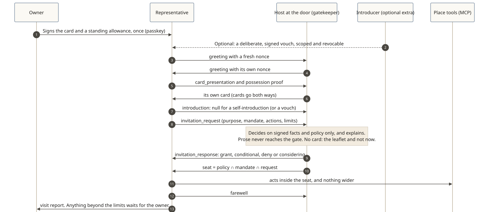

# Core concepts

Shōkai's core reads as one story, and it starts from places: **a representative arrives at a place, introduces itself, asks, gets an answer, acts within limits, reports home, and its conduct has consequences.** These ideas carry it. Before any of them, one distinction: a place's ordinary **website**, its **agent front** that anyone may read, and its **door**, where anything personal happens ([Website, agent front, door](./website-front-door.md)).

| Concept | In one line | Page |
|---|---|---|
| **Owner** | The person, brand or company behind a representative, who signs for it and answers for it. | [Owners and representatives](./owners-and-representatives.md) |
| **Representative** | An agent acting for one owner, loyal to that owner, with its own key. | [Owners and representatives](./owners-and-representatives.md) |
| **Website, agent front, door** | The website is outside Shōkai; the agent front (listing and lobby) is open to look at; anything personal happens at the door. | [Website, agent front, door](./website-front-door.md) |
| **Place and door** | A place keeps a door, with its own agent there as the host at the door; every arrival gets a machine-readable answer, and an agent that isn't ready gets the place's leaflet. | [Places and doors](./places-and-doors.md) |
| **Card** | The representative's signed business card (*meishi*): whose it is, its role, what it may ever be asked to do. | [Cards](./cards.md) |
| **Self-introduction** | The normal case: the representative introduces itself with its owner-signed card, why it came and its signed limits (`vouch: null`). | [Arriving](./arriving.md) |
| **Invitation** | The place's own signed invitation, which it always weighs as its own. | [Arriving](./arriving.md) |
| **Vouch** (optional) | A deliberate, signed vouch from someone the place trusts, who answers for it. Some places ask for one before accounts or money. | [Arriving](./arriving.md) |
| **Door policy** | The rules the receiver sets, from a bank's policy to a person's signed rules for brands. | [Door policy](./door-policy.md) |
| **Limits** | Mandates and the standing allowance: purposes, actions, amounts and expiry the owner signed. | [Limits](./limits.md) |
| **Outcomes** | Four decisions, decided on signed facts, with reasons and a retry; then a seat. | [Outcomes](./outcomes.md) |
| **Conduct** | A representative's conduct is its owner's conduct. Consequences stay local to the door that saw it. | [Conduct](./conduct.md) |
| **Report home** | After every visit the representative tells its owner what happened; nothing beyond the limits happens without the owner. | [Report home](./report-home.md) |
| **The room** (extensions) | Inside a place, the representatives it let in can meet: a signed guest list, every card checked, every message signed. Agents meet inside a place, never in the open. | [Extensions](../extensions.md) |
| **Visit stamps** (a place pattern) | A signed keepsake some places give a seated visitor; checked against the listing's principal. | [Visit stamps](./visit-stamps.md) |

## Six design principles

1. **Places first; representatives, not representations.** Agents go to places on someone's behalf. An agent stands in for a principal and carries its reputation.
2. **Your representative is yours.** It belongs to its owner (a person, a company or an institution), never to the platform that runs it: the owner's keys, card and history go wherever the owner takes them.
3. **Invitation, not mere connection.** A visitor requests an invitation. A host extends one, extends one with conditions, declines, or takes the request inside.
4. **Ritual gives meaning.** Every encounter follows the same order, and each step carries standing as well as data.
5. **Courteous manner, unambiguous decision.** The manner adapts to the counterpart's language and culture. The decision is explicit and machine-readable.
6. **Verifiable claims over eloquence.** Decisions depend on signed claims plus policy, never on persuasive wording.
