# Website, agent front, door

A place shows itself to agents in **three layers**. Shōkai is careful about which of them it touches.

[](../diagrams/svg/website-front-door.svg)

| Layer | What it is | Who can see it | What Shōkai does |
|---|---|---|---|
| **1. The website** | The place's ordinary pages, apps and feeds. | Anyone. Any agent can already load a public URL. | Nothing. Shōkai doesn't govern it and can't stop it. |
| **2. The agent front** | A short, machine-readable description the place *chooses* to publish for agents: who it is, what it offers, what each action will ask the owner for (`data_asks`), and its door rules. In Shōkai this is the **place listing** and the **lobby**. | Anyone, without saying who they are. Nothing about the reader is asked for or kept. | Defines its shape, and that it stays open to look at. |
| **3. The door** | Anything personal: a quote for this owner, a booking, opening an account, moving money, a personalised answer. | Only a representative that shows its owner's signed card, any introduction the place requires, and limits its owner signed. | The whole protocol: cards, introductions, limits, a clear answer, a seat, a report home, and conduct that counts. |

**Looking is free; limits start at the door.** A place decides how much its front shows. A bank might list its products and rates; an invite-only place might publish almost nothing beyond where its door is. Ordinary rate limits still apply to anyone. What a front can never do is make a reader sign in, hand over an email or accept a cookie just to look.

## Why three layers

Today, most places make agents choose between two bad options. Either the agent reads the human website and guesses (scraping, clicking, imitating a person), or it signs in first and the place collects data before showing anything. The agent front is the middle: a place says plainly, for machines, what it offers and what it would ask, and a representative can tell its owner *before* anything is shared. That is the "look before you join" idea, and it's how Shōkai cares for the owner's time and attention.

The door is where trust is needed, so that's where Shōkai puts it. A place can tell which software is calling (for example with [Web Bot Auth](https://datatracker.ietf.org/doc/draft-ietf-webbotauth-httpsig-protocol/)) and which person signed in (with OAuth). At the door the representative introduces itself, and the place learns whose representative this is, why it came and what it may do.

## A front can point to what the place already has

Shōkai doesn't replace the agent-facing pieces a place may already publish. A listing entry can carry `links` to them. They are hints: they prove nothing, and nothing a linked document says widens what the door decides.

| `rel` (suggested) | Points to | Status, as of Oct 2026 |
|---|---|---|
| `schema-org`, `product-feed` | Structured data in the site's pages, or a product feed. Google's own guidance says its AI search features need no special AI files, only clear pages and accurate structured data and feeds ([Google Search Central](https://developers.google.com/search/docs/appearance/ai-features)). | Live, the base layer. [schema.org](https://schema.org/) |
| `mcp-server`, `mcp-server-card` | An MCP server with the place's tools, or the file that describes it before connecting ([MCP Server Cards, SEP-2127](https://github.com/modelcontextprotocol/modelcontextprotocol/pull/2127)). | Server Cards merged as an extension on Oct 6, 2026. |
| `a2a-agent-card` | An [A2A Agent Card](https://a2a-protocol.org/latest/specification/) describing the place's agent server. | A2A v1.0.1. |
| `nlweb` | A natural-language "ask" endpoint over the site's content ([NLWeb](https://github.com/nlweb-ai/NLWeb/blob/main/docs/nlweb-rest-api.md), an open project started at Microsoft). | Open source, active. |
| `commerce-profile` | A checkout protocol the place supports: Google's [Universal Commerce Protocol](https://support.google.com/merchants/answer/16837055?hl=en), the [Agentic Commerce Protocol](https://github.com/agentic-commerce-protocol/agentic-commerce-protocol) or Shopify's [Shop MCP](https://shopify.dev/changelog/posts/add-shopping-and-shop-pay-checkout-to-any-agent-with-shop-mcp). | Early access or beta; Shop MCP live. |
| `llms-txt` | A curated guide for agents at [`/llms.txt`](https://llmstxt.org/). | Community proposal, used mostly for developer docs. |

`rel` values are free-form; these are suggestions, not a registry, and a reader ignores values it doesn't know. A link's `href` is a hint too: it may point anywhere, so a representative treats what it finds there as untrusted, checks identity at the door, not at the link, and sends a seat's signed acts only to the door's own origin (the origin of the listing's `entry`), never to an address a link alone suggests.

Naming these technologies implies no affiliation or endorsement. Status lines were checked against the linked sources on 2026-10-26 and these projects move quickly.

## Three examples (fictional)

### A bank: Harborlight Bank

- **Website.** Rates, branches, help articles. Unchanged.
- **Agent front.** Harborlight's listing says it's a `bank`, which actions it offers (look up rates, open an account, check a balance, make a payment), that opening an account `creates_account` and `requires_introduction`, and what each action would ask for: nothing to look up rates, `account` for a balance. A representative reads it anonymously and can tell its owner, "Harborlight needs an introduction to open an account; reading rates asks for nothing."
- **Door.** Checking a balance or sending a payment happens only after the owner-signed card, an introduction if Harborlight requires one, and a mandate or standing allowance with amounts. The seat is never wider than policy ∩ mandate ∩ request, and a transfer beyond the limits goes home to the owner. See [the Harborlight example](../examples/harborlight-bank.md).

```json
{ "type": "place_listing", "places": [{
    "name": "harborlight", "category": "bank",
    "actions": [
      { "action": "bank.read_rates", "purposes": ["visitation"], "spends": false, "data_asks": [] },
      { "action": "account.create", "purposes": ["account_servicing"], "spends": false, "creates_account": true, "requires_introduction": true, "data_asks": ["name", "date_of_birth", "government_id", "address"] },
      { "action": "bank.get_balance", "purposes": ["account_servicing"], "spends": false, "data_asks": ["account"] } ],
    "links": [{ "rel": "mcp-server-card", "href": "https://harborlight.example/.well-known/ai-catalog.json" }],
    "…": "entry, lobby, inbox, onboarding_url, locales, purposes, spec_ref" }] }
```

### A store: Corsavel

- **Website.** The luggage catalogue for people.
- **Agent front.** Browsing the catalogue asks for nothing (`data_asks: []`); placing an order declares `name`, `address`, `payment_method`. The front links to Corsavel's product feed and the checkout protocol it already supports.
- **Door.** Asking for a quote for this owner, placing an order or joining the loyalty programme needs the card and a spending limit the owner signed. With no spending allowance there is no spending. See [Look before you join](../examples/look-before-you-join.md).

### A photographer's portfolio: Ines Calder Photography

- **Website.** The portfolio, for people.
- **Agent front.** A small listing: the styles she shoots (portraits, weddings), the regions she covers, a price range as text, and two actions: `portfolio.view` (asks for nothing) and `booking.request` (declares `name` and `email`). It might link to nothing else.
- **Door.** A representative asking for a quote for one wedding date shows its owner's card and a mandate for that purpose. Her place can answer `considering`: it takes the request inside so she decides herself, by a stated date. Her taste in which jobs she takes is never misconduct; pressure or fake urgency from a visitor is.

## What Shōkai doesn't do here

- It doesn't police the ordinary website, and it isn't a robots.txt for agents.
- It doesn't rank places or keep a global directory. A place's category is self-declared.
- It doesn't cap looking. Sign-ups, money and anything personal are gated and capped at the door (see [Conduct](./conduct.md) and the [threat model](../security.md)).

*[Spec](../../SPEC.md): Arrive (Website, agent front, door; The door; The lobby: unprepared visitors); Minimal HTTP binding.*
