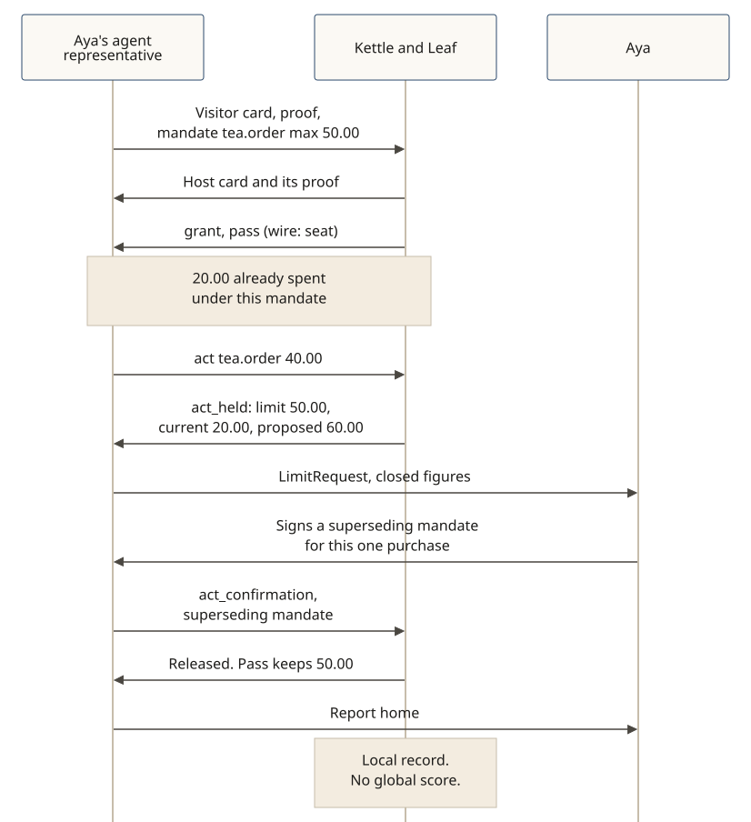

# A held act at a 50.00 ceiling

**In v0.5.0.** At a place that holds purchases (`ext-spending`, [SPEC §7.3](../../SPEC.md)), an honest order that would go over the signed ceiling is held, not refused outright, and not answered `never`. The owner can release that one act with a superseding mandate.

**The story:** Aya Linden (fictional) sends her agent representative to Kettle & Leaf, a fictional tea shop, to buy tea. She has signed a Shōkai visitor card that lasts for months, and a short mandate for `tea.order` with a ceiling of USD 50.00. The shop's pass uses the same ceiling. She has already spent USD 20.00 under this mandate. The representative is admitted with a pass and orders a tin at USD 40.00, which would bring the errand to USD 60.00.

The door answers `act_held`, with `over_limit` figures: `limit` 50.00 (the lower of the pass's and the mandate's `max_amount`), `current` 20.00, and `proposed` 60.00. Nothing is charged while it is held. The hold expires in minutes (at most 15).

The representative takes a closed `LimitRequest` home — the place, the hold, those figures, and the deadline, with no free text — and does not send it back to the shop. Aya approves on her signing page. The page shows that the approval is for this one purchase. The representative returns a superseding mandate in `act_confirmation`: it names the current mandate, binds this hold (`supersedes.hold` = `{hold_id, act_digest}`), has `max_amount` equal to `proposed` exactly (60.00), expires no later than the hold, and carries `shown_to_owner`. Aya signs it with her passkey. The representative cannot sign it for her.

That one act is released. The pass keeps its old mandate and its 50.00 ceiling. Later spending in the same pass is again over the limit: refused, or held for a new approval. Offering the same superseding mandate again is `not_now` / `MANDATE_INVALID`.

The report home states the ceiling, the one purchase she approved above it, and the total, so the total does not read as overspending: "Spent USD 60.00: USD 20.00 within your USD 50.00 limit, and one purchase of USD 40.00 that you approved above it." The shop keeps a local record. There is no global score.

If Aya declines, or does not answer by the deadline, the hold lapses, nothing is charged, and the representative does not guess. That is still `not_now`, not `never`.
