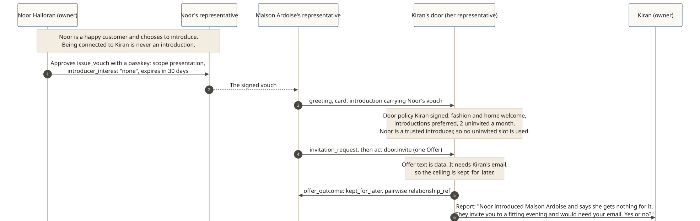

# A friend introduces a brand

**The story:** Noor Halloran (fictional) loves Maison Ardoise, a fictional clothing brand. She thinks her friend Kiran Vale would too. Kiran's representative keeps a door for brands, under rules Kiran signed. Noor chooses to introduce the brand.

[](../diagrams/svg/example-maison-ardoise.svg)

## 1. The introduction is deliberate

Noor and Kiran being friends, or their representatives having met, is **never** an introduction. Noor's representative asks her, and Noor approves `issue_vouch` with her passkey. Before she signs, she is shown the scope, the expiry and what it would cost her standing if the brand misbehaved.

```json
{ "vouch_id": "v-noor-maison-01",
  "introducer": { "principal_id": "did:jwk:eyJ…noor", "display_name": "Noor Halloran" },
  "subject": { "representative_id": "did:web:maison-ardoise.example", "card_digest": "sha-256:…" },
  "scope": { "purposes": ["presentation"] },
  "relationship": "customer_of_record",
  "introducer_interest": "none",
  "revocation_log": "https://noor-rep.example/shokai/revocations",
  "expires_at": "2026-11-25T18:00:00Z" }
```
*`introducer_interest: "none"` is a signed statement that Noor gets nothing for this. Had she been offered a referral discount, it would say `"discount"`, Kiran would be told, and by default the introduction would get no more priority than an uninvited brand.*

## 2. Kiran's door policy decides

Kiran's policy welcomes `fashion`, `home` and `travel`, prefers introductions, and allows two uninvited brands a month. Noor is one of the introducers it names, so Maison Ardoise is **introduced** and uses no uninvited slot. The brand never learns who else Kiran trusts.

## 3. One offer, declared up front

```json
{ "type": "act", "tool": "door.invite",
  "arguments": { "offer": {
    "offer_id": "o-ma-fitting-11", "kind": "invitation", "category": "fashion",
    "item": "A private fitting evening, Thursday 6 PM",
    "context": { "door": "did:key:z6MkKiranRep…", "matches_categories": ["fashion"], "via_vouch": "v-noor-maison-01" },
    "valid_until": "2026-11-12T23:59:59Z",
    "needs_from_owner": ["email"] } } }
```
*An invitation must say why this door. Everything it would need from Kiran is declared: here, her email to confirm the booking.*

## 4. The ceiling, then taste

Because the invitation needs something from Kiran, its ceiling is `kept_for_later`: the representative can't hand over her email itself. Its own judgement of Kiran's taste could only lower that, never raise it.

```json
{ "type": "offer_outcome", "offer_id": "o-ma-fitting-11", "outcome": "kept_for_later",
  "relationship_ref": "rel-7c1e…", "courtesy": { "text": "Thank you. I'll share this with Kiran.", "locale": "en-US", "locale_match": "exact" } }
```
*`relationship_ref` is pairwise: another brand gets a different one, so brands can't link Kiran by comparing references. The door's own card still names Kiran's owner key, so brands that compare notes can link it to the same owner (SPEC §13 item 20).*

## 5. Report home

> Noor introduced Maison Ardoise, and says she gets nothing for it. They're inviting you to a private fitting evening on Thursday at 6 PM. To confirm, they'd need your email. **Yes or no?** If you don't reply by Nov 12, it's a no.

If Kiran says yes, she approves sharing her email with her passkey, and only then. If Maison Ardoise later misbehaved while relying on Noor's vouch, Noor's standing as an introducer at Kiran's door would drop for that purpose. That is what makes her introduction worth something.
