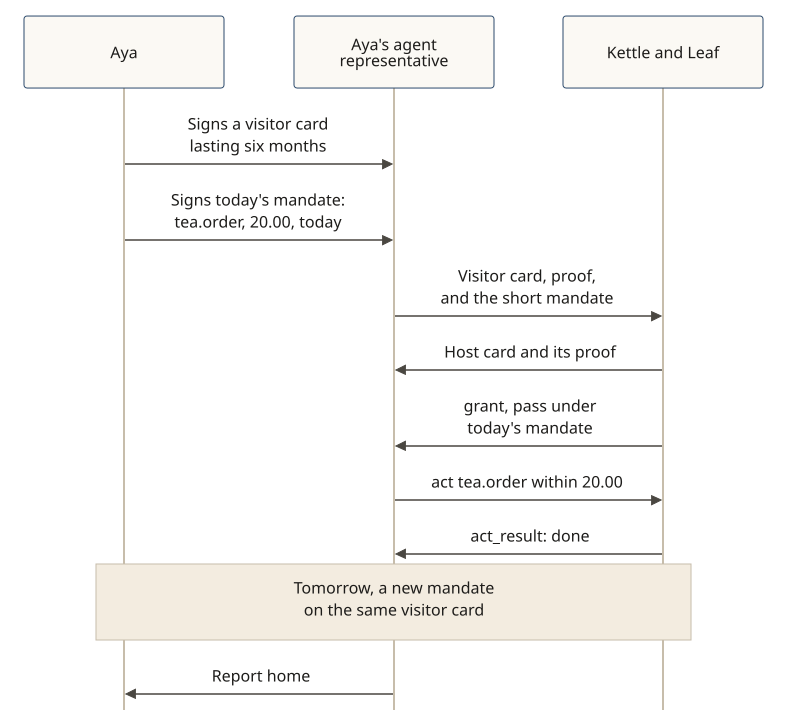

# Card and mandate lifetimes

**In v0.5.0.** The Shōkai visitor card lasts as long as the owner chooses — often months. The mandate is short-lived: it is the errand's limits, not the card. There is no "one-day card."

**The story:** Aya Linden (fictional) signs a Shōkai visitor card for her agent representative in early October, set to expire the following April. The same morning she signs a mandate for a visit to Kettle & Leaf, a fictional tea shop: `tea.order`, up to USD 20.00, for today.

[](../diagrams/svg/example-card-and-mandate.svg)

```json
{ "card_id": "card-aya-01",
  "protocol": "shokai/0.5",
  "kind": "visitor",
  "representative_id": "did:key:z6Mk…AyA",
  "principal": { "principal_id": "did:jwk:…A1y", "kind": "person", "display_name": "Aya Linden" },
  "issued_at": "2026-10-01T12:00:00Z",
  "expires_at": "2027-04-01T12:00:00Z" }
```

```json
{ "mandate_id": "man-aya-kettle-2026-10-26",
  "card_id": "card-aya-01",
  "purpose": { "code": "purchase" },
  "actions": ["tea.browse", "tea.order"],
  "limits": { "max_amount": { "value": "20.00", "currency": "USD" } },
  "issued_at": "2026-10-26T09:00:00Z",
  "expires_at": "2026-10-26T23:59:59Z" }
```

*Abridged: a real card and mandate also carry the owner's binding, digests, and signatures. Keys and digests are shortened with `…`.*

The door checks the visitor card and an audience-bound possession proof, shows its host card with its proof, welcomes the representative, and grants a pass under today's mandate. An order within USD 20.00 goes through. An order that would pass the mandate is refused `not_now`, or held if the shop holds purchases (see [A held act at a 50.00 ceiling](./act-held-ceiling.md)). Tomorrow Aya can sign a new mandate on the same visitor card; she does not need a new card for a new errand. If she wants the card to last longer, or to end sooner, that is her choice when she signs it.

The representative reports home, and the shop keeps a local record. There is no global score.
