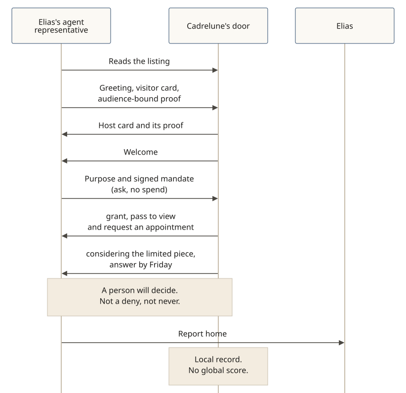

# Considering an unusual order

**In v0.5.0.** When a request is unusual but honest, the door can take it inside for a person to decide (`considering`, [SPEC §6.8](../../SPEC.md)). That is not a `deny`, and it is not `never`.

**The story:** Elias Moreau (fictional) collects watches. He asks his agent representative to find out whether he could be considered for a limited reissue at Cadrelune, a fictional heritage watchmaker. The representative presents the Shōkai visitor card Elias signed, and a no-spend mandate to ask, not to buy.

The door checks the visitor card and an audience-bound possession proof, and shows its Shōkai host card with its proof. The host representative welcomes the visitor. The door grants a pass to view the reissue and to request an appointment (wire: `seat`). The request to be considered for the limited piece itself goes inside, with a date for the answer (`considering`, and a `response_by`).

Eligibility for `considering` is decided by policy: a verified card, a valid mandate, and the requested action on the place's consideration list. If the deadline lapses, the visitor treats it as `deny` / `not_now`. The representative reports home: the director will answer by Friday, and the appointment is Elias's to confirm. The house keeps a local record. There is no global score.

A second, honest visitor the same evening, without what this house's policy asks for that limited piece, hears `not_now` and what would change it. Nothing is held against it. `never` is reserved for misconduct.

The longer place story is [A collector at a heritage watchmaker](./heritage-watchmaker.md).
