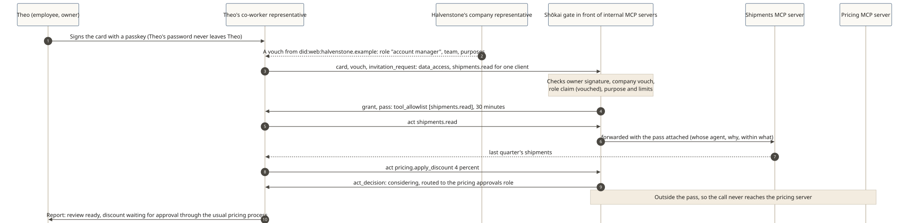
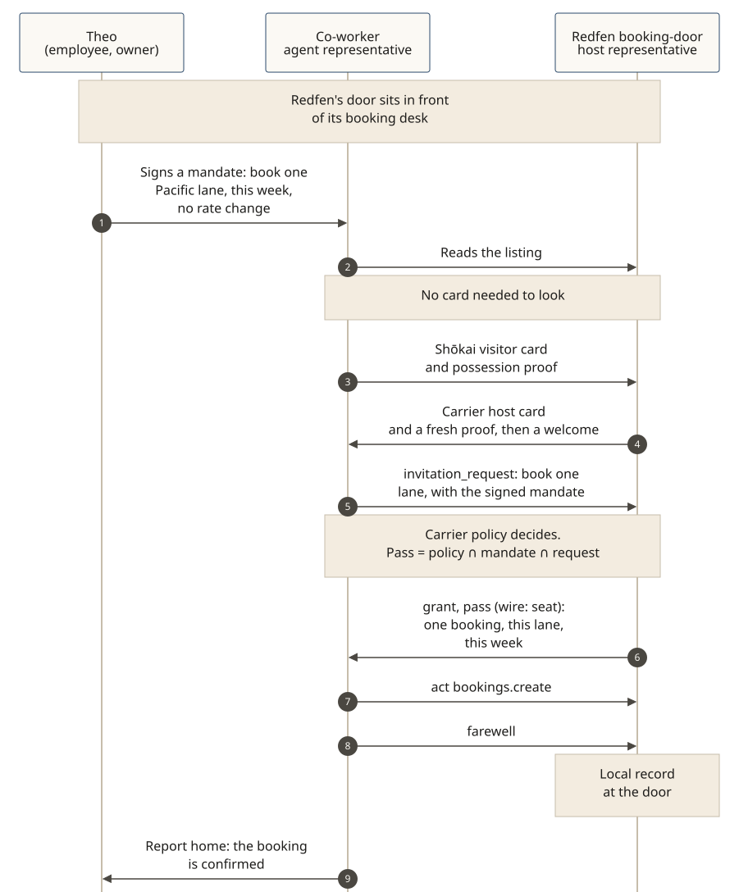

# At a freight company

**The story, told from the place's side.** Halvenstone Freight (fictional) is a freight company. Theo Marchetti (fictional) is an account manager there. He has a co-worker **agent representative** acting for him. Halvenstone puts a Shōkai **host representative** in front of each internal resource it is responsible for, and its agents also visit suppliers' and carriers' doors. Every company, desk and person on this page is fictional. The eight beats of a visit are the same as on every worked example; the grant is a **pass** (wire: `seat`).

[](../diagrams/svg/example-enterprise-doors.svg)

## Why a door, when there's already SSO?

The company's identity provider (for example Okta or Microsoft Entra ID) stays the source of truth for who works there, their role and team. OAuth still tells an MCP server which app and which user. What neither shows is **which of Theo's agents** is calling, **why** today, and **what Theo actually cleared it to do**, which by default is narrower than everything Theo is allowed to do. The door adds that, and keeps a local record (SPEC §9.1).

## 1. A host representative for each internal resource

Halvenstone runs internal MCP servers for **shipments**, a **pricing desk**, and a **customs-docs desk**. Each one has a Shōkai door in front of it, with a host representative and a door policy the company signed. A co-worker agent is not admitted to "the company" in general. It visits the door in front of the resource it came to use, with a purpose and a mandate scoped to that errand.

The door admits Theo's representative on the **Shōkai visitor card** Theo signed with his passkey, and on Halvenstone's door policy. Single sign-on still says who the employee is (outside the protocol).

## 2. Theo signs a Shōkai visitor card, and a customer link

Theo signs his agent representative's Shōkai visitor card with his passkey. The signing key stays on Theo's device, not on an agent server.

```json
{ "type": "card_presentation",
  "card": { "payload": {
    "card_id": "card-theo-visitor-01",
    "protocol": "shokai/0.5",
    "kind": "visitor",
    "representative_id": "did:key:z6MkTheoRep…",
    "principal": { "principal_id": "did:jwk:eyJ…theo", "kind": "person", "display_name": "Theo Marchetti" },
    "issued_at": "2026-10-01T12:00:00Z",
    "expires_at": "2027-10-01T12:00:00Z",
    "owner_binding": { "method": "passkey_webauthn", "owner_id": "did:jwk:eyJ…theo", "rp_id": "owners.halvenstone.example" },
    "revocation_url": "https://theo-rep.example/shokai/revocations"
  }, "signatures": ["…"] },
  "possession_proof": { "alg": "Ed25519", "signer": "did:key:z6MkTheoRep…", "audience": "did:web:halvenstone.example", "value": "…" } }
```

The door presents Halvenstone's Shōkai host card with its own audience-bound possession proof. The host representative welcomes the visitor. The visitor is not yet admitted.

Halvenstone marks internal tools `requires_customer_link` ([SPEC §5.4](../../SPEC.md), the institutions extension in v0.5.0). The **customer link** is made in the company's own channel — here, its own app after SSO has already recognized Theo as an employee — and is signed by Halvenstone's principal key and by Theo's passkey. The door checks that link. It does not treat a self-declared job title as enough.

```json
{ "link_id": "cl-theo-hf-01",
  "place": "did:web:halvenstone.example",
  "owner_id": "did:jwk:eyJ…theo",
  "rp_id": "owners.halvenstone.example",
  "scope": { "actions": ["shipments.read"] },
  "issued_at": "2026-10-02T09:00:00Z",
  "expires_at": "2027-10-02T09:00:00Z",
  "shown_to_owner": { "text": "Link your co-worker agent to your Halvenstone staff record for shipments.read.", "locale": "en-US" } }
```
*The same `CustomerLink` shape a bank uses for an existing customer. A company uses it for someone it already knows, made in its own channel. When Theo changes team or leaves, the company ends the link; the door consults it on every visit that needs it.*

**Optional (SPEC §4):** Halvenstone may also sign a vouch for a role claim such as "account manager, Pacific freight team", so that claim is `vouched` rather than self-declared. That vouch is not what admits Theo. If the company uses one, it is labeled optional, and it carries `issued_at`, `expires_at`, `card_digest` and a `revocation_log` like any other v0.5.0 vouch.

## 3. A visit to the shipments door

Theo signs a mandate for this errand: prepare a quarterly review for one client, Lantern Coast Imports, read-only, thirty minutes. His representative presents the purpose and the signed limits at the shipments door.

```json
{ "type": "invitation_request",
  "card_digest": "sha-256:…",
  "mandate": { "payload": { "purpose": { "code": "data_access", "statement": "Prepare Q3 review for one client", "locale": "en-US" },
                            "allowed_actions": ["shipments.read"], "counterparties": ["did:web:halvenstone.example"],
                            "customer_link": { "link_id": "cl-theo-hf-01", "link_digest": "sha-256:…" },
                            "limits": { "max_session_s": 1800 } } },
  "proposal": { "request": { "actions": ["shipments.read"], "data_classes": ["client:lantern-coast"] }, "etiquette_register": "established",
                "value_to_counterparty": { "text": "Quarterly review prep.", "locale": "en-US" } } }
```

The door decides and grants a pass. On the wire the pass is the `seat` object. Every later act is checked against it. A call to any other tool does not reach a server.

```json
{ "type": "invitation_response", "decision": "grant",
  "seat": { "seat_id": "seat-hf-theo-088",
            "levels": ["act_on_behalf"],
            "tool_allowlist": ["shipments.read"],
            "access_mode": "user_delegated",
            "brand": { "label": "Halvenstone Freight", "vendor_warranted": true },
            "limits": { "max_session_s": 1800, "data_classes": ["client:lantern-coast"] },
            "mandate_id": "m-…" } }
```

[](../diagrams/svg/example-enterprise.svg)

The representative then suggests a 4% discount and tries `pricing.apply_discount`. It's outside the pass, so it gets an explicit decision:

```json
{ "type": "act_decision", "decision": "considering",
  "seat_id": "seat-hf-theo-088", "tool": "pricing.apply_discount",
  "consideration_ref": "con-hf-088-discount",
  "routed_to": { "kind": "role", "role": "pricing approvals", "human": true },
  "response_by": "2026-10-28T17:00:00Z" }
```
*It does not act on its own and does not fail silently. The discount goes to the people who approve pricing, through the process they already use. If the owner later signs a superseding mandate, that can lift a hold; this request was outside the pass, so it is taken inside as `considering` (SPEC §6.8, §7.3).*

## 4. Visiting a carrier's door, and a warehouse partner's door

The same representative also goes outside the company. **Redfen Trailways** (fictional) is a trucking carrier Halvenstone books. **Quaymill Warehousing** (fictional) is a warehouse partner. Each keeps its own Shōkai door.

At Redfen's **booking door**, Theo's representative arrives with Theo's visitor card and a mandate Theo signed: book one Pacific lane, this week, no rate change. Redfen's host representative checks the card, welcomes the visitor, and decides. The pass, if granted, is that one booking. A rate change would be outside the pass.

```json
{ "type": "invitation_request",
  "card_digest": "sha-256:…",
  "mandate": { "payload": { "purpose": { "code": "booking", "statement": "Book one Pacific lane this week, no rate change", "locale": "en-US" },
                            "allowed_actions": ["bookings.create"], "counterparties": ["did:web:redfen-trailways.example"],
                            "limits": { "max_session_s": 1800 } } },
  "proposal": { "request": { "actions": ["bookings.create"], "data_classes": ["lane:pacific"] }, "etiquette_register": "established",
                "value_to_counterparty": { "text": "One scoped booking request.", "locale": "en-US" } } }
```

[](../diagrams/svg/example-enterprise-carrier.svg)

At Quaymill's door, the visitor may instead carry **the company's** Shōkai visitor card, signed by Halvenstone as principal (`kind: "company"`), with a mandate scoped to "confirm inbound for one shipment, read-only." The partner's door decides under its own policy. The pattern is the same: a card, a proof, a purpose, a pass, a local record.

**In v0.5.0:** a place can put a door in front of each resource; an employee can sign a visitor card and a mandate; a company can also be a principal and sign a visitor card of its own; a partner's door is just another door; CustomerLink is available when a place already knows the person (SPEC §5.4).

**Proposal, not built:** a connector that binds these doors to a live shipments system, a carrier booking desk, or a warehouse management system. The door sits in front of the resource; that binding is not in v0.5.0.

## 5. Report home, and a trail security can read

> The Q3 review for Lantern Coast Imports is ready. I suggested a 4% discount; it's with pricing approvals, due by Wednesday 10 AM PT. The Pacific-lane booking at Redfen is confirmed. Nothing else was changed.

The door keeps a local record of each visit (SPEC §9.1). Security can read whose agent called, which tools, why, and what was routed for approval. Every decision's `basis` replays. There is no global score.
