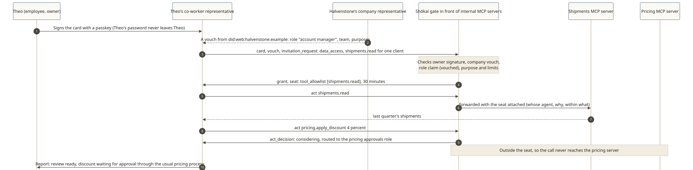

# An employee's co-worker agent

**The story:** Theo Marchetti (fictional) is an account manager at Halvenstone Freight (fictional). His co-worker agent prepares a quarterly review for one client. Halvenstone runs internal MCP servers for shipments and pricing, with a Shōkai gate in front of them.

[](../diagrams/svg/example-enterprise.svg)

## Why a gate, when there's already SSO?

The company's identity provider (for example Okta or Microsoft Entra ID) stays the source of truth for who works there, their role and team. OAuth still tells an MCP server which app and which user. What neither shows is **which of Theo's agents** is calling, **why** today, and **what Theo actually cleared it to do**, which by default is narrower than everything Theo is allowed to do.

## 1. The company introduces the representative

Theo signs his representative's card with his passkey. Halvenstone's own representative, under `did:web:halvenstone.example`, vouches for its role, so the claim "account manager, Pacific freight team" is `vouched`, not self-declared.

```json
{ "vouch_id": "v-hq-theo-rep",
  "introducer": { "principal_id": "did:web:halvenstone.example", "display_name": "Halvenstone Freight" },
  "subject": { "representative_id": "did:key:z6MkTheoRep…", "card_digest": "sha-256:…" },
  "scope": { "purposes": ["data_access"], "claims": ["role-account-manager"] },
  "relationship": "employee_of_record",
  "revocation_log": "https://halvenstone.example/shokai/revocations" }
```
*When Theo changes team, the company revokes and reissues the vouch once; the gate consults the log on every visit.*

## 2. A request with a purpose

```json
{ "type": "invitation_request",
  "mandate": { "payload": { "purpose": { "code": "data_access", "statement": "Prepare Q3 review for one client", "locale": "en-US" },
                            "allowed_actions": ["shipments.read"], "counterparties": ["did:web:halvenstone.example"],
                            "limits": { "max_session_s": 1800 } } },
  "proposal": { "request": { "actions": ["shipments.read"], "data_classes": ["client:lantern-coast"] }, "etiquette_register": "established",
                "value_to_counterparty": { "text": "Quarterly review prep.", "locale": "en-US" } } }
```

## 3. The seat, enforced on every tool call

```json
{ "decision": "grant",
  "seat": { "tool_allowlist": ["shipments.read"], "limits": { "max_session_s": 1800, "data_classes": ["client:lantern-coast"] } } }
```
The gate forwards each MCP `tools/call` for `shipments.read` with the seat attached. A call to any other tool never reaches a server.

## 4. Outside the seat: considering, not a silent failure

The representative suggests a 4% discount and tries `pricing.apply_discount`. It's outside the seat, so it gets an explicit decision:

```json
{ "type": "act_decision", "decision": "considering",
  "routed_to": { "kind": "role", "role": "pricing approvals", "human": true },
  "response_by": "2026-10-28T17:00:00Z" }
```
*It never acts on its own and never fails silently. The discount goes to the people who approve pricing, through the process they already use.*

## 5. Report home, and a trail security can read

> The Q3 review for Lantern Coast Imports is ready. I suggested a 4% discount; it's with pricing approvals, due by Wednesday 10 AM PT. Nothing else was changed.

Security sees the whole trail: whose agent, which tools, why, what was routed for approval. Every decision's `basis` replays.
