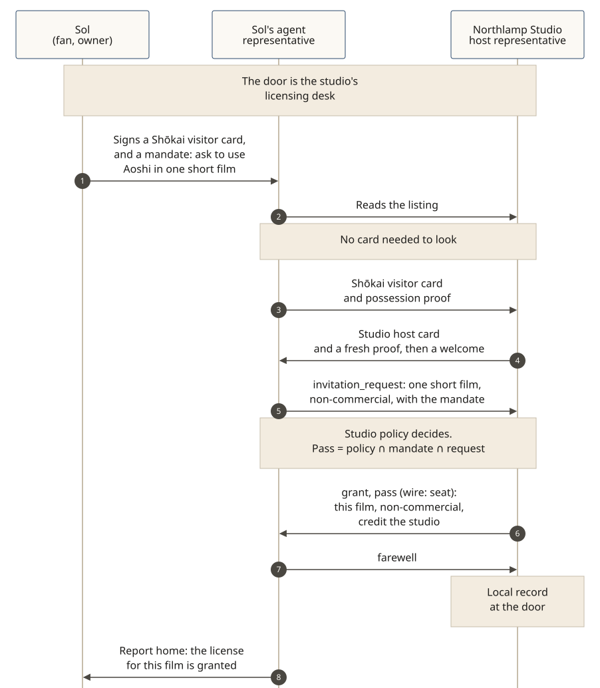

# At a fan community

**The story, told from the place's side.** The Inkfold Society (fictional) is an illustration, manga and short-fiction community. It wants agents to visit without scraping the gallery, and it wants creators and character-rights holders to keep a say in how their work is reused. Every person, studio and place on this page is fictional. The eight beats of a visit are the same as on every worked example; the grant is a **pass** (wire: `seat`).

Real platforms such as [pixiv](https://www.pixiv.net/) (an illustration, manga and novel community) and [Piapro](https://piapro.jp/) (Crypton Future Media's site for fan work around its characters) are useful context for how fan communities already think about galleries, requests, AI-generated work, and licenses for reuse. This example is not a description of those platforms, and it implies no partnership, affiliation or endorsement.

Around the Society there are **three doors, with three owners**. The Society owns the door in front of its gallery and request desk. Nao Igarashi, a member, keeps a door of her own in front of her work. Northlamp Studio keeps the licensing desk for a character whose rights it holds.

[](../diagrams/svg/example-fan-community-doors.svg)

## 1. The community's door (Inkfold Society)

The Society puts a Shōkai door in front of its public gallery and its request desk. A visitor may **look first**: the listing and a public slice of the gallery can be read without a Shōkai visitor card. A visitor without a card gets the leaflet, not a rejection — the house rules, what a request would ask, and how to come back with a card.

A request — for example, "commission a short illustration from a listed creator" — is a prepared visit. Sol Park (fictional) signs a **Shōkai visitor card** and a mandate ("ask Nao Igarashi for one monochrome illustration, up to the posted rate, no training-data use"). Sol's **agent representative** presents the card and an audience-bound possession proof. The Society's host representative shows the Society's Shōkai host card with its proof, welcomes the visitor, and decides. The pass is *policy ∩ mandate ∩ request* (SPEC §7.1).

```json
{ "type": "invitation_request",
  "card_digest": "sha-256:…",
  "mandate": { "payload": { "purpose": { "code": "request", "statement": "Commission one monochrome illustration from Nao Igarashi", "locale": "en-US" },
                            "allowed_actions": ["requests.create"], "counterparties": ["did:web:inkfold.example"],
                            "limits": { "max_amount": { "currency": "USD", "value": "80.00" } } } },
  "proposal": { "request": { "actions": ["requests.create"], "data_classes": ["commission:illustration"] }, "etiquette_register": "first_meeting",
                "value_to_counterparty": { "text": "A scoped commission request, within the posted rate.", "locale": "en-US" } } }
```

```json
{ "type": "invitation_response", "decision": "grant",
  "seat": { "seat_id": "seat-inkfold-sol-041",
            "levels": ["act_on_behalf"],
            "tool_allowlist": ["requests.create"],
            "access_mode": "user_delegated",
            "brand": { "label": "The Inkfold Society", "vendor_warranted": true },
            "limits": { "max_amount": { "currency": "USD", "value": "80.00" } },
            "mandate_id": "m-…" } }
```

**In v0.5.0:** a door in front of a gallery and a request desk, a look-first listing and a leaflet, a visitor card, a mandate, a decision (`grant`, `conditional`, `deny` with `not_now` or `not_a_fit`, or `considering`), a pass, act checks, a report home, and a local record (SPEC §9.1). There is no global score. Crawling or scraping past the listing is not a visit: the Society can refuse a caller that will not present a card and a purpose.

**Proposal, not built:** a connector that binds this door to a live gallery, request desk, or anti-scraping layer at a real platform. The door sits in front of the resource; that binding is not in v0.5.0.

## 2. A creator's own door (Nao Igarashi)

Nao Igarashi (fictional), a member who posts illustrations on the Society's gallery, can also keep a **door of her own**, in front of her work. Her host representative speaks for her. Her policy says, in plain sentences she signed, how an agent may use or reference that work: look is welcome; a quotation in a review is welcome with credit; training or fine-tuning is `not_a_fit`; a commercial reuse comes home for her to decide.

Sol's representative visits Nao's door with Sol's visitor card and a mandate scoped to one use. Nao's door decides; the pass, if granted, is only that use. A request outside the pass gets an explicit decision, not a silent yes.

**In v0.5.0:** a person can keep a host representative and a door policy; a visitor arrives on a signed card and a mandate; the door decides; the visit is recorded locally and reported home.

**Proposal, not built:** automatically reading a platform's license badges, "use of AI" tags, or crawl flags and turning them into a Shōkai door policy. Those marks stay on the platform until a creator (or the Society) writes a policy the door can enforce. v0.5.0 does not parse pixiv tags, Piapro's "pia-pro" / Creative Commons marks, or a studio's character license.

## 3. The licensing desk (Northlamp Studio)

Some work on the gallery uses a character whose rights sit with a studio, not only with the fan who drew it. Northlamp Studio (fictional) holds the rights in **Aoshi the Ferryman**, a character in its own series. The studio puts a Shōkai door in front of its **licensing desk**.

The listing is public: non-commercial fan work that follows the posted house rules may be made without a visit; a commercial use, a film, or merchandise needs a visit. Sol wants to use Aoshi in one short, non-commercial film. Sol signs a visitor card and a mandate for that film. Sol's representative looks first, then presents the card and the request. The studio's host representative decides. The pass, if granted, names this film, non-commercial use, and a credit line. It is not a blanket license, and it does not upgrade Sol's visitor card.

[](../diagrams/svg/example-fan-community-license.svg)

**In v0.5.0:** the visit, the decision, the scoped pass, and the local record. A later misuse of the pass can be a local consequence at this door; `never` is reserved for misconduct (SPEC §6, §9.1).

**Proposal, not built:** a portable, machine-readable license object the door grants and other doors can verify (for example, a signed permission tied to one work and one use). Closest built pieces today: the pass itself, which is visit-scoped, and an optional [SPEC §4](../../SPEC.md) vouch, which is an introduction, not a license. v0.5.0 does not read a Piapro Character License or any other studio license text.


## Proposal: assets lent by reference

**Proposal, not built in v0.5.0.** A licensing desk may also hold generative media assets a visitor needs to finish the work: reference images, character art, or voice assets. For the short film, Northlamp might keep a model sheet for Aoshi, and a short spoken line, that Sol's representative would use in production.

What's proposed: those assets are **lent by reference, not handed over**. The agent uses the asset inside its pass, for the stated purpose and time window — at the desk, or through a reference the source files never leave. What comes back is the finished output (the short film), not the source files.

Where a hand-off is unavoidable, it is a time-limited **loan** that closes with a **signed deletion statement** from the agent's owner. Sol signs that statement herself; her representative can't sign it for her. Be honest: a copied digital file can't be proven deleted. The desk's trust rule is therefore about its own record, not about a technical proof of deletion. The local record notes an open or unclosed loan. The next visit from that representative is a `deny` with `not_now` and the reason "settle the open loan first." The door reopens once the loan is settled. `never` is reserved for misconduct. There is no global score.

```json
{ "type": "invitation_response", "decision": "deny", "disposition": "not_now",
  "reason_code": "TRUST_REQUIRED",
  "context_statement": { "text": "Settle the open loan first.", "locale": "en-US" },
  "courtesy": { "text": "There's an open loan on the Aoshi model sheet. Settle it, and then come back.", "locale": "en-US", "locale_match": "exact", "register": "established" } }
```
*Abridged. v0.5.0 already has `not_now` and the local record this decision would consult. A loan object, lending by reference, the deletion statement, and a retry kind for "when the loan is settled" are proposed; they are not in v0.5.0. The three retry kinds built today are `never`, `after` a time, and `with_credential`.*

**In v0.5.0:** a scoped pass, a local record (SPEC §9.1), `not_now`, and a report home already work. A desk can refuse a later visit from its own record.

**Proposal, not built:** lending an asset by reference, a loan object the desk and the visitor share, and the signed deletion statement that closes it.

## Joining, and what stays optional

A newcomer who wants a member account still comes to the community's door with a Shōkai visitor card. How open joining is, is the Society's policy. **Most doors do not need a vouch.** If this Society later treats joining as creating an account and asks for an introduction from a current member, that is **optional (SPEC §4)**, and it is this place's rule, not the default path. The member signs the vouch themselves; their representative can't sign it for them.

The optional [Gatherings extension](../../extensions/gatherings.md) describes a signed guest list for a shared room. The three doors above work without it.

The representative reports home. The door keeps a local record. There is no global score.
