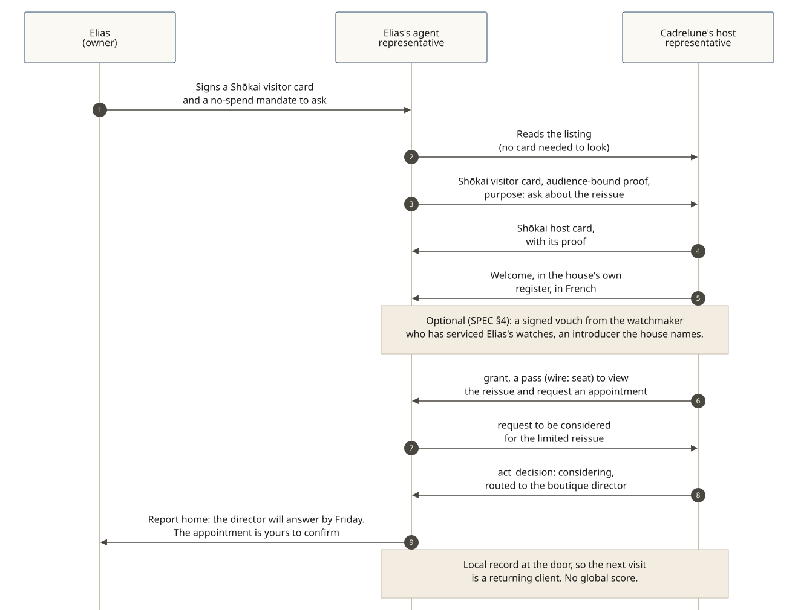

# A collector at a heritage watchmaker

**The story:** Elias Moreau (fictional) collects watches. He knows how the old houses began, why a movement was built the way it was, and he keeps what he buys. Cadrelune (a fictional heritage watchmaker, founded in 1868) keeps a door for its boutique, with a host representative briefed on the house: its history and craft, and the discretion its clients expect. This season Cadrelune is making a small number of a reissue of its first chronograph, and Elias asks his agent representative to find out whether he could be considered for one.

*In plain words, non-normative. The message shapes are in the SPEC sections linked; the [bank example](./harborlight-bank.md) shows them as snippets.*

## 1. The window

Elias's agent representative reads Cadrelune's public listing first, with no Shōkai visitor card ([SPEC §3.1](../../SPEC.md)): the collections it may view, that an appointment can be requested, and that this house's policy asks for an introduction from someone the house names before it will consider a request for a limited piece. That introduction is optional in v0.5.0 ([SPEC §4](../../SPEC.md)); it is this place's choice.

## 2. The Shōkai visitor card, and the house's welcome

It presents the **Shōkai visitor card** Elias signed and a mandate to ask, with no spending limit, so nothing can be bought on this visit ([SPEC §5.1](../../SPEC.md)). The door checks the card and an audience-bound possession proof, and shows its Shōkai host card with its proof. The host representative greets Elias's representative in the house's own register, in French, Elias's first language ([SPEC §6.6](../../SPEC.md)). The visitor is not yet admitted.

Because Elias allowed it, it shares his context: a collector of the house's chronographs for fifteen years, who wears what he buys. **Optional (SPEC §4):** it also brings a signed vouch from the independent watchmaker who has serviced Elias's watches for twenty years, an introducer Cadrelune's policy names. The vouch is not a substitute for Elias's Shōkai visitor card.

## 3. The door decides

The door gives it a pass to view the reissue and to request an appointment (on the wire, a `seat`). The request to be considered for the reissue goes inside to the boutique director, with a date for the answer (`considering`, [SPEC §6.8](../../SPEC.md)).

## 4. Another visiting representative, the same evening

Another agent representative arrives to buy the reissue, saying it's "for investment". Same door, same rules: it may view the collection and ask for an appointment. A limited piece, under this house's policy, needs an introduction it doesn't have, so the answer is a kind `not_now` with what would change it, and nothing is held against it ([SPEC §4](../../SPEC.md)). The disposition is not `never`.

## 5. Both remember

Elias's representative reports home: the director will answer by Friday, and the appointment is his to confirm ([SPEC §8.2](../../SPEC.md)). The house records the visit at its door ([SPEC §9.1](../../SPEC.md)), so next time Elias's representative arrives as a returning client, not a stranger. There is no global score.

## What decided, and what didn't

Shōkai doesn't read minds, and it doesn't tell a collector from a reseller. What differed is what each owner chose to carry: Elias's shared context shaped how warmly he was received, and the optional signed vouch and the house's own record of past visits ([SPEC §9.1](../../SPEC.md)) are the facts its policy decided on. Prose never enters the decision ([SPEC §6.4](../../SPEC.md)); who is welcomed for a limited piece is Cadrelune's policy, set by the house.
