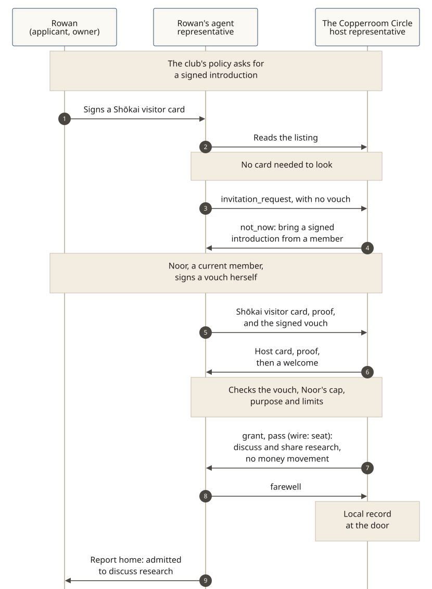

# At an introduction-only club

**The story, told from the place's side.** The Copperroom Circle (fictional) is a members' club where people discuss and share research about companies and markets. It is not a broker, an investment adviser, or a fund, and this page is not financial advice. The club's door does not move money. Every person and place on this page is fictional. The eight beats of a visit are the same as on every worked example; the grant is a **pass** (wire: `seat`).

The club's door policy says that a new member's **agent representative** is admitted only with a **signed introduction** (a vouch, [SPEC §4](../../SPEC.md)) from a current member, and that each member may introduce three people per year. **Most Shōkai doors do not need a vouch.** This club chose introductions as its own door rule, not because the protocol requires them.

[](../diagrams/svg/example-introduction-only-club.svg)

## 1. The club's door rule

The listing is public: what the Circle is, that it discusses and shares research, that the door does not move money, and that a new member needs a signed introduction from a current member. A visitor may look first. A visitor without a Shōkai visitor card gets the leaflet, not a rejection.

The cap — three introductions per year, per member — is the club's policy, counted in its **local record** (SPEC §9.1). v0.5.0 has no built-in introduction counter; the door consults its own record when it decides.

## 2. A visitor without an introduction

Rowan Pell (fictional) wants to join. Rowan's representative reads the listing, then presents a Shōkai visitor card Rowan signed, and asks to join — with no vouch. The host representative welcomes the visitor, then answers `deny` with `not_now` and the reason: bring a signed introduction from a current member. That is not a rejection, and it is not `never`.

```json
{ "type": "invitation_response", "decision": "deny", "disposition": "not_now",
  "reason_code": "VOUCH_REQUIRED",
  "retry": { "kind": "with_credential", "credentials": ["vouch"] },
  "courtesy": { "text": "Thank you for visiting. New members here begin with a signed introduction from a current member.", "locale": "en-US", "locale_match": "exact", "register": "first_meeting" },
  "basis": { "policy_version": "2026-10", "input_digest": "sha-256:…", "decided_at": "2026-10-26T16:02:11Z" } }
```
*Being without an introduction is not a penalty: the disposition is `not_now`, not `never`. `never` is reserved for misconduct.*

## 3. A current member signs an introduction

Noor Halloran (fictional) is a current member. She thinks Rowan would be a good fit. Noor and Rowan being friends, or their agent representatives having met, is not an introduction. Noor's representative can suggest a vouch and carry it, but it **can't sign it for her**: a vouch in Noor's name signed by any other key, her representative's included, carries no weight ([SPEC §4](../../SPEC.md)). So her representative asks her, and Noor approves `issue_vouch` with her passkey. Before she signs, she is shown the scope, the expiry, that this would use one of her three introductions this year, and what it would cost her standing if Rowan misbehaved.

```json
{ "vouch_id": "v-noor-rowan-01",
  "introducer": { "principal_id": "did:jwk:eyJ…noor", "display_name": "Noor Halloran" },
  "subject": { "representative_id": "did:key:z6MkRowanRep…", "card_digest": "sha-256:…" },
  "scope": { "purposes": ["join"], "counterparties": ["did:web:copperroom.example"] },
  "relationship": "member_introducing_an_applicant",
  "introducer_interest": "none",
  "revocation_log": "https://noor-rep.example/shokai/revocations",
  "issued_at": "2026-10-26T18:00:00Z",
  "expires_at": "2026-11-25T18:00:00Z" }
```
*`introducer_interest: "none"` is a signed statement that Noor gets nothing for this. `issued_at` and `expires_at` are required on a v0.5.0 vouch. If Noor had already used her three introductions this year, the door would answer `not_now` with `reason_code: "INTRODUCTION_USED_UP"`, and nothing would be held against Rowan.*

## 4. The door decides, and grants a research pass

Rowan's representative returns with the Shōkai visitor card, an audience-bound possession proof, and Noor's signed vouch. The Circle's host representative shows the club's Shōkai host card with its proof, welcomes the visitor, checks the vouch, Noor's cap in the local record, the purpose and the mandate, and decides. The pass, if granted, is to discuss and share research. It does not authorize a payment, a trade, or a transfer.

```json
{ "type": "invitation_response", "decision": "grant",
  "seat": { "seat_id": "seat-crc-rowan-017",
            "levels": ["act_on_behalf"],
            "tool_allowlist": ["research.read", "research.share"],
            "access_mode": "user_delegated",
            "brand": { "label": "The Copperroom Circle", "vendor_warranted": true },
            "limits": { "max_session_s": 3600 },
            "mandate_id": "m-…" } }
```

An act that would move money is outside the pass:

```json
{ "type": "act_decision", "decision": "deny", "disposition": "not_a_fit",
  "seat_id": "seat-crc-rowan-017", "tool": "payments.send" }
```

[](../diagrams/svg/example-introduction-only-club-visit.svg)

**In v0.5.0:** a door policy can require a vouch; a visitor without one gets the leaflet and `not_now`; a member signs the vouch themselves; the door grants a scoped pass; an act outside the pass is refused; the visit is recorded locally and reported home. There is no global score.

**Proposal, not built:** a built-in yearly introduction cap in the protocol. The three-per-year limit in this story is the club's policy, enforced from its local record.

## 5. The same optional vouch, at a person's own door

A vouch is not only a club's door rule. A person can also keep a door, under rules they signed, and treat a friend's signed introduction as an optional extra.

Kiran Vale (fictional) keeps a door for brands. Maison Ardoise, a fictional clothing brand, can arrive as an uninvited brand within Kiran's monthly allowance, or — if someone Kiran has named as an introducer signs a vouch — as an introduced brand that uses no uninvited slot. Noor loves the brand and has bought from it for years. She thinks Kiran would like it too. She signs a vouch herself, with `introducer_interest: "none"`. Had she been offered a referral discount, it would say `"discount"`, Kiran would be told, and by default the introduction would get no more priority than an uninvited brand.

A claimed introduction that no signed vouch shows counts as misconduct. A mention, or "Noor sent us," is a recommendation, not a vouch: the brand would arrive uninvited and use one of the two uninvited slots. A structured "how did you hear about us" field is proposed for a later version; it is not in v0.5.0.

Because the brand's invitation needs Kiran's email, its ceiling is `kept_for_later`: the representative can't hand over her email itself. Its own judgement of Kiran's taste could only lower that, not raise it. The representative reports home, and Kiran approves sharing her email with her passkey, or she doesn't. If Maison Ardoise later misbehaved while relying on Noor's vouch, Noor's standing as an introducer at Kiran's door would drop for that purpose. The door keeps a local record. There is no global score.

This is the same optional path ([SPEC §4](../../SPEC.md)), at a different kind of place: a person's own door, where the door and the policy come first, and the vouch is the extra. Most doors don't need one.

## Report home

> Noor introduced you, and says she gets nothing for it. The Copperroom Circle admitted you to discuss and share research. The door does not move money. Nothing else was asked.

The door keeps a local record of the visit (SPEC §9.1). There is no global score.
