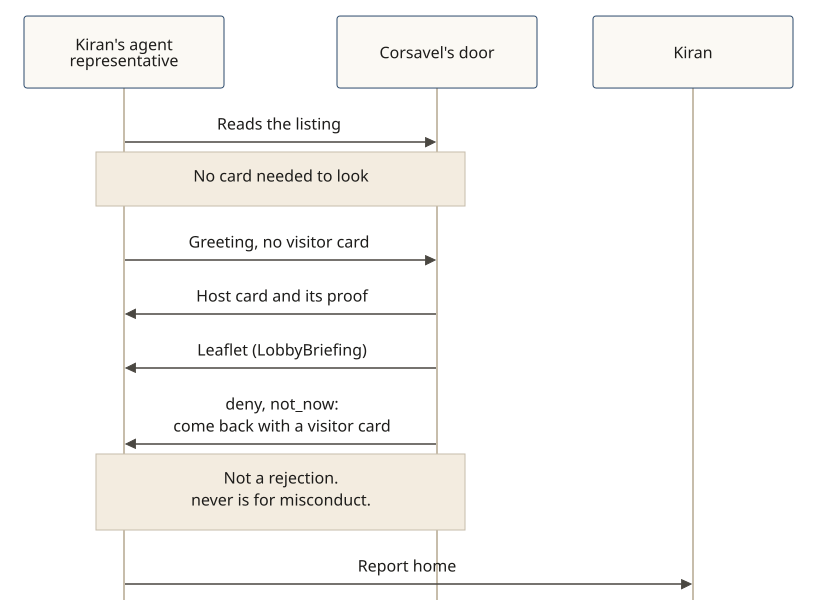

# A leaflet isn't a rejection

**In v0.5.0.** When an agent representative arrives without a Shōkai visitor card, the door does not ignore it, and it does not answer `never`. It explains itself and asks the visitor to come back prepared.

**The story:** Kiran asks her agent representative to see whether Corsavel (a fictional luggage store) is worth a proper visit. The representative reads the public listing first, then greets without a Shōkai visitor card.

The door answers in this order ([SPEC §3.3](../../SPEC.md)):

1. Its own signed greeting, and its Shōkai host card with a possession proof, so the visitor can check who keeps the door.
2. The leaflet (`LobbyBriefing`): what the place is, how it works, an onboarding link, and the actions it serves, in plain sentences the representative can show Kiran as a quote from the place.
3. A polite `deny` / `not_now`, with readiness items (here, a signed Shōkai visitor card to shop) and a retry that names the fix (`with_credential` / `signed_card`).
4. A farewell.

Being unprepared is not a penalty and not a rejection. The disposition is `not_now`, not `never`. Nothing is held against the visitor. `never` is reserved for misconduct. The representative reports home, and may ask Kiran whether to set up a visitor card.

The longer place story, with the listing and the leaflet snippets, is [Look before you join](./look-before-you-join.md).
