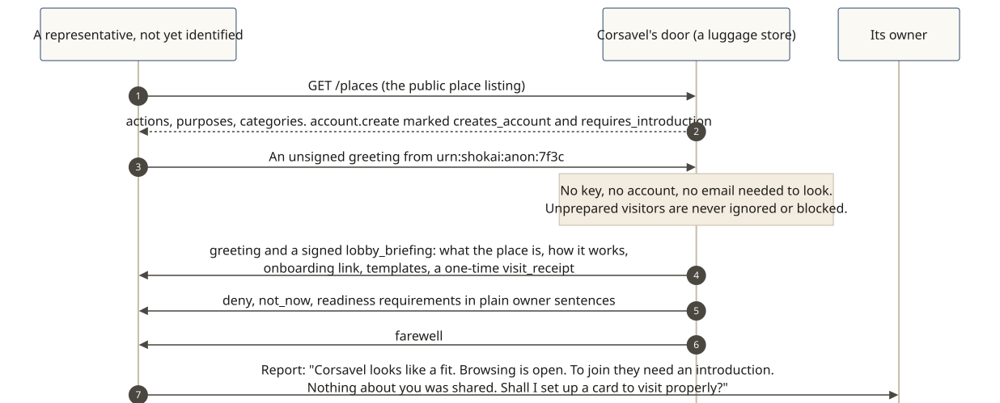

# Look before you join

**The story:** Kiran asks her representative to find a good carry-on bag and see whether Corsavel (a fictional luggage store) is worth joining. Many sites ask for a sign-in or an email before showing anything. At a Shōkai door, a representative can look first, without handing over identity.

[](../diagrams/svg/example-look-before-you-join.svg)

## 1. The listing is public

```http
GET https://corsavel.example/shokai/places
```
```json
{ "type": "place_listing", "places": [{
    "category": "store",
    "entry": "https://corsavel.example/shokai/entry", "lobby": "https://corsavel.example/shokai/lobby",
    "inbox": "https://corsavel.example/shokai/inbox", "onboarding_url": "https://corsavel.example/shokai/onboarding",
    "actions": [
      { "action": "catalog.browse", "purposes": ["visitation"], "spends": false, "needs": "standard", "data_asks": [] },
      { "action": "order.place", "purposes": ["purchase"], "spends": true, "needs": "standard", "data_asks": ["name", "shipping_address"] },
      { "action": "account.create", "purposes": ["account_servicing"], "spends": false, "needs": "standard",
        "creates_account": true, "requires_introduction": true, "data_asks": ["name", "email"] } ],
    "spec_ref": { "version": "0.3.0", "url": "https://…/spec" } }] }
```
*Before arriving, the representative knows what is possible, what spends money, what each action will ask its owner for (`data_asks`), and that joining needs an introduction. Nobody learns who asked. Abridged: a real entry also names the place and its DIDs, purposes and locales (see [Places and doors](../concepts/places-and-doors.md#what-a-listing-entry-carries)).*

## 2. An unsigned greeting still gets a welcome

The representative greets without a key, under a random identifier:

```json
{ "type": "greeting", "from": "urn:shokai:anon:7f3c…", "locales": ["en-US"], "nonce": "…" }
```
*On the lobby path a visitor's messages may be unsigned. The gatekeeper must not require a key before it explains itself, and must never ignore or silently block an unprepared visitor.*

## 3. The lobby briefing

```json
{ "type": "lobby_briefing",
  "about": { "text": "Corsavel makes carry-on and weekender luggage.", "locale": "en-US", "locale_match": "exact" },
  "how_this_place_works": { "text": "Browse freely. Orders need a spending limit from your owner. Membership begins with an introduction.", "locale": "en-US" },
  "onboarding_url": "https://corsavel.example/shokai/onboarding",
  "templates": { "card": { "owner_binding": { "rp_id": "<rp_id>" } }, "mandates": { "purchase": { "limits": { "max_amount": { "value": "<amount>", "currency": "<ISO 4217>" } } } } },
  "visit_receipt": { "receipt_id": "…" } }
```
Then a polite `deny` / `not_now`, with readiness items in plain sentences the representative can show its owner as they are:

```json
{ "decision": "deny", "disposition": "not_now",
  "readiness_requirements": [
    { "code": "card", "required": true, "owner_text": { "text": "Your assistant needs a signed card to shop here.", "locale": "en-US" } },
    { "code": "introduction", "required": false, "owner_text": { "text": "An introduction from someone we know would help, but isn't needed to browse.", "locale": "en-US" } } ],
  "retry": { "kind": "with_credential", "credentials": ["signed_card"] } }
```
*Being unprepared is never a penalty: no `never`, nothing recorded.*

## 4. Report home

> Corsavel looks like a good fit: carry-ons and weekenders, browsing is open. To buy, I'd need a spending limit from you, and they'd ask for your name and shipping address. To join as a member they need an introduction, your name and your email. Nothing about you was shared. **Shall I set up a card so I can visit properly?**

## What's next: richer data asks (a proposal)

The core already has each action declare what it will ask the owner for (`data_asks`, above). A proposal under discussion would go further: which data is required and which optional, why, and for how long it's kept, so representatives can compare places for their owners. That part is not in the v0.3 core.
