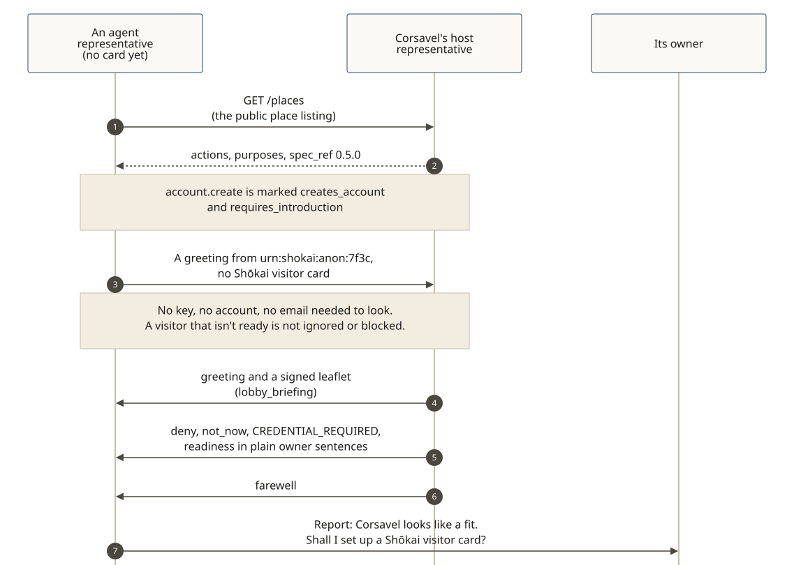

# Look before you join

**The story:** Kiran asks her agent representative to find a good carry-on bag and see whether Corsavel (a fictional luggage store) is worth joining. Many sites ask for a sign-in or an email before showing anything. At a Shōkai door, an agent representative can look first, without handing over a Shōkai visitor card.

[](../diagrams/svg/example-look-before-you-join.svg)

## 1. The listing is public

```http
GET https://corsavel.example/shokai/places
```
```json
{ "type": "place_listing", "protocol": "shokai/0.5",
  "door": "https://corsavel.example/shokai",
  "published_at": "2026-10-20T09:00:00Z",
  "places": [{
    "name": "corsavel",
    "display_name": "Corsavel",
    "principal_id": "did:web:corsavel.example",
    "representative_id": "did:key:z6MkCorsavelHost…",
    "category": "store",
    "entry": "https://corsavel.example/shokai/entry",
    "lobby": "https://corsavel.example/shokai/lobby",
    "inbox": "https://corsavel.example/shokai/inbox",
    "onboarding_url": "https://corsavel.example/shokai/onboarding",
    "locales": ["en-US"],
    "purposes": [{ "code": "visitation", "statement": { "text": "Browse the catalog.", "locale": "en-US" } }],
    "actions": [
      { "action": "catalog.browse", "purposes": ["visitation"], "spends": false, "needs": "standard", "data_asks": [] },
      { "action": "order.place", "purposes": ["purchase"], "spends": true, "needs": "standard", "data_asks": ["name", "address"] },
      { "action": "account.create", "purposes": ["account_servicing"], "spends": false, "needs": "standard",
        "creates_account": true, "requires_introduction": true, "data_asks": ["name", "email"] } ],
    "spec_ref": { "version": "0.5.0", "url": "https://shokaiprotocol.com/spec/" } }] }
```
*Before arriving, the agent representative knows what is possible, what spends money, what each action will ask its owner for (`data_asks`), and that this place's policy asks for an introduction before it creates an account (optional in v0.5.0, SPEC §4). Nobody learns who asked. Abridged: a real entry also names house_digest when a Shōkai host card is used (see [Places and doors](../concepts/places-and-doors.md#what-a-listing-entry-carries)).*

## 2. A greeting without a card still gets an answer

The agent representative greets without a Shōkai visitor card, under a random identifier:

```json
{ "type": "greeting", "from": "urn:shokai:anon:7f3c…", "locales": ["en-US"], "nonce": "…" }
```
*On the lobby path a visitor's messages may be unsigned. The host representative must not require a key before it explains itself, and does not ignore or silently block a visitor that isn't ready.*

## 3. The leaflet

This is the leaflet (`lobby_briefing`): not a rejection, an ask to return prepared.

```json
{ "type": "lobby_briefing",
  "about": { "text": "Corsavel makes carry-on and weekender luggage.", "locale": "en-US", "locale_match": "exact", "register": "first_meeting" },
  "how_this_place_works": { "text": "Browse freely. Orders need a spending limit from your owner. Membership begins with an introduction.", "locale": "en-US" },
  "onboarding_url": "https://corsavel.example/shokai/onboarding",
  "inbox": "https://corsavel.example/shokai/inbox",
  "spec_ref": { "version": "0.5.0", "url": "https://shokaiprotocol.com/spec/" },
  "templates": { "card": { "owner_binding": { "rp_id": "<rp_id>" } }, "mandates": { "purchase": { "limits": { "max_amount": { "value": "<amount>", "currency": "<ISO 4217>" } } } } },
  "visit_receipt": { "receipt_id": "…", "nonce": "…", "issued_at": "2026-10-26T16:01:00Z", "expires_at": "2026-11-02T16:01:00Z", "handling": "bearer_secret" } }
```
Then a polite `deny` / `not_now`, with readiness items in plain sentences the agent representative can show its owner as they are:

```json
{ "type": "invitation_response", "decision": "deny", "disposition": "not_now",
  "reason_code": "CREDENTIAL_REQUIRED",
  "readiness_requirements": [
    { "code": "card", "required": true,
      "detail": { "text": "A signed Shōkai visitor card is required to shop.", "locale": "en-US" },
      "owner_text": { "text": "Your assistant needs a signed card to shop here.", "locale": "en-US" } },
    { "code": "introduction", "required": false,
      "detail": { "text": "An introduction is helpful for membership, not required to browse.", "locale": "en-US" },
      "owner_text": { "text": "An introduction from someone we know would help, but isn't needed to browse.", "locale": "en-US" } } ],
  "retry": { "kind": "with_credential", "credentials": ["signed_card"] } }
```
*Being unprepared is not a penalty: the disposition is `not_now`, not `never`, and nothing is held against the visitor. `never` is reserved for misconduct or a policy trust violation.*

## 4. Report home

> Corsavel looks like a good fit: carry-ons and weekenders, browsing is open. To buy, I'd need a spending limit from you, and they'd ask for your name and address. To join as a member this place asks for an introduction, your name and your email. Nothing about you was shared. **Shall I set up a Shōkai visitor card so I can visit properly?**

## What's next: richer data asks (a proposal)

The core already has each action declare what it will ask the owner for (`data_asks`, above). A proposal under discussion would go further: which data is required and which optional, why, and for how long it's kept, so agent representatives can compare places for their owners. That further part is still a proposal; it is not in v0.5.0.
