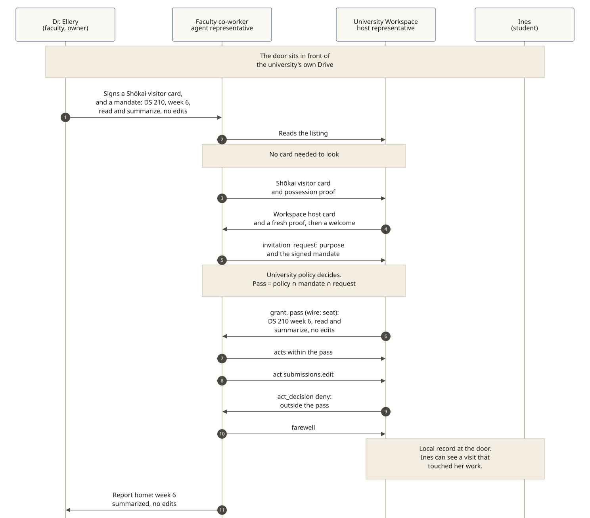

# An online university: three doors a campus would set

**Non-normative, written for v0.5.0.** This page is from the **place's side**: how an online university would set the doors that matter once faculty and students have agent representatives. The specification decides; where this page and the spec disagree, the spec wins.

**The story:** Sorawick Online University (fictional) teaches a fifteen-week online course, DS 210, Data and Society. Dr. Hana Ellery (fictional) teaches it, with Prof. Oren Calloway (fictional). Ines Marlow (fictional) is an enrolled student. The university provides a Workspace — a Drive under university credentials — where students submit weekly work. Every name here is fictional. No real university, course, faculty member, student, or product is described.

Faculty now have co-worker agents that can help design a course, operate it, and read what students submit. Students should have a representative of their own from enrollment, and keep using it. The university's job is to put a **Shōkai door** in front of each resource it is responsible for, so a visit is visible, scoped, and recorded.

The visits themselves follow the eight beats: the **window** (the listing, and the leaflet for a visitor without a card), **cards and proofs**, **welcome**, **purpose and signed limits**, **decide**, **pass** (wire: `seat`), **acts checked**, and **report home** with a **local record**.

**What v0.5.0 already gives, and what it does not.** Shōkai already has Shōkai visitor and host cards, audience-bound possession proofs, signed mandates, a pass (wire: `seat`), local records, and a customer link for a place that already knows someone ([SPEC §5.4](../../SPEC.md), the institutions extension). A connector that binds a door to a particular Workspace or Drive is **not built**. Where this draft talks about the university's Workspace door, the door sits in front of the university's own Drive; wiring that door to a vendor's Workspace product is a proposal, not something the 0.5 release ships.

## Three doors the university sets

[](../diagrams/svg/example-university-three-doors.svg)

A campus door for admissions and the registrar still sits at the front: a visiting representative with no Shōkai visitor card gets the leaflet, not a rejection; a prospective student can read the window and, with a card, may receive a narrow pass to look, ask and apply; enrollment may use the university's own signed offer of admission (optional in v0.5.0, SPEC §4). This page's focus is the three doors below, which is where weekly teaching actually happens.

## 1. The university's Workspace door

Students submit weekly work, through a fifteen-week term, into a Drive the university provides under its own credentials. That Workspace is the university's, not each student's private store. **Without a door**, a faculty member — or a co-worker agent acting for them — can be given access to those folders, sweep them at speed, and bring back a synthesis. The store does not, by itself, say whose agent came, for which course and week, or that they may summarize and not edit. The student whose work was read may not know that an agent visited at all.

**With a door in front of the university's Drive**, that visit becomes visible and scoped. The university owns and operates one Workspace door. It signs the Shōkai host card and sets the door policy. Students are not the owners of this door. They are the **subjects of the record**: university policy is that every visit that touches a student's work is recorded at the door and is visible to that student.

The door sits in front of the resource. A Drive (or other Workspace) integration is not built in v0.5.0; this is how the university would place a Shōkai door in front of its own Drive, not a claim that 0.5 already wires one to a vendor's product.

Each week, Dr. Ellery's co-worker agent visits as her **visiting representative**, with the **Shōkai visitor card** she signed and a mandate she signed for that errand — scoped to one course, one week, read-only, summarize only. For example: "read DS 210 week 6 submissions, summarize, no edits." The university already knows her as faculty, so the door may also ask for a **customer link** made in its own staff channel ([SPEC §5.4](../../SPEC.md)). The Workspace host representative checks the card and the audience-bound possession proof, shows the Workspace host card with its own proof, welcomes the visitor, and decides. The pass is *policy ∩ mandate ∩ request* (SPEC §7.1): the university's door policy, what Dr. Ellery signed, and what this visit asked for.

[](../diagrams/svg/example-university-workspace-door.svg)

```json
{ "type": "invitation_request",
  "card_digest": "sha-256:…",
  "mandate": { "payload": { "purpose": { "code": "data_access", "statement": "Read DS 210 week 6 submissions, summarize, no edits", "locale": "en-US" },
                            "allowed_actions": ["submissions.read", "submissions.summarize"] } },
  "proposal": { "request": { "actions": ["submissions.read", "submissions.summarize"] }, "etiquette_register": "established",
                "value_to_counterparty": { "text": "Weekly review of DS 210 week 6 submissions.", "locale": "en-US" } } }
```

```json
{ "type": "invitation_response", "decision": "grant",
  "seat": { "seat_id": "seat-sw-ws-ellery-w6-01", "levels": ["act_on_behalf"],
            "tool_allowlist": ["submissions.read", "submissions.summarize"],
            "access_mode": "user_delegated",
            "brand": { "label": "Sorawick Workspace", "vendor_warranted": true } } }
```

A request to edit is outside the pass. The Workspace host representative refuses it with a reason:

```json
{ "type": "act_decision", "decision": "deny", "disposition": "not_a_fit",
  "seat_id": "seat-sw-ws-ellery-w6-01", "tool": "submissions.edit" }
```

The visiting representative reports home to Dr. Ellery (a synthesis of week 6, rendered from machine fields, SPEC §8.2). The Workspace door keeps a **local record** of the visit (SPEC §9.1). Because the visit touched Ines's work, university policy makes that record visible to Ines: she can see who visited, for what purpose, and what was granted or refused. There is no global score.

The same contrast holds for every week of the term: institutional folder access under university credentials can be invisible and unscoped; a door in front of the university's Drive makes the faculty agent a named visitor with a signed limit, and the student a visible subject of the record.

## 2. The course door

DS 210 has its own door, in front of the course's materials, questions and guidance. Dr. Ellery's co-worker agent — the same agent that helped design and produce the course — now **operates it as the course's host representative**. That is how this campus would run an agentic course: the agent that built the materials is the agent that keeps the door. Dr. Ellery and Prof. Calloway set the course policy and sign the course Shōkai host card; they do not leave decisions the policy does not cover to the agent alone.

This is a **curated door**. Ines is already enrolled, so the university can ask for a **customer link** ([SPEC §5.4](../../SPEC.md)), made in its own enrollment channel — not from a self-declared "I am a student here." The link is signed by the university's principal key and by Ines's passkey. The course door checks it on visits that need it. When enrollment ends, the university ends the link.

```json
{ "link_id": "cl-ines-ds210-01",
  "place": "did:web:ds210.sorawick.example",
  "owner_id": "did:jwk:eyJ…ines",
  "rp_id": "owners.sorawick.example",
  "scope": { "actions": ["course.materials.read", "assignment.submit", "grades.view_own", "course.ask"] },
  "issued_at": "2026-09-01T12:00:00Z",
  "expires_at": "2027-06-01T12:00:00Z",
  "shown_to_owner": { "text": "Link your agent representative to your DS 210 enrollment for materials, submissions, your own grades and course questions.", "locale": "en-US" } }
```

Ines's **agent representative** arrives with the **Shōkai visitor card** she signed and an audience-bound possession proof. The course host representative shows the course Shōkai host card with its proof, welcomes the visitor, and decides. The pass is again *policy ∩ mandate ∩ request*:

```json
{ "type": "invitation_response", "decision": "grant",
  "seat": { "seat_id": "seat-ds210-ines-01", "levels": ["act_on_behalf"],
            "tool_allowlist": ["course.materials.read", "assignment.submit", "grades.view_own", "course.ask"],
            "access_mode": "user_delegated",
            "brand": { "label": "DS 210: Data and Society", "vendor_warranted": true },
            "mandate_id": "m-…" } }
```

| In the pass | Not in the pass |
|---|---|
| Course materials | Other students' records, grades and submissions |
| Submitting her own assignments | The class roster |
| Her own grades | Grading tools (faculty and staff use their own doors) |
| Questions and guidance within course policy | Anything Ines didn't sign for |

A request for `grades.view_all` is refused with a reason (`act_decision` `deny`, `not_a_fit`). A question the pass does not cover, such as asking for an extension, can be answered `considering`: taken inside to Dr. Ellery, with a date for the answer (SPEC §6.8). The course-operating agent does not decide that alone.

Throughout the term, Ines's representative can come back for materials, submit work, and ask for guidance, always within the pass. The course door records each visit locally. Ines's representative reports home.

**Optional (SPEC §4):** a shared study room, or a classmate's vouch to enter one, is not required for the course door or the Workspace door to function, and it is not the way this campus admits students to the course.

## 3. Onboarding: each student gets a representative of their own

The most lasting thing the university can set up is making sure each student has an **agent representative** and a **Shōkai visitor card** at enrollment, practices with it all term, and can take it to other doors afterwards.

A student comes with a representative in one of two ways:

- **Bring your own.** Ines already has a representative agent. She signs its Shōkai visitor card once with her passkey, on her own device. The signing key stays with her, not on an agent server.
- **Make one here.** Tomas Reyna (fictional), a classmate, has no agent yet. The university's enrollment setup creates a representative for him. It is still **his**: he signs its Shōkai visitor card with his own passkey, the card names him as the owner, and he can withdraw it or take it with him. The university hosts the setup; it does not sign for him.

From week 1, that representative is what the student uses at the course door, and later at other course doors, at the campus door, or at doors outside the university. By the end of the term it is a practiced habit, not a new tool they meet at the last assignment. Each place still decides under its own policy. The Workspace door remains the university's; the student's representative is not its host.

A visiting representative that arrives at the campus or course door without a Shōkai visitor card is not ignored: it receives the leaflet (what the place is, what is needed, a plain sentence for its owner) and a kind `not_now`. That is not a rejection (SPEC §3.3).

## Proposal: badges that open doors

**Proposal, not built in v0.5.0.** Universities issue credentials and badges. [Open Badges 3.0](https://standards.1edtech.org/open-badges/specifications/standards/v3p0) is a 1EdTech standard, built on the [W3C Verifiable Credentials Data Model](https://www.w3.org/TR/vc-data-model-2.0/). Shōkai v0.5.0 does not read Open Badges. The closest piece already in the protocol is an optional vouch ([SPEC §4](../../SPEC.md)): a signed introduction, which is not an achievement credential.

Ines earns a "Data Ethics, gold" badge. Her agent representative can carry it. A door whose policy asks for that badge — an advanced lab, or a scholarship desk — may grant a wider pass when the badge is presented and checks out.

The **Shōkai visitor card is not upgraded.** It still says who she is and who stands behind the representative. Badges are separate signed proofs, presented alongside the card when a door asks for them. Each door decides what a badge is worth. The student chooses what to show — the minimum the door asked for — so no door sees her whole record. There is no global score.

## Faculty and staff doors

The university can put a door in front of faculty and staff tools the same way a company puts a door in front of internal MCP servers: roster, grading, and section administration sit behind a staff door. A faculty co-worker agent arrives on the faculty member's Shōkai visitor card, with a customer link made in the university's own staff channel ([SPEC §5.4](../../SPEC.md)). That door is how the course-operating agent reaches tools a student must not. It is the same protocol; it is not a third path for students.

Dr. Ellery can also send the same agent out, with the Shōkai visitor card she signed for going out, to a publisher or another campus service. The place she visits sees her going-out visitor card, not the course host card.

## Student data and no nudging

- **What the owner allowed.** A student's representative shares what the student signed for, and not more. It is loyal to the student (SPEC §1).
- **Declared up front.** Each campus and course action declares the personal data it will ask for (`data_asks`). A place shouldn't ask for undeclared data, and a representative takes an undeclared ask home rather than answer it (SPEC §3.1).
- **Other students stay private.** Another student's records are not in a student's pass. A visit that touches a student's work is recorded at the door that was visited, and university policy makes that record visible to the student it concerns.
- **No nudging.** A place's prose is not an input to a decision (SPEC §6.4). Instructions hidden in prose have no effect and are noted as manipulation (SPEC §6.5). At a person's own door, pressure the signed offer doesn't back is declined and reported (SPEC §10).
- **Nothing beyond the limits.** Anything beyond what the student signed goes home for the student to decide.

## Run it

The campus door, the course door, an optional study room, a publisher visit and a weekly collection at a coursework door are in one SDK run, with fresh keys and no network (owner keys are stand-ins for passkeys): [`examples/traces/university.mjs`](../../examples/traces/university.mjs). It checks the narrow prospective pass, enrollment with and without the university's signed offer, the course tools and a refused `grades.view_all`, the course's local record, the optional study room with and without a classmate's vouch, Dr. Ellery's one agent with more than one Shōkai card, and a protocol-level visit to a coursework door with a pass for that course folder only. The SDK test suite in `packages/shokai` includes these checks.

That run is the protocol walk. It does not implement a Drive or Workspace connector, and it does not itself design a course. In the run, the weekly collection is modeled as a door Ines's representative keeps for her own coursework folder. This page places that visit at one university-owned Workspace door instead, with students as the subjects of the record rather than the door's owners. Wiring the door to a vendor's Workspace remains a proposal.
