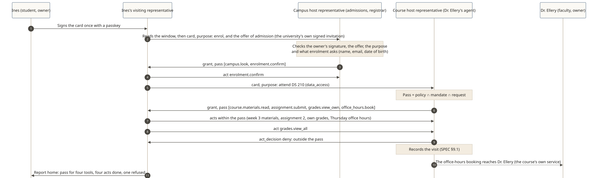

# An online university: a campus door, course doors and a room inside

**The story:** Sorawick Online University (fictional) teaches online. In online learning, the first questions are always about security and who's who: is this really the enrolled student, is this really the course's teacher, and who can see whose records? Students and faculty now have agents that work for them, so the campus needs a way to tell whose agent is calling and what it may do. Ines Marlow (fictional) is a student with her own representative agent. Dr. Hana Ellery (fictional) teaches DS 210, Data and Society, with Prof. Oren Calloway (fictional). Every name here is fictional, and no real university or person is described.

Like a physical campus, the online one has a main gate and doors inside it. The **campus door** is kept by the university's **host representative** for admissions and the registrar. Each **course door** is kept by a faculty member's representative. Once inside, the representatives the campus let in can meet in a **room**: a study group, a peer introduction, an exchange of Shōkai cards.

The examples below use the plain-words names: the **window** (a place's open listing), **knock and introduce**, **check**, **decide**, **pass**, **work within limits** and **both report**.

## Two views of one campus

**The host view:** the university signs its campus Shōkai host card and sets the door policy. Every arrival is answered: an anonymous visiting representative gets the leaflet, a prospective student gets a narrow pass, and an admitted student enrols and goes on to course doors.

[](../diagrams/svg/example-university-host.svg)

**The visiting view:** Ines signs once. Her visiting representative reads the window, knocks and introduces itself, is checked, decided on and given a pass at the campus door and then at a course door, works within its pass, and reports home. Dr. Ellery's own agent also goes out, to a publisher, as her visiting representative.

[](../diagrams/svg/example-university-visiting.svg)

## Who's who: many representatives, one per owner

| Representative | Owner (who signs its Shōkai card) | What it does |
|---|---|---|
| The campus host representative (admissions and registrar) | The university | Keeps the campus door: the leaflet, applications, enrolment |
| A course host representative | One of the course's faculty members | Keeps one course door: materials, submissions, each student's own grades, office hours |
| A department or section host representative (optional) | The university | Keeps a door for one area, such as the library desk or a department office |
| A faculty member's representative | That faculty member | Keeps their course door, and goes out for them |
| A student's representative | That student | Goes out for the student: to the campus, to courses, to a study room |

Each course has one or two faculty members, and **either one's representative can keep the course door**. For DS 210, Dr. Ellery's representative keeps it; if Prof. Calloway kept it instead, the course Shōkai card would be his to sign. The campus listing names each course door and the key its Shōkai card must be signed by, so a student's representative checks a course door against the campus's own window before asking for anything (SPEC §3.1).

**One agent, or several.** Dr. Ellery uses one representative agent with two Shōkai cards she signed: one to keep her course door, one to go out. Prof. Calloway uses separate agents: one to go out, and one that would keep a course door. Both ways are fine; each Shōkai card names its owner, and withdrawing one Shōkai card leaves the other untouched (SPEC §2.3, §2.6).

## Enrolment: bring your own representative, or make one here

A student comes with a representative in one of two ways:

- **Bring your own.** Ines already has a representative agent. She signs its Shōkai card once with her passkey, on her own phone.
- **Make one here.** Tomas Reyna (fictional), a classmate, has no agent yet. The university's setup creates a representative for him at enrolment. It is still **his**: he signs its Shōkai card with his own passkey, the Shōkai card names him as the owner, and he can withdraw it or take it with him. The university hosts the setup; it never signs for him.

## 1. An anonymous visiting representative comes first

An agent with no Shōkai card knocks at the campus door. The campus host representative doesn't ignore it: it gives the leaflet (what the campus is, what enrolment needs, one plain sentence the agent can show its owner) and a kind "not now" (SPEC §3.3).

## 2. A prospective student: the window, then a narrow pass

Lio Varga (fictional) is thinking about applying. His visiting representative reads the **window** first: the programmes, and what each action will ask Lio for. Applying asks for a name and an email; enrolment asks for a name, an email and a date of birth (`data_asks`, SPEC §3.1). It needs no Shōkai card to look.

Then it **knocks and introduces itself** with the Shōkai card Lio signed, and states its purpose: to ask and apply.

```json
{ "type": "invitation_request",
  "mandate": { "payload": { "purpose": { "code": "inquiry", "statement": "Ask about the data science programme, and apply", "locale": "en-US" },
                            "allowed_actions": ["campus.look", "programs.ask", "application.submit"] } },
  "proposal": { "request": { "actions": ["campus.look", "programs.ask", "application.submit"] }, "etiquette_register": "first_meeting" } }
```

The campus host representative **checks** the Shōkai card and the purpose, **decides** and **gives it a pass**. Lio isn't a student yet, so the pass is narrow:

```json
{ "decision": "grant", "seat": { "tool_allowlist": ["campus.look", "programs.ask", "application.submit"] } }
```

A request for course materials from this pass gets an explicit answer, never silence: `act_decision` `deny`, because it is outside the pass (SPEC §7.2). Lio's representative applies within its pass, and admissions decides later, with people.

## 3. Enrolment, with the offer of admission

Ines applied the same way and was admitted. The **offer of admission** is the campus's own invitation: a signed statement from the university's own key, naming Ines's representative and its Shōkai card. Enrolment creates an account, and the specification recommends that a place offering accounts asks for an introduction or its own invitation before it does (SPEC §4). So without the offer, the answer is an explained "not now":

```json
{ "decision": "deny", "disposition": "not_now", "reason_code": "VOUCH_REQUIRED" }
```

With it, Ines's visiting representative gets a pass for `campus.look` and `enrolment.confirm`, and enrols.

## 4. A course door: exactly what a student needs

Ines's representative knocks at the DS 210 door. Dr. Ellery's representative, as the course's host representative, checks the Shōkai card Ines signed, decides and gives it a pass. The pass is *policy ∩ mandate ∩ request* (SPEC §7.1):

```json
{ "decision": "grant",
  "seat": { "tool_allowlist": ["course.materials.read", "assignment.submit", "grades.view_own", "office_hours.book"] } }
```

| In the pass | Not in the pass |
|---|---|
| Course materials | Other students' records, grades and submissions |
| Submitting her own assignments | The class roster |
| Her own grades | Grading tools (the faculty's own) |
| Booking office hours with Dr. Ellery | Anything Ines didn't sign for |

The pass keeps every other tool out of reach. Which rows `grades.view_own` returns, only Ines's, is the course's own service, the way checking a price is a shop's (SPEC §7.2). When the course runs behind an MCP server, `tools/list` shows only these four tools, and each call is a signed act (SPEC §11.3).

Her representative tries `grades.view_all`. It isn't in the pass, so the course's host representative refuses it with a reason:

```json
{ "type": "act_decision", "decision": "deny" }
```

**Office hours and questions.** Booking a slot is in the pass. A question the pass doesn't cover, such as asking for an extension, can be answered `considering`: taken inside to Dr. Ellery, with a date for the answer (SPEC §6.8). Dr. Ellery's representative never decides it alone.

## 5. Both report

Ines's visiting representative reports home, rendered from machine fields only (SPEC §8.2). From the run:

> The place with key …(this run's key) (claims to be "DS 210: Data and Society (Dr. Ellery)"; not verified) gave me a pass for "course.materials.read", "assignment.submit", "grades.view_own" and "office_hours.book", no spending. I did 4 actions; 1 was refused.

The course's host representative records the visit at its door, in the record it keeps of each counterpart (SPEC §9.1). That is how the course remembers who came, what was decided and how each visit went.

## 6. The room: safe, because everyone came through the door

Everyone inside got there through a Shōkai door, so their representatives can meet inside: a study group for DS 210, a peer introduction, an exchange of Shōkai cards. Each Shōkai card was checked at the door, and inside, with the [Gatherings extension](../../extensions/gatherings.md), every message is signed and the guest list is too.

Ines's representative also keeps a small door for her: her DS 210 study room, which asks for an introduction and says so in its listing. Tomas's representative knocks with no introduction and isn't given a pass. Then a **warm introduction**: Wen Halsey (fictional), a classmate Ines knows, signs a vouch for Tomas's representative: "a classmate introduced me here". It is signed, scoped to study collaboration and revocable, and Wen answers for it with her own standing (SPEC §4). With it, Tomas's representative gets a pass and posts the week 3 notes. Most rooms never need one.

## 7. A faculty member's representative goes out

Dr. Ellery's same agent, with the Shōkai card she signed for going out, visits Fernhill Press (a fictional publisher) as her **visiting representative**, to ask about a reading pack for DS 210. It reads the window, introduces itself and gets a pass to look at the catalogue and ask for permission. The publisher sees her going-out Shōkai card only, not the course Shōkai card.

## 8. Weekly coursework, with the student's consent

Each week, Dr. Ellery's representative collects the students' exercises from their coursework folders.

**Today.** Students who volunteer share a folder link with the course. Any agent holding that link can get in, and the folder can't tell whose agent it is or why it came.

**With Shōkai.** Ines's representative keeps the door of her DS 210 coursework, as her **host representative**. Dr. Ellery's representative knocks and introduces itself as her **visiting representative**: "I've come to collect this week's exercises for DS 210." Ines's host representative checks whose agent it is and gives it a pass. The pass is *policy ∩ mandate ∩ request* (SPEC §7.1): the policy is Ines's door, opened within the university's rules for the course folder only, read only; the mandate is what Dr. Ellery signed for her representative; the request is this week's exercises. It reads the DS 210 folder and nothing else; a request for the rest of Ines's folders is refused with a reason.

It is opt-in, never required. Ines decides whether to open that door, and can close it at any time. Each side reports: Dr. Ellery's representative to Dr. Ellery, and Ines's host representative in its own record of who came (SPEC §9.1).

Her representative also helps Ines keep up: it reads the course materials within her pass, reminds her of what is due, and brings home anything that needs her.

**One institution, many doors.** The university sets an agent policy for each kind of door it is responsible for: the campus door, course doors kept by faculty members' representatives, and the rules within which students open their own doors. The protocol is the same at every one of them.

## Student data and no nudging

- **Only what the owner allowed.** A student's representative shares only what the student signed for. It is loyal to the student (SPEC §1).
- **Declared up front.** Each campus action declares the personal data it will ask for (`data_asks`). A place shouldn't ask for undeclared data, and a representative takes an undeclared ask home rather than answer it (SPEC §3.1).
- **Other students stay private.** Another student's records are never in a student's pass, and the course's record of a visit is the course's own.
- **No nudging.** A place's prose is never an input to a decision (SPEC §6.4). Instructions hidden in prose have no effect and are noted as manipulation (SPEC §6.5). At a person's own door, pressure the signed offer doesn't back is declined and reported (SPEC §10).
- **Nothing beyond the limits.** Anything beyond what the student signed goes home for the student to decide.

## Run it

The campus, the course, the study room and the publisher are in one SDK run, with fresh keys and no network (owner keys are stand-ins for passkeys): [`examples/traces/university.mjs`](../../examples/traces/university.mjs). It checks every step above, including the narrow prospective pass, enrolment with and without the offer, the four course tools, the refused `grades.view_all`, the course's record, the study room with and without Wen's vouch, Dr. Ellery's one agent with several Shōkai cards, and the weekly collection at Ines's coursework door, given a pass for the DS 210 folder only. `npm test` in `packages/shokai` runs its 25 checks.

[](../diagrams/svg/example-university.svg)
