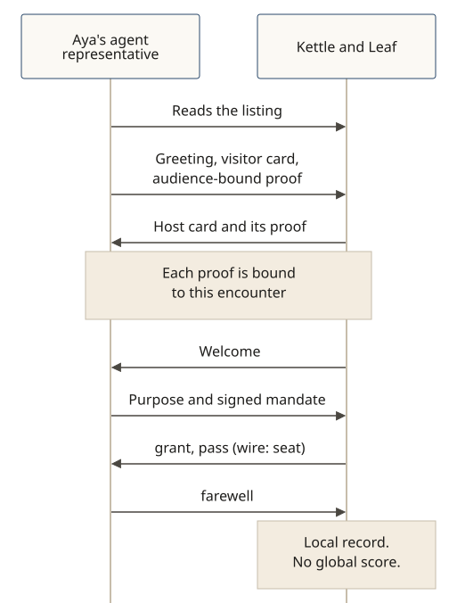

# Proofs both ways

**In v0.5.0.** A prepared visit checks more than a name on a card. The door checks the Shōkai visitor card and an audience-bound possession proof. The Shōkai host card is shown back with its own proof ([SPEC §2.4](../../SPEC.md)).

**The story:** Aya Linden (fictional) sends her agent representative to Kettle & Leaf, a fictional tea shop, to browse and, if she likes, to buy tea within a short mandate. Both sides show who they are before a pass is issued.

1. At the doorstep, the representative reads the listing. A visitor without a Shōkai visitor card would get the leaflet, not a rejection.
2. It greets with the visitor card Aya signed, and a possession proof bound to this encounter (the host's nonce), so a copied proof from another visit will not do.
3. The door answers with its Shōkai host card and a possession proof of its own, so Aya's representative can check that this is Kettle & Leaf's door, not a look-alike name.
4. The host representative welcomes the visitor. The visitor states its purpose and the signed mandate. The door decides, and a pass (wire: `seat`) is admission.
5. Acts in the pass are checked. The representative reports home, and the shop keeps a local record. There is no global score.

A name on either card is a claim, not identity (C199). What the proofs show is possession of the keys for this encounter. A brand that wants to tie its host card to a domain uses `did:web`, which is in v0.5.0; other account bindings are still a draft. See [Identity proofs](./identity-proofs.md).
