# Extensions

The core is complete on its own: **a door can be safe and courteous at its entrance with the core alone.** Everything else is an optional extension.

**The door and the room.** The core is the door: getting into a place. Gatherings and Peer meetings are the room: inside a place, the representatives it let in can meet, like people exchanging business cards at a gathering. The place signs the guest list and checks every card, and every message in the room is signed by whoever said it. Agents meet inside a place, never in the open.

## How extensions work

- Each extension is one short normative document with its **own conformance level**. An implementation claims "core" plus the extensions it implements, for the roles it plays.
- Extensions are **versioned with the core**. A change to the core that affects an extension bumps both.
- An extension adds rules only for its own messages, members and actions. **It never weakens a core rule**; where they seem to disagree, the core wins.
- Nothing was lost in the split: every rule from the earlier single document is in the core, in an extension, or marked informative, and every test still runs.

## The extensions

| Extension | Status | What it adds |
|---|---|---|
| **Gatherings** | stable | The room: a place inviting several representatives to one gathering, with a signed guest list, house rules, disclosure tiers and signed room items. |
| **Peer meetings** | stable | A room for two: two owners' representatives meeting in a pair place, seeded by an owner-to-owner invitation. |
| **Teaching visits** | experimental | A representative visiting to learn or teach, with the owner's approval of a lesson. |
| **Profiles and evidence** | stable | A richer principal profile (expertise, working style, taste) and fetched evidence with digests (the `evidenced` proof level). |
| **Seeking** | stable | A host publishing what it is looking for, so visitors can say which needs they address. |
| **Visit receipts** | stable | Linking an anonymous lobby visit to a later, identified one, only with a one-time receipt. |
| **Door gifts** | stable | Gifts at a person's door, claim tickets and gift caps. *"Never data for a gift" stays in the core.* |
| **Signed place listings** | experimental | A place signing its listing. |
| **Revocation status** | stable | How an allowance's status is published and re-signed, its one-hour lifetime and stapled statuses. *"A fetched revocation wins" stays in the core.* |
| **Meaning notes** | stable | Carrying meaning across languages and cultures, beyond the language-neutral core. |
| **W3C VC mapping** | experimental | Expressing cards, vouches and mandates as W3C Verifiable Credentials. |

**Stable** means the rules are settled for v0.3 and only fixes are expected. **Experimental** means the extension may change or be dropped after review; don't depend on it yet. Since the feature freeze (October 27, 2026), no new extensions or proposals enter the 0.3 line; they wait for v0.4.

Each extension is rendered with the specification: see [the extensions](../extensions/README.md).

## Conformance levels

An implementation claims **core** plus the extension levels it implements; each extension's slug is its document's name. [`conformance/homes.json`](../conformance/homes.json) maps every check to its level.

| Level | Slug | `shokai-conformance` |
|---|---|---|
| Core | `core` | Always runs: the listing and lobby, the ritual (including checking the place against its listing), seats, and the negative checks (a request before the card, a reused nonce, tampering after signing, a copied card). |
| Visit receipts | `visit-receipts` | `--ext visit-receipts` |
| Signed place listings | `signed-listings` | `--ext signed-listings` |
| Test vectors | (normative, Appendix B) | `--vectors`. Against a URL they run on the runner's own crypto; pass a module to test yours. |
| Gatherings, Peer meetings, Teaching visits, Profiles and evidence, Seeking, Door gifts, Revocation status, Meaning notes, W3C VC mapping | `gatherings`, `peer-meetings`, `teaching-visits`, `profiles-and-evidence`, `seeking`, `door-gifts`, `revocation-status`, `meaning-notes`, `vc-mapping` | Not in the runner yet; the reference implementation's suites test them. |

The runner is a door-side check of the core, not all of it: it can't see a door's internal decisions (determinism, conduct records, vouch weighting), which the reference suites test.

Discovery uses what is already on the wire (the actions a place lists, the messages it accepts). A general way to advertise extensions is planned with the next wire change.
