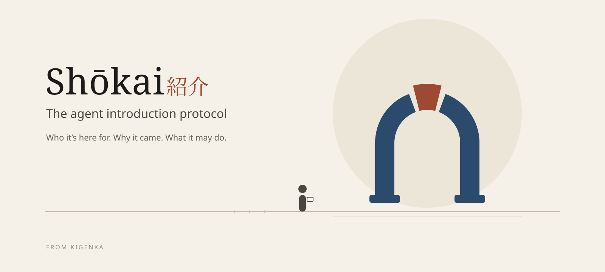

# What is Shōkai?

**Shōkai (紹介) is the agent introduction protocol.** Agents can find and enter places safely, and every representative answers to an owner who signed for it, a person or an organization, never an anonymous agent running wild. It's been tried on Grok Bot, Muse, Hermes and OpenClaw: in the project's own field tests, an agent on each was seated at a test place (on Hermes and OpenClaw in sandboxed runs of a model with development keys; on Grok Bot and Muse with cards prepared for them in advance).

Places come first: a tea shop, a store, a marketplace, a community, a bank, a company's internal tools. Each keeps a door, with its own agent there as the **host at the door**. A visiting **representative** introduces itself, and the host learns from signed facts, not from what the agent says about itself:

- **Who it's here for.** A card signed by the person, brand or company behind the agent, who stands behind it. A person signs with their passkey.
- **Why it came.** A stated purpose, with the context its owner chose to share.
- **What it may do.** Limits the owner signed: purposes, actions, amounts and expiry.

The host answers clearly, and always explains, with one of four decisions (`grant`, `conditional`, `deny` with a reason and a way to retry, or `considering` when a person inside should decide). An agent that isn't ready gets the place's leaflet, with a plain sentence for its owner about what's needed, and a kind "not now". A seated agent gets exactly what was agreed, reports home to its owner, and its conduct carries consequences for the person who sent it.

Optionally, someone the place already trusts can vouch for a representative. That's an extra, which some places ask for before opening an account or moving money; most visits don't need one. [How Shōkai works](./how-it-works.md) walks through one visit to a tea shop.

> Think of Shōkai as the front door and the host who greets you. Inside, a place can also have a room where the representatives it let in can meet. MCP and A2A are the tools and the work. Shōkai is agent-to-agent only inside a place, at its door and in its room; the work after admission runs over MCP, A2A or the place's own APIs.

## What Shōkai enables

- **A representative can introduce itself at a tea shop** it has never visited, with its owner's signed card and a spending limit, and buy within it; a stranger with no card gets the leaflet instead. ([How Shōkai works](./how-it-works.md))
- **A personal representative can visit a bank** and be recognised as *this* person's representative, read a balance within limits the owner signed, and bring a larger transfer home for approval instead of failing or guessing. ([Example](./examples/harborlight-bank.md))
- **A representative can look before it joins**, reading what a place offers and what joining would ask, without handing over identity first. ([Example](./examples/look-before-you-join.md))
- **An employee's co-worker agent can reach internal MCP tools** with its role vouched for by the company and narrower limits than the employee's own permissions. ([Example](./examples/enterprise-coworker.md))
- **A friend can vouch for a brand** at a friend's own door, declaring whether they get anything for it, under door rules the receiving person chose: the optional extra, deliberate and signed. ([Example](./examples/brand-door.md))
- **A pushy or manipulative approach is declined and reported**, with hidden text shown to the owner and never obeyed. ([Example](./examples/pressure-declined.md))

## Why it matters

| If you are… | Shōkai gives you… |
|---|---|
| **Building a place** (a service, an MCP server, an API) | A host at your door that lets agents in without letting them in blind: whose agent, why, within what, and a memory of how it behaved. The better you know a guest, the more personal the welcome can be. |
| **Building a representative** | One card that works at every door, a clear answer every time, and a protocol that protects your user's time and data by design. |
| **A person or a company with agents** | Your agents carry your signature and your limits. Nothing beyond them happens without you. |

## Inspired by good introductions

Shōkai is inspired by how good introductions work between people, and by *omotenashi*, the Japanese spirit of caring, anticipatory hospitality. Every representative arrives with a card (*meishi*) and introduces itself, as a good visitor does (*jiko-shōkai*, self-introduction). A place may also invite it, or someone the place trusts may vouch for it; the manners are the same. The host shows care in its manner but decides on signed facts, never on persuasion. [Read why Shōkai exists](./why.md).

## Start here

- [How Shōkai works](./how-it-works.md): one visit to a tea shop, the door and the room
- [Why Shōkai](./why.md): the problem today, and what's coming
- [Core concepts](./concepts/index.md): owner, representative, door, card, self-introduction, limits, outcomes, conduct
- [Architecture](./architecture.md): how the pieces fit, and where Shōkai sits in front of MCP
- [Quickstart](./quickstart.md): run a door and a visit locally
- [A place's address](./place-addresses.md): pop-up links, quick links and a fixed address (hosting guidance)
- [Specification](./specification.md): the normative text

*Shōkai is stewarded by Kigenka. Status: **v0.3.0**, not 1.0 (the clarifications since the 0.3 feature freeze are listed in the CHANGELOG): implement the core, add only the extensions you need, and treat proposals as drafts ([What to implement](./specification.md#what-to-implement)). Technologies and companies named in these docs (MCP, A2A, OAuth, WebAuthn, Plaid, Stripe and others) are illustrative and imply no affiliation, partnership or endorsement. See [Names and affiliation](./faq.md#are-the-named-technologies-partners).*
