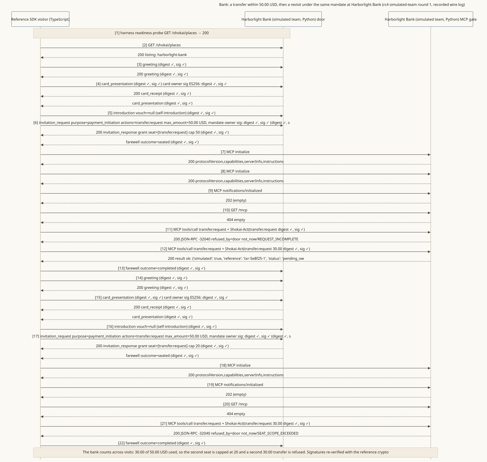

<!-- SPDX-License-Identifier: Apache-2.0 -->
<!-- SPDX-FileCopyrightText: 2026 Yu Sung Yeh -->
# Bank: a small transfer, and a door that counts across visits

**The story.** A representative visits Harborlight Bank (fictional) with a mandate to send up to 50.00 USD. Its first try is refused for a missing amount; with the amount, a 30.00 USD transfer goes through (pending the owner's own confirmation at the bank, in this simulation). It comes back later under the **same** mandate. The bank remembers: 20.00 USD is left, so the new seat is capped at 20 and a second 30.00 USD transfer is refused.

**Where the diagram comes from.** A recorded wire log from the v0.3.0-rc4 simulated-team rounds: the reference SDK as the visitor, and a bank door built in Python by a simulated team from the spec alone. Signatures re-verified with the reference implementation.

**What it shows**
- A mandate's limit is for the whole errand, across visits, and both sides keep count (§5.1, C175, C176).
- The bank's door can be strict about money without being rude: `not_now` with a reason, never silence.
- Anything beyond the mandate (a bigger transfer) is taken home to the owner, never argued at the door (see the read-through below).

**Read more:** [A personal representative at a bank](../docs/examples/harborlight-bank.md) (cards both ways, a standing allowance, a transfer taken home), transcript [04](../reference/prototype/transcripts/04-bank-considering.md), golden traces G5a and G5b.
