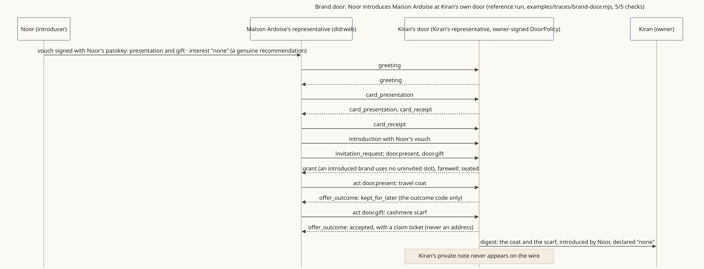

<!-- SPDX-License-Identifier: Apache-2.0 -->
<!-- SPDX-FileCopyrightText: 2026 Yu Sung Yeh -->
# Brand door: a friend introduces a brand at a person's own door

**The story.** Kiran Vale (fictional) has a door of her own, where brands may present things to her under rules she signed. Her friend Noor (fictional) loves Maison Ardoise (a fictional clothing brand) and chooses to introduce it, declaring that nobody paid her to. The brand's representative is seated, presents a travel coat (kept for Kiran's digest) and offers a scarf as a gift (accepted, as a claim ticket, never an address). The brand learns only those outcome codes.

**Where the diagram comes from.** A run of the reference implementation ([traces/brand-door.mjs](traces/brand-door.mjs)), mirroring its conformance scenario V29-D2, with fresh fictional keys; [traces/brand-door.trace.json](traces/brand-door.trace.json) lists every message in order (5/5 checks).

**What it shows**
- A person can be a place's principal: their representative keeps their door (§10).
- An introduction is deliberate and accountable, and says whether it was paid (§4).
- The brand never gets data for a gift, and learns the outcome only (§10, `no_data_for_gift`).

**Read more:** [A friend introduces a brand](../docs/examples/brand-door.md), [Pressure declined and reported](../docs/examples/pressure-declined.md).
