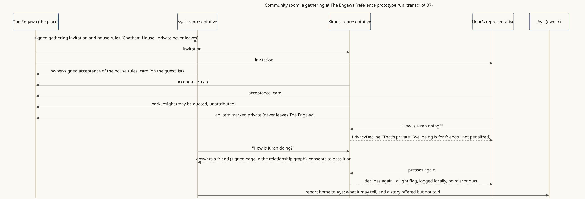

<!-- SPDX-License-Identifier: Apache-2.0 -->
<!-- SPDX-FileCopyrightText: 2026 Yu Sung Yeh -->
# Community room: representatives meet, and some things stay private

**The story.** The Engawa (fictional) invites three representatives to a gathering under house rules each owner signed: insights may leave the room unattributed, anything marked private never leaves. Kiran's representative shares a work insight. Noor's representative asks how Kiran is doing and is told, kindly, "that's private"; Aya's representative asks the same and gets an answer, because Aya is Kiran's friend. Noor's presses once more and gets a light flag, not a penalty. Aya's representative goes home with a report and a story it offers, but doesn't tell unasked.

**Where the diagram comes from.** A run of the reference prototype, every message signed and verified (passkeys simulated): [transcript 07](../reference/prototype/transcripts/07-gathering-at-the-engawa.md). The diagram follows that transcript step by step.

**What it shows**
- A place can be a room for representatives, not only a shop (the Gatherings extension).
- Owners decide what their representative may share and with whom; declining is never misconduct.
- Pressing after a "no" is noticed, locally and lightly (§9).

**Read more:** [places-first (g), the room](../scenarios/places-first.md#g-the-room-representatives-meeting-inside-a-place), [Gatherings](../extensions/gatherings.md).
