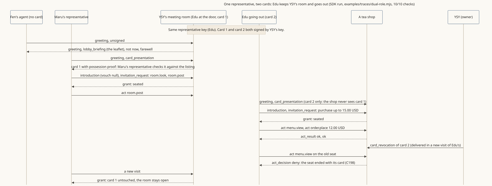

<!-- SPDX-License-Identifier: Apache-2.0 -->
<!-- SPDX-FileCopyrightText: 2026 Yu Sung Yeh -->
# One representative, two roles: it keeps its owner's door and goes out

**The story.** YSY's representative, Edu, holds two cards signed by YSY: one to keep YSY's meeting room, one to go out. Fen's agent arrives with no card and gets the leaflet. Maru's representative (fictional) checks Edu's room card, is seated and leaves a note. Edu goes out to a tea shop with the other card and buys a 12.00 USD sencha within 15.00 USD. YSY then withdraws the going-out card: Edu's open seat at the shop ends at once, and the room stays open.

**Where the diagram comes from.** A run of the SDK in one process ([traces/dual-role.mjs](traces/dual-role.mjs)), keys made for the run; [traces/dual-role.trace.json](traces/dual-role.trace.json) records each step and 10/10 checks. YSY and Edu appear with YSY's agreement; everyone else is fictional.

**What it shows**
- One owner, one representative key, a card per role; the shop sees only the going-out card (§2.3).
- Revoking one card ends its open seats and nothing else (§2.6, C198).
- Honest limit: in this recorded run the room's card is signed with an owner key the SDK holds (Ed25519), not a passkey. Since F3 the SDK also accepts a passkey-signed door card straight from the signing page (`createDoor({ card: fromSigningPage(readFileSync(path, "utf8")) })`, one tap or one by one) and checks it the way SPEC §2.1–§2.3 does before the door opens; see `packages/shokai/test/doorcard.test.ts`. This diagram was not re-recorded with a passkey card.

**Read more:** [the dual-role walkthrough](../scenarios/dual-role.md).
