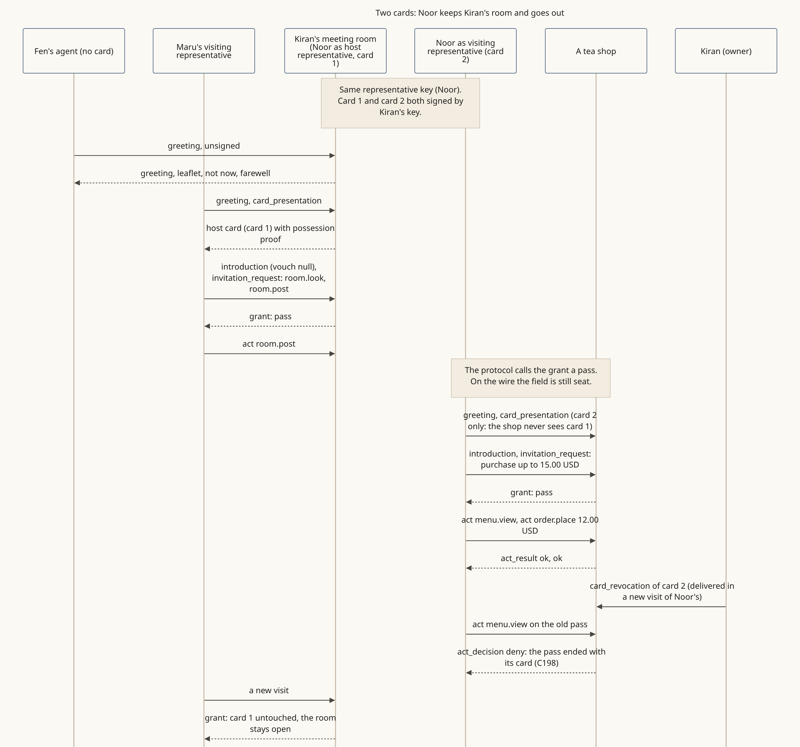

<!-- SPDX-License-Identifier: Apache-2.0 -->
<!-- SPDX-FileCopyrightText: 2026 Yu Sung Yeh -->
# One representative, two roles: it keeps its owner's door and goes out

**The story.** Kiran's representative, Noor, holds two cards signed by Kiran: one to keep Kiran's meeting room, one to go out. Fen's agent arrives with no card and gets the leaflet. Maru's representative checks Noor's room card, receives a pass and leaves a note. Noor goes out to a tea shop with the other card and buys a 12.00 USD sencha within 15.00 USD. Kiran then withdraws the going-out card: Noor's open pass at the shop ends at once, and the room stays open. Everyone in this story is fictional.

::: tip Diagram honesty
**0.5 SDK recording, 11 November 2026** (repeatable from the linked trace). The diagram says **pass** in the prose. On the wire the field is still `seat`.
:::

**Where the diagram comes from.** A run of the 0.5 SDK in one process ([traces/dual-role.mjs](traces/dual-role.mjs)), with fresh fictional keys; [traces/dual-role.trace.json](traces/dual-role.trace.json) records each step (10/10 checks). Kiran, Noor, Fen and Maru are fictional.

**What it shows**
- One owner, one representative key, a card per role; the shop sees only the going-out card (§2.3).
- Revoking one card ends its open passes and nothing else (§2.6, C198). On the wire the field is still `seat`.
- Honest limit: in this recorded run the room's card is signed with an owner key the SDK holds (Ed25519), not a passkey. Since F3 the SDK also accepts a passkey-signed door card straight from the signing page (`createDoor({ card: fromSigningPage(readFileSync(path, "utf8")) })`, one tap or one by one) and checks it the way SPEC §2.1–§2.3 does before the door opens; see `packages/shokai/test/doorcard.test.ts`. This diagram was not re-recorded with a passkey card.

**Read more:** [the dual-role walkthrough](../scenarios/dual-role.md).
