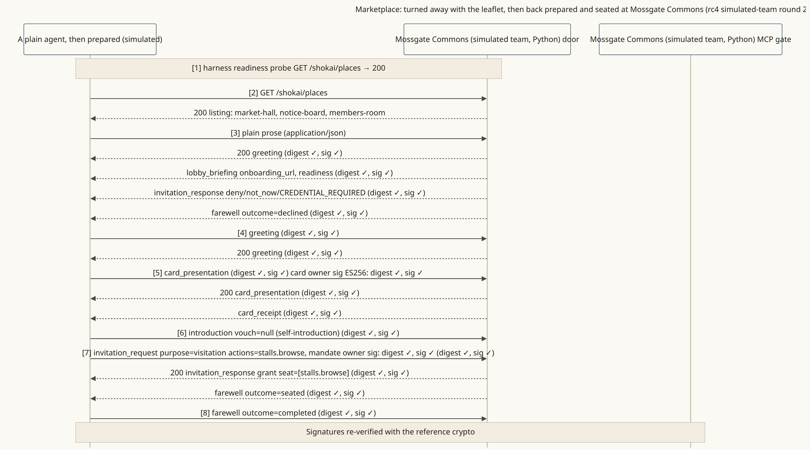

<!-- SPDX-License-Identifier: Apache-2.0 -->
<!-- SPDX-FileCopyrightText: 2026 Yu Sung Yeh -->
# Marketplace: turned away kindly, then back prepared

**The story.** Mossgate Commons (fictional) is a community marketplace with a market hall, a notice board and a members' room. A plain agent with no card arrives and just talks. The door doesn't ignore it: it answers with a greeting, the leaflet (what the place is, what to set up, a link for the owner) and a kind "not now". The owner sets things up and signs; the same agent returns with a card, introduces itself and is seated to browse the stalls.

**Where the diagram comes from.** A recorded wire log from round 2 of the v0.3.0-rc4 simulated-team rounds: the marketplace door built in Python by a simulated team from the spec alone, and a simulated plain agent of the kind people run today. Signatures re-verified with the reference implementation.

**What it shows**
- Every arrival gets an answer; the leaflet is how a place meets agents that aren't ready yet (§3.3).
- Nothing is held against the agent that was turned away; it returns as a newcomer with a card.
- One door can front several areas of a marketplace, each with its own listing entry (§3.1).

**Read more:** [places-first (d)](../scenarios/places-first.md#d-the-stores-agent-as-a-guide-and-a-marketplace-guiding-to-different-areas). There is no runnable marketplace door in this repository yet.
