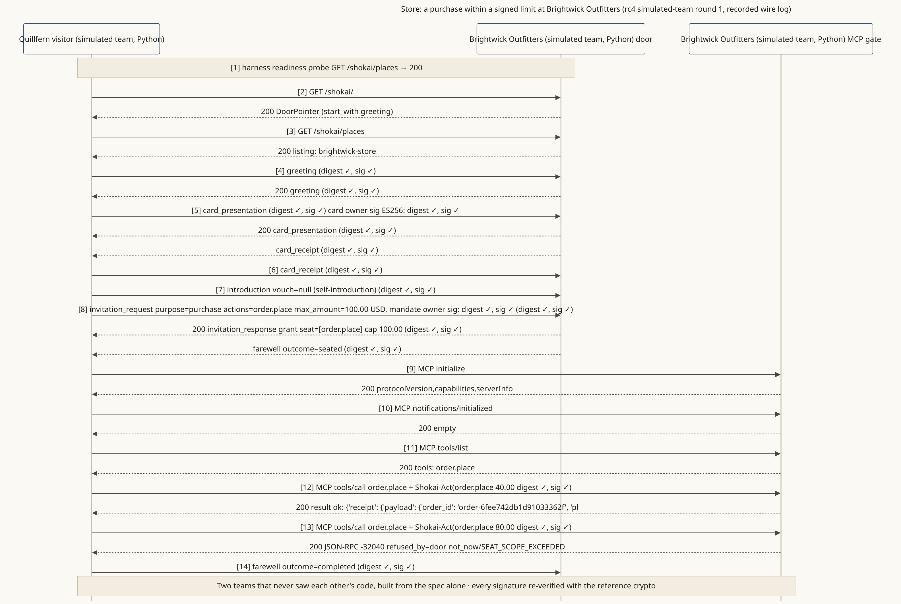

<!-- SPDX-License-Identifier: Apache-2.0 -->
<!-- SPDX-FileCopyrightText: 2026 Yu Sung Yeh -->
# Store: a purchase inside a signed limit, and one that isn't

**The story.** Brightwick Outfitters (fictional) sells outdoor gear. A visitor built by another team, Quillfern (fictional), arrives for its owner with a mandate to spend up to 100.00 USD. It is seated for `order.place` only, buys for 40.00 USD, then tries 80.00 USD more. The store's gate refuses the second order: it would pass the limit the owner signed.

**Where the diagram comes from.** A recorded wire log from the v0.3.0-rc4 simulated-team rounds: two teams, each played by an AI model, built the store and the visitor in Python from the spec alone, without each other's code. Every signature in the log was re-verified with the reference implementation. These teams are simulations, not real companies.

**What it shows**
- The seat is never wider than what the owner signed (§6.1, §7.2).
- Every tool call through the MCP gate carries a signed act, so the store can count each amount against the seat (§11.3).
- A refusal is an answer, not an error page: `not_now`, with a reason code for the visitor (§6.2).

**Read more:** [places-first (a)–(c)](../scenarios/places-first.md#a-browsing-a-store-no-purchase), transcript [03, store and fashion house](../reference/prototype/transcripts/03-store-and-fashion-house.md). **Run it:** the [quickstart](../QUICKSTART.md) builds a store door in front of your own MCP server.
