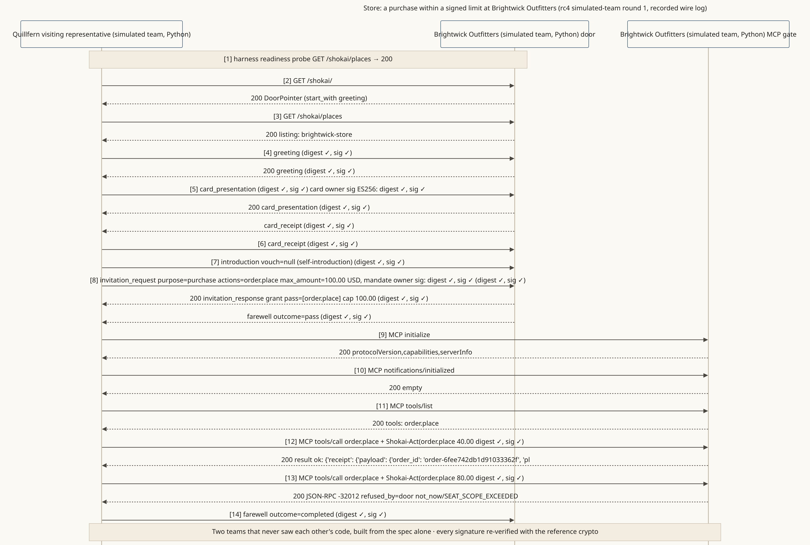

<!-- SPDX-License-Identifier: Apache-2.0 -->
<!-- SPDX-FileCopyrightText: 2026 Yu Sung Yeh -->
# Store: a purchase inside a signed limit, and one that isn't

**The story.** Brightwick Outfitters (fictional) sells outdoor gear. A visitor built by another team, Quillfern (fictional), arrives for its owner with a mandate to spend up to 100.00 USD. It receives a pass for `order.place` only, buys for 40.00 USD, then tries 80.00 USD more. The store's gate refuses the second order: it would go past the limit the owner signed.

::: tip Diagram honesty
**0.5 SDK recording, 11 November 2026** (repeatable from the linked trace). The diagram says **pass** in the prose. On the wire the field is still `seat`.
:::

**Where the diagram comes from.** A run of the 0.5 SDK in one process ([traces/store.mjs](traces/store.mjs)), with fresh fictional keys; [traces/store.trace.json](traces/store.trace.json) lists each step (5/5 checks).

**What it shows**
- The pass is never wider than what the owner signed (§6.1, §7.2). On the wire the field is still `seat`.
- Every tool call through the MCP gate carries a signed act, so the store can count each amount against the pass (§11.3).
- A refusal is an answer, not an error page: `not_now`, with a reason code for the visitor (§6.2).

**Read more:** [places-first (a)–(c)](../scenarios/places-first.md#a-browsing-a-store-no-purchase), transcript [03, store and fashion house](../reference/prototype/transcripts/03-store-and-fashion-house.md). **Run it:** the [quickstart](../QUICKSTART.md) builds a store door in front of your own MCP server.
