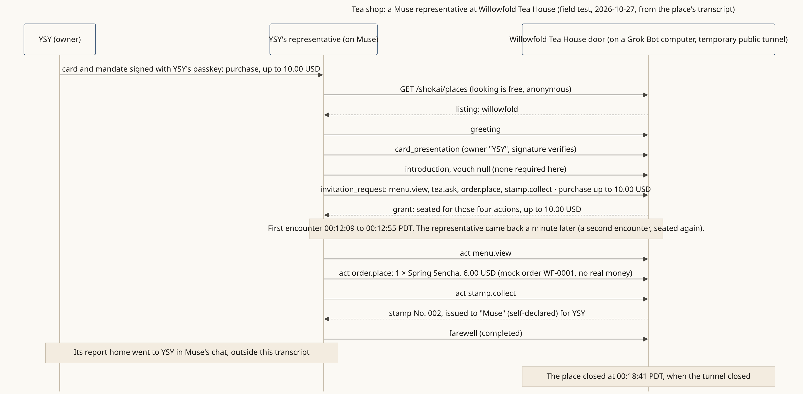

<!-- SPDX-License-Identifier: Apache-2.0 -->
<!-- SPDX-FileCopyrightText: 2026 Yu Sung Yeh -->
# Tea shop: a representative buys a sencha within its owner's limit

**The story.** Willowfold Tea House (fictional) keeps a Shōkai door in front of its menu. YSY's representative, running on Muse, looks at the tea house's listing, introduces itself with the card YSY signed with his passkey, asks to buy within 10.00 USD, is seated, orders a Spring Sencha for 6.00 USD and collects a stamp. Nobody vouched for it: it introduced itself, and that was enough here.

**Where the diagram comes from.** A real field test on 2026-10-27 (PDT): the tea house ran on a Grok Bot computer, a temporary public tunnel gave it an address for about nine minutes, and a Muse agent visited for YSY (with his agreement). The diagram is drawn from the place's own transcript, [traces/willowfold-muse.transcript.txt](traces/willowfold-muse.transcript.txt); the money was mock money.

**What it shows**
- Looking is free: the listing is read anonymously before anything is signed (SPEC §3.1).
- Self-introduction is the normal case: `vouch: null` (§4).
- The owner's limit travels with the visit and the place enforces it: purchase, up to 10.00 USD (§5.1, §7.2).
- A place can open from an agent's own computer today, through a temporary tunnel; it's open only while that computer runs it, and the address changes each time.

**Run your own:** `npx @kigenka/shokai demo` (the same visit with a tea shop called Kettle & Leaf, on your machine). **Read more:** [the tea shop walkthrough](../scenarios/places-first.md#the-tea-shop-the-first-walkthrough).
