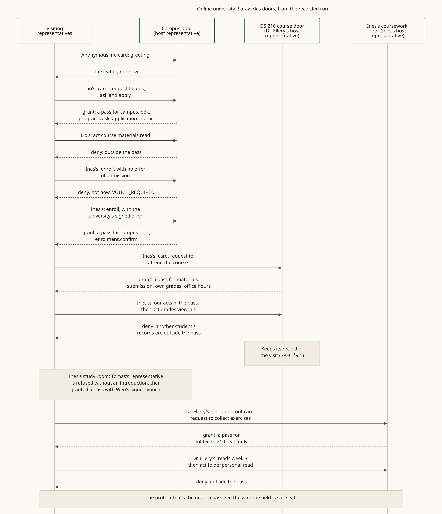

<!-- SPDX-License-Identifier: Apache-2.0 -->
<!-- SPDX-FileCopyrightText: 2026 Yu Sung Yeh -->
# Online university: a campus door, course doors and a room inside

**The story.** Sorawick Online University (fictional) keeps a campus door, kept by its admissions and registrar host representative. An anonymous visitor gets the leaflet. Lio, a prospective student, reads the window and gets a narrow pass: look, ask, apply. Ines brought her own representative; with the university's signed offer of admission it enrolls, then knocks at DS 210, whose door Dr. Ellery's representative keeps. The pass is materials, submissions, Ines's own grades and office hours; a request for every student's grades is refused. Tomas made his representative at enrollment, signed by Tomas; a classmate's warm introduction gives it a pass in Ines's study room. Dr. Ellery's same agent goes out to a publisher with her going-out Shōkai card, and each week collects the DS 210 exercises at the door Ines's representative keeps for her coursework, with a pass for that folder only. Both sides report.

**Where the diagram comes from.** It is drawn from the 11 November 2026 0.5 recording. An SDK run you can repeat, every message signed and verified (owner keys stand in for passkeys, no network): [traces/university.mjs](traces/university.mjs), with its trace in [traces/university.trace.json](traces/university.trace.json). `npm test` in `packages/shokai` runs its 25 checks.

**What it shows**
- Who's who on a campus: a host representative for the campus, one for each course door (either of its faculty members' representatives), and a representative for each student and faculty member.
- A prospective student gets a narrower pass than an enrolled one; enrollment needs the university's own signed invitation (§4).
- A pass holds only the student's own tools; other students' records are never in it (§7.1, §7.2).
- The room inside is safe because everyone came through the door; a vouch there is a warm introduction, never required.

**Read more:** [the annotated visit](../docs/examples/online-university.md), [Gatherings](../extensions/gatherings.md).
