# Relationship to other protocols

Shōkai is an open protocol that gives online places a door for agents. Technically, it is a signed introduction layer: before any work begins, the place's door checks who sent the agent, why it came, and what its owner allows, all from signed facts.

When an agent representative (an agent acting for a person) arrives, it introduces itself. The **door** decides whether to admit it, on signed facts; the **host representative** (the place's own agent) welcomes the visitor the door admitted. The visitor's conduct counts against its owner.

Shōkai is meant to **complement** the protocols below and to grow with them, not to replace them. **It is agent-to-agent only inside a place**: at the door, the visiting agent representative introduces itself to the place's host representative, which is itself an agent. **The work after admission runs over MCP, A2A or the place's own APIs**, or a commerce or payment protocol. Shōkai is designed to work alongside these protocols and to reuse their building blocks where it can.

**Where the other descriptions fit.** A place has three layers: its ordinary website (outside Shōkai), its **agent front** (the place listing and lobby, open to anyone to look at) and its **door** (anything personal). At the door the software decides on signed facts, and the host representative welcomes the visitor. Many of the projects below publish agent-facing descriptions of their own: MCP Server Cards, A2A Agent Cards, NLWeb endpoints, commerce profiles. Shōkai doesn't replace them. A listing entry can point to them with `links`, as hints, and the door decides only on signed facts. See [Website, agent front, door](https://github.com/Kigenka/shokai/blob/v0.5.0/docs/concepts/website-front-door.md).

| Project | What it does well | How Shōkai fits | Sources |
|---|---|---|---|
| **MCP** (Model Context Protocol) | Gives an agent tools and data. Optional authorization for HTTP transports, based on OAuth 2.1. Donated by Anthropic to the Agentic AI Foundation, a directed fund under the Linux Foundation (Dec 2025). Current spec revision: 2026-07-28. | **Shōkai sits in front of MCP servers.** MCP answers "which tools can this client call?" Shōkai answers "whose representative is this, why is it here, and what may it do?" After the door grants a pass, the work runs on the MCP server as before. | [Specification (2026-07-28)](https://modelcontextprotocol.io/specification/2026-07-28/) · [Authorization](https://modelcontextprotocol.io/specification/2026-07-28/basic/authorization) · [Anthropic](https://www.anthropic.com/news/donating-the-model-context-protocol-and-establishing-of-the-agentic-ai-foundation) |
| **A2A** (Agent2Agent) | Agents working together on tasks: messages, tasks, artifacts, streaming. v1.0 released March 2026 (latest patch v1.0.1, May 2026). A Linux Foundation project since June 2025, hosted by the Agentic AI Foundation since August 2026. The Agent Card describes the *server* agent; client identity comes from the HTTP layer. | **Complementary.** A2A covers the work, Shōkai the introduction. A Shōkai place could expose the services a pass allows over A2A. | [Spec](https://a2a-protocol.org/latest/specification/) · [v1.0.0](https://github.com/a2aproject/A2A/releases/tag/v1.0.0) · [v1.0.1](https://github.com/a2aproject/A2A/releases/tag/v1.0.1) · [Enterprise features](https://a2a-protocol.org/latest/topics/enterprise-ready/) · [AAIF](https://aaif.io/blog/a2a-joins-aaif) |
| **Personal Agent Protocol** ("Poppy", Meta and Sierra) | How a personal agent acting for one user works with a company: discovery (`/.well-known/poppy.json`), sessions, sign-in, pairwise user IDs per company, company-defined scopes, and API, web and company-agent access. Draft **0.4** is the current in-progress text (as of 2026-11-10). Version **0.3** was published and frozen on 2026-11-04. A company can offer signed-out sessions without running an OAuth server. | **The closest neighbour at a company visit, and a complement.** Poppy is how a personal agent works with a company; Shōkai is how that agent introduces itself, who it represents and what its owner signed, at a company or anywhere else — including a small place that has no customer accounts. See [below](#the-personal-agent-protocol). | [Draft 0.4 spec](https://personalagentprotocol.org/docs/spec) · [Changelog](https://personalagentprotocol.org/docs/changelog) · [Path to 1.0](https://personalagentprotocol.org/docs/path-to-1) · [Sierra](https://sierra.ai/blog/introducing-personal-agent-protocol) |
| **PACT** (Personal Agent Consent & Trust; Decagon and Instinct) | How a personal agent works with a business's hosted agent: the agent identifies itself with signed requests, the customer signs in with the business over OAuth (the agent never handles login credentials), and the provider issues a short-lived delegation token. Built on A2A 1.0 and OAuth. Open-sourced 2026-10-06, Apache-2.0. Decagon has said it is joining the Personal Agent Protocol working group; PACT remains a separate specification. | **Complementary, on the same company-visit layer as Poppy.** Shōkai adds owner-signed cards on both sides and a door that small places can run without a hosted-agent provider. | [Decagon](https://decagon.ai/blog/introducing-the-personal-agent-consent-trust-protocol-pact) · [Specification](https://openpactprotocol.org/) · [Repository](https://github.com/openpactprotocol/openpactprotocol) |
| **OAuth 2.x** (and the IETF WIMSE agent guidance) | Delegated access with scopes defined by the receiving side. MCP authorization is based on OAuth 2.1. The WIMSE working group's AIMS draft (`draft-ietf-wimse-aims-01`, 2026-11-02) describes how to apply existing WIMSE and OAuth standards to agent authentication and authorization; it does not define a new protocol. | Shōkai doesn't replace it. After admission a place can keep using OAuth; mapping the owner to OAuth `sub` and the representative to `client_id` is an alignment item. | [MCP authorization](https://modelcontextprotocol.io/specification/2026-07-28/basic/authorization) · [draft-ietf-wimse-aims-01](https://datatracker.ietf.org/doc/draft-ietf-wimse-aims/) |
| **Web Bot Auth** (IETF working group) | Lets an automated client sign its HTTP requests (RFC 9421) so a site can verify them against keys discovered from the request. Current WG draft: `draft-ietf-webbotauth-httpsig-protocol-01` (2026-10-29). By the draft's own text, a valid signature identifies automated traffic; it does not authenticate the human user or define delegation. | **A transport layer below Shōkai.** It proves which software is calling; Shōkai adds whose representative it is, why it came and what it may do. Accepting a Web Bot Auth signature in Shōkai's HTTP binding is on the roadmap. Poppy draft 0.4 recommends it for operator signatures. | [Draft](https://datatracker.ietf.org/doc/draft-ietf-webbotauth-httpsig-protocol/) · [Charter](https://datatracker.ietf.org/wg/webbotauth/about/) |
| **KYA-OS** (Know Your Agent Operating System; DIF) | An identity, delegation and accountability layer that other agent protocols can embed: agent and server DIDs, scoped revocable delegation as W3C Verifiable Credentials, and signed proofs. Donated to the Decentralized Identity Foundation by Vouched in March 2026 (then called MCP-I) and renamed KYA-OS in April 2026. The public repository holds the specification and an MCP binding (MIT). | **Complementary on the visitor's identity and delegation.** Shōkai's experimental VC mapping is a possible future alignment; nothing has been built or tested with KYA-OS. | [DIF announcement](https://blog.identity.foundation/kya-os/) · [Repository](https://github.com/decentralized-identity/kya-os-mcp) |
| **x401** (Proof) | An HTTP identity challenge, the identity-side counterpart to payment-oriented 402 flows: a server returns `401` with a proof request, and the agent presents issuer-signed verifiable credentials (typically via OpenID4VP). Draft 0.2.0, Apache-2.0, published at x401.id. Announced 2026-06-25. It needs an identity issuer. | **Complementary on issuer-backed identity.** Shōkai has no issuer or registry: the owner signs the representative's card with a passkey. The two can sit side by side. | [Specification](https://x401.id/) · [Proof, 2026-06-25](https://www.proof.com/blog/introducing-x401) |
| **WebAuthn / passkeys** | Phishing-resistant signatures from a person's device. | Shōkai uses passkeys (ES256) for every owner signature: Shōkai cards, mandates, allowances, door policies and consents. | [W3C WebAuthn](https://www.w3.org/TR/webauthn-3/) |
| **AP2** (Agent Payments Protocol; donated by Google to the FIDO Alliance, v0.2, April 2026) and **Agentic Commerce Protocol** (maintained by OpenAI and Stripe; latest stable spec dated 2026-04-17, beta) | AP2 proves a user authorized a payment, with checkout and payment mandates signed on a trusted surface (human-present or human-not-present). ACP covers checkout between buyer, agent and merchant. AP2's own specification says it is designed to work with the Universal Commerce Protocol (UCP). | **Used for payments; Shōkai doesn't define them.** A pass that includes spending can hand over to them, and carrying or pointing to an AP2 mandate is on the roadmap. | [AP2 spec](https://ap2-protocol.org/ap2/specification/) · [Google](https://blog.google/products-and-platforms/platforms/google-pay/agent-payments-protocol-fido-alliance/) · [ACP](https://www.agenticcommerce.dev/) · [ACP repository](https://github.com/agentic-commerce-protocol/agentic-commerce-protocol) |
| **Account-linking services** (for example Plaid) | Let an app read a person's bank data with the person's consent. | Unchanged. A proposal (carried grants) would let a representative show a signed *reference* to an approval that already exists, never an access token. | Proposal only; see the [Harborlight example](https://github.com/Kigenka/shokai/blob/v0.5.0/docs/examples/harborlight-bank.md) |

Shōkai is independent and not affiliated with or endorsed by any of these projects or companies. Names are used only to describe how the protocols relate.

The rows above were checked against the cited primary sources on **2026-11-10** (America/Los_Angeles), except the account-linking row (it still points to Shōkai's own Harborlight example and was not rechecked at a Plaid or similar primary page) and the WebAuthn row (we reconfirmed that Shōkai uses passkeys for owner signatures; we did not re-read a new W3C WebAuthn revision today). These projects move quickly; if something here has changed, we'd like to know.

## How Shōkai makes MCP better

The visiting representative asks for the specific tools its errand needs. The **door** checks the signed facts and grants a pass with exactly those tools, not the whole server — never wider than policy ∩ mandate ∩ request (SPEC §7.1). The **host representative** welcomes the visitor the door admitted. With the pass named, `tools/list` lists only the pass's tools, and every `tools/call` carries a signed act the door checks before the tool runs (§11.3). Fewer tools in the agent's context, and access scoped by limits its owner signed. More: [How Shōkai makes MCP better](https://github.com/Kigenka/shokai/blob/v0.5.0/docs/index.md#how-shōkai-makes-mcp-better).

## What Shōkai adds, in the drafts we reviewed

These are findings from the drafts and announcements cited above, checked on 2026-11-10, not claims that Shōkai is first or the only project in any category.

- **Introductions with stakes.** In the drafts we reviewed on 2026-11-10, we did not find another protocol that combines a third-party introducer whose standing at a place changes with the visiting representative's conduct. Nearby work includes registered-agent programs run by payment networks and identity badges such as [AGNTCY's](https://github.com/agntcy/identity).
- **Owner-signed, portable limits for any purpose**, not just payments — and an owner-signed Shōkai host card for the place's own representative, which each side can check.
- **A clear answer** (`grant`, `conditional`, `deny` with a reason and a way to retry, or `considering`), where others often return HTTP 401/403 or an OAuth error.
- **Local conduct with consequences** for the representative, its owner and its introducer. No global score.
- **A person's own door** for brands, under rules the person signed, and doors that a small place can run without customer accounts or a central registry.

## The Personal Agent Protocol

*Checked against Personal Agent Protocol draft 0.4 (in progress at `/docs/spec`) and the published 0.3 text (frozen 2026-11-04 at `/docs/0.3/spec`) on 2026-11-10. Poppy's drafts change often; re-check before relying on any detail here. Shōkai is not affiliated with Meta, Sierra or the Personal Agent Protocol, and nothing here has been proposed to its authors.*

**Different questions.** Poppy has three parties: a user, their personal agent and a company that implements the protocol. Shōkai has principals, representatives, introducers and places, and a place can be anyone: a company, a person's own representative, a small shop, a project room. So the two overlap at company visits, and Shōkai also covers places that are not companies.

**Where Poppy is ahead.**
- *Unlinkable identity by default:* each company sees a different user identifier until the user signs in. Shōkai has per-place owner identities (SPEC §2.8, since v0.3.0), but a Shōkai visitor card still shows its owner DID at every place it visits.
- *Sign-in and revocation:* Poppy builds on OAuth sessions and token revocation, and draft 0.3 onward lets a company offer signed-out sessions without an OAuth server. Shōkai revokes Shōkai cards, vouches, consents and allowances by signed statements (SPEC §2.6, §4, §8.1), which is newer and less exercised.
- *Company sessions across channels:* one session can cover the company's website, APIs (including MCP) and company agent. Draft 0.4 adds, among other things, serving several protocol versions at once and operations that can be user-approved or agent-approved (on an instruction the user already gave).
- *Backing:* its Path to 1.0 page lists many design partners. Shōkai is a small open project.

**Where Shōkai adds something.** A Shōkai visitor card and limits the owner signs with a passkey; a Shōkai host card the place's owner signs for the representative that keeps the door; introductions that an introducer answers for; conduct with consequences for the owner and the introducer; a person's own door for brands; and places where people's representatives meet (Gatherings, Peer meetings). Poppy's official roadmap still lists **signed approvals** — a signature from the user's device over the exact terms, so the company need not rely on the personal agent's word — as work before 1.0 (Operations 8.1 says the company currently relies on the personal agent). That is a place the two could grow together.

**How they could fit (illustrative; nothing built or tested).**
1. *A company serves both.* Ordinary personal agents use its Poppy discovery document and sessions; owner-vouched representatives can also use its Shōkai door. The Shōkai listing can point to the Poppy document with a `links` entry, and the reverse with an extension entry.
2. *An owner-signed mandate inside a Poppy session.* A Poppy extension named under a domain Kigenka controls (for example `kigenka.com/owner-mandate`, version 1) could carry a passkey-signed Shōkai mandate when the agent confirms an operation. The company would check the owner signature, that the operation's terms fall inside the mandate (actions, `max_amount`, counterparty, validity) and the mandate's running totals (SPEC §5.1). To respect Poppy's privacy model, the agent would present it only after sign-in, or use a per-company owner identity (SPEC §2.8).
3. *What stays Shōkai's own.* Peer meetings, gatherings, the inbound door, door gifts and conduct notices between places are outside Poppy's stated scope (agent and company).

| Shōkai | Poppy (draft 0.4) | Note |
|---|---|---|
| Representative (`did:key`) | client and agent identifiers | Poppy's user id is opaque and pairwise per company |
| Owner DID | user identifier (pairwise), then the account after sign-in | Per-place owner identities (SPEC §2.8) narrow the gap |
| Shōkai card actions and mandate limits | company-defined scopes, and operation terms under a user or agent approval | Signed approvals from the user's device are on Poppy's roadmap; they are not in draft 0.4 |
| Pass (the specification calls it a seat) | session, token lifetime and scopes | A pass is policy ∩ mandate ∩ request, per visit |
| `considering`, taken home | an operation left proposed until it expires | Silence is no in both |
| Vouch, introducer | none in the drafts we reviewed | Could be a later extension |

