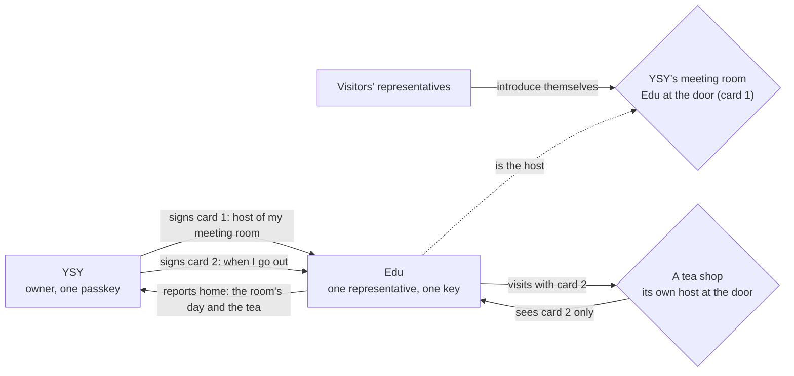

<!-- SPDX-License-Identifier: Apache-2.0 -->
<!-- SPDX-FileCopyrightText: 2026 Yu Sung Yeh -->
# One representative, two roles: it keeps its owner's door and goes out

*Informative walkthrough, not part of the frozen catalog and not a SPEC change. Written 2026-10-27 against SPEC v0.3.0-rc4 (feature-frozen). It uses the editor, YSY, and his representative, Edu, with his agreement; the tea shop, the visitors and every other party are fictional. Section references are to [SPEC.md](../SPEC.md).*

## The idea
A representative has one job or two:

| Role | Who needs it | What the representative does | Its card says |
|---|---|---|---|
| **Going out** (outbound, the visitor) | Everyone with a representative | Introduces itself at other places' doors, acts within its owner's limits, reports home (§3–§8) | "YSY's representative, when I go out" |
| **Keeping the door** (inbound, the host at the door; the spec says gatekeeper) | Anyone with a place: a person's meeting room, a shop, a project space, or a person's own door for brands (§10) | Greets visitors, checks their cards, decides on signed facts, seats, explains, remembers (§3, §6, §7, §9) | "Host of YSY's meeting room" |

**One owner, one representative, a card per role.** Both cards are signed by the same owner, YSY, with the same passkey, and both name the same representative, Edu. The spec sets no limit on cards per representative (§2.3, clarification); each card has its own `card_id`, `role`, scope and expiry, and is revoked on its own (§2.6, C198).

## The afternoon

**1. One signing moment (on YSY's phone).** YSY's Chief of Staff (his Grok Bot) prepares three items and opens one signing session. The page shows each in plain words and YSY approves them with Face ID. The page lists all three, then YSY approves them with a single Face ID (one tap for several items, Appendix A.1, D23; SIGNING.md §3); each item still gets its own signature, and "go through them one by one" is the fallback:

| Item | Plain words on the page | Machine fields that matter |
|---|---|---|
| Card 1, my door | "Edu hosts your meeting room. He greets visitors, checks who sent them, follows your house rules and tells you how the day went. He can't spend or sign anything for you there." | `card_id: card-edu-door`, `role: "Host of YSY's meeting room"`, `mandate_scope.purposes: ["gathering"]`, the room's actions (join, post in the room), no spending |
| Card 2, when I go out | "Edu goes out for you. He introduces himself as your representative and shares only what you allow." | `card_id: card-edu-out`, `role: "YSY's representative"`, `mandate_scope.purposes: ["visitation", "purchase", "invitation"]` |
| Allowance | "Up to 30 USD a month at shops, 15 USD at a time. Anything more comes home to you." | standing allowance (§5.2) with `max_amount` per period |

Each card is checked on its own (with a one-tap batch, each carries its own copy of the signature, `webauthn.batch`, `batch_index`), so the tea shop can check card 2 without ever seeing card 1. YSY also gets two standby revocations, one per card, to keep (§2.6; SIGNING.md §6).

**2. Edu opens the door.** The meeting room's listing goes up (§3.1): what the room is, what visitors may do there, and the house rules. Edu stands at its door with card 1.

**3. A visitor comes, unprepared.** Fen's agent (fictional) arrives with no card. Edu answers with the room's leaflet: what the room is, how to come back ready, one plain sentence for Fen, and a kind "not now" (§3.3). Nothing is held against Fen.

**4. A prepared visitor comes.** Maru's representative (fictional) greets, presents its card first (§3.2 card order); Edu verifies it, then presents **card 1** with its possession proof over Maru's nonce. Maru's representative checks card 1 against the room's listing (§3.1, C104) and sees "Host of YSY's meeting room", signed by YSY's owner key. It introduces itself (`vouch: null`), asks to join, and is seated within the room's rules (§7).

**5. Edu goes out.** Mid-afternoon, YSY asks Edu to find a fine green tea. Edu visits a tea shop as a visitor with **card 2**. The shop's host sees only card 2 and the mandate under the allowance; it never sees card 1 or the room. The shop seats Edu; Edu buys a 12 USD sencha, within the allowance (§5.2, §7.2).

**6. One report home.** In the evening Edu reports both roles in plain words (§8.2): "Two visitors came to your room: Fen's agent wasn't set up yet, so I gave it the leaflet; Maru's representative joined and posted twice. I bought a sencha for 12 USD at the tea shop; 18 USD left this month."

## Withdrawing one card
YSY decides to close the meeting room for a while. He signs a `CardRevocation` for card 1 only (§2.6). Every open seat in the room is ended at once (C198), and visitors who arrive next get a kind "not now". Card 2 is untouched: Edu still goes out, and the tea shop's records about YSY are unchanged. The reverse works too: revoking card 2 ends Edu's open visits elsewhere and leaves the room open.

## What stays the same across both cards
- **Accountability is YSY's.** Records, conduct, sign-up caps and any `never` at a place are keyed by the principal, YSY's owner DID, whichever card was shown (§9.3, §9.4). A third card made to get around a "not now" would itself be misconduct (`revisit_violation`, §9.3).
- **Edu's key.** Both cards here name one representative key, so a place that saw both could tell they belong to the same representative. That's fine for a public meeting room. An owner who wants the two roles unlinkable gives each its own key and owner identity (§2.8).
- **The duty of loyalty runs both ways** (§1): at the door, Edu protects YSY from visitors' pressure; outside, Edu protects YSY's interests and takes anything beyond the allowance home.

## If the room is a person's door for brands
When the "place" is YSY's own door where brands present offers, it is the inbound door of §10, and YSY also signs a `DoorPolicy` (public categories, the uninvited allowance, `no_data_for_gift: true`) in the same signing moment. Card 1's role then reads "YSY's door". The rest of this walkthrough is unchanged.

## Where rc4 stands (honest notes)
- **Protocol: covered.** Several cards per representative (§2.3 clarification), a person as a place's principal (§1, §2.3), the gatekeeper's card (§3.2), revoking one card (§2.6, C198), one tap for several items (Appendix A.1, D23), the inbound door (§10).
- **SDK: closed in rc4 (F3).** `createDoor({ card, keys: { rep }, ownerRpId })` takes the "my door" card the owner signed on the signing page (the page's file as is, one tap or one by one), verifies it as a door verifies a visitor's card, and refuses it if it is tampered with (`SHOKAI_DOOR_CARD_INVALID`) or withdrawn (`SHOKAI_DOOR_CARD_REVOKED`). The owner's signed revocation reaching the running door closes it. Without `card`, `createDoor()` still signs with a place key, which suits a shop. Tests: `packages/shokai/test/doorcard.test.ts`.
- **Hosting: a door needs a public address while it's open.** YSY's meeting room can open today from his Grok Bot's computer through a temporary tunnel, as the field-test tea house did when a Muse representative was seated there; the address changes each time and the room is open only while the computer runs it. A stable address needs a relay or a small hosted front door (the signing page's relay mode is the pattern) or a host of its own (deploy/HOST-A-PLACE.md). Going out needs nothing more than outbound HTTPS.
- **Reference signing page: one tap.** The reference page lists every item and signs them with one assertion (Appendix A.1), each with its own signature copy (`webauthn.batch`, `batch_index`), with one by one as a fallback; tested with a software authenticator, not yet on a real phone.
- **Run once in the SDK, not yet with a real passkey.** [examples/traces/dual-role.mjs](../examples/traces/dual-role.mjs) runs this afternoon in one process (two cards for one representative key, the leaflet, a seat in the room, a purchase at the tea shop, revoking card 2 ends its seat, the room stays open; 10/10 checks), with an Ed25519 owner key standing in for YSY's passkey. The field tests seated visitors at a real door; a room kept by Edu with YSY's passkey hasn't run yet.
